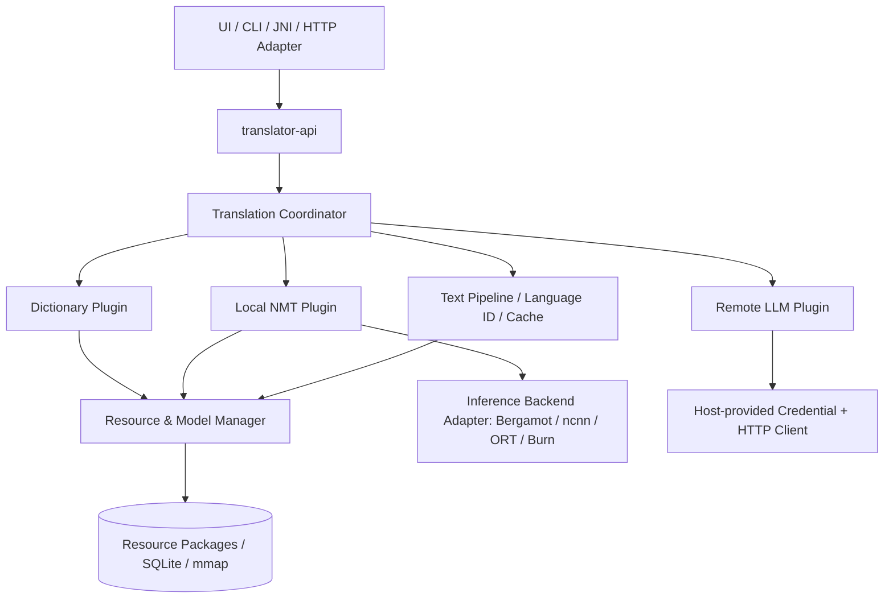

# 轻量跨平台混合翻译 SDK — 完整软件开发设计文档

> 文档版本：v1.5（架构基线；ADR 增补见 §14 与文末修订记录）  
> 编写日期：2026-11-05（v1.5 修订 2026-11-05）  
> 交付形式：Rust Library SDK；**不实现 UI**，但预留桌面、Android、命令行及服务端适配接口  
> 目标平台：Windows x86_64、Ubuntu Linux x86_64/aarch64、macOS aarch64/x86_64、Android arm64-v8a

## 0. 执行摘要

本项目实现一套以**本地优先、低常驻内存、模块可替换**为核心的翻译 SDK。应用层只依赖稳定的 `translator-api`；SDK 内部通过 `Coordinator` 调度三类能力：**Dictionary（词典/短语/轻规则）**、**Local NMT（本地神经机器翻译）**、**Remote LLM（可选远程语言模型）**。`Resource & Model Manager` 是共享资源层而非译文流水线最后一级。用户默认离线，绝不因本地引擎失败而自动上传文本，除非明确配置允许。

**首期推荐的实现路线**：纯 Rust 字典/路由/缓存 + 可插拔的 Bergamot/Marian 本地 NMT 适配器（验证后落地）；并行保留 `ncnn` 适配接口并以 Android 低内存基准决定后续取舍。所有第三方资源必须通过独立的资源包及许可证审核进入发行包。**不能假设 Firefox 任意语言对都有模型，也不能假设这些模型能直接在 ncnn 上推理。**

### 0.1 已确定与待验证

| 项目 | 状态 | 约束 |
|---|---|---|
| Rust 核心与 UI 分离 | 已确定 | SDK 不依赖 Tauri、egui、Android UI |
| 三引擎能力分层 | 已确定 | 词典、本地 NMT、远程 LLM |
| 可替换插件化 | 已确定 | 稳定能力契约、插件发现/注册、版本兼容 |
| 低内存优先 | 已确定 | 冷启动、热模型、推理峰值分别测量 |
| Bergamot + Firefox Marian | **优先验证** | 语言覆盖、原生平台构建、授权、模型注册表 |
| ncnn + Marian/OPUS-MT | **技术备选** | Seq2seq 导出、跨注意力、动态解码及量化均需验证 |
| 词库许可证与再分发 | **必须审核** | 每个词库包单独登记来源、版本、义务 |
| 具体性能指标 | **待实测** | 本文中的数值均为工程目标，不是实测结果 |

## 1. 范围、用户场景与非目标

### 1.1 范围

- 文字翻译：单词、短语、完整句子、较长文本（自动分段）；源语言可指定或自动识别。
- 词典查询：词条、读音、词性、释义、例句和来源信息；与完整句子翻译分开建模。
- 本地 NMT：按语言对加载模型、翻译、并发调度、超时/取消、延迟卸载和内存预算。
- 远程 LLM：统一 Provider 插件，密钥交由宿主注入，显式授权网络调用。
- 资源包：字典、词形分析器、规则、语言识别模型、神经翻译模型的发现、安装、卸载、完整性校验、更新回滚。
- 端口适配：原生 Rust API；之后用 C ABI / JNI / UniFFI / HTTP adapter 暴露相同语义。
- CLI、自动化测试、基准测试、日志和诊断能力。

### 1.2 暂不实现

- 图形界面、划词热键、OCR、语音识别、系统翻译服务接管。
- 自训练大型翻译模型；完整的规则机器翻译语法引擎。
- 默认云端翻译、云端历史同步、上传用户词典。
- 不可信动态库插件直接加载进核心进程（v0.x 阶段优先编译期插件和数据驱动资源插件）。

### 1.3 典型使用

1. 单词查询时：语言检测 → 精确词条查询 → 返回多释义（无模型常驻）。
2. 简短固定短语：规范化 → 安全精确匹配 → 命中可信短语库 → 返回结果。
3. 一般完整句子：本地 NMT；术语/占位符保护由前后处理组件协作。
4. 未安装模型：返回可安装资源建议；只有在明确授权后才能请求远程 LLM。
5. Android 内存紧张：拒绝新的高预算模型加载，完成/取消进行中的请求后释放模型。

## 2. 总体架构与依赖规则



**依赖方向**：`api → core/contracts`；`dictionary`, `nmt`, `llm`, `runtime-*`, `resources` 依赖 `contracts`；由顶层 `composition-root` 装配并注入。`core/contracts` **不得**依赖 ncnn、Bergamot、SQLite、HTTP 实现。资源管理器提供共享服务，可被 Coordinator 或各插件调用，不能反向控制业务调度。

### 2.1 四个“插件”边界

| 插件类别 | 能力标识 | 可替换内容 | 首期形态 |
|---|---|---|---|
| Translation Engine | `translation.dictionary` / `translation.nmt` / `translation.remote` | 请求翻译、引擎选择 | Rust Trait，编译期注册 |
| Dictionary / Linguistic Provider | `dictionary.lookup` / `analysis.tokenize` / `analysis.detect` | 词库、形态分析、语言识别 | Trait + 数据包 |
| Inference Runtime | `runtime.bergamot` / `runtime.ncnn` / `runtime.ort` | 特定模型执行 | 独立 crate + 原生适配 |
| Resource Package & Installer | `package.dictionary` / `package.model` 等 | 文件、版本、索引、元数据 | 声明式 Manifest + installer |

区分 **模型**（Marian、M2M100）与 **推理运行时**（Bergamot、ncnn、ORT）：兼容关系由 `ModelCompatibility` 显式声明，不允许通过字符串名称猜测兼容。

## 3. Cargo Workspace 与模块职责

```text
translator-sdk/
├── Cargo.toml
├── crates/
│   ├── translator-api/           # 唯一受支持的对外入口、Builder、Facade
│   ├── translator-types/         # 请求/结果/错误/语言/能力/版本（无重型依赖）
│   ├── translator-core/          # coordinator、策略、缓存键、路由、取消
│   ├── translator-plugin-api/    # Engine/Provider/Runtime traits、注册表
│   ├── translator-resources/     # 包管理、校验、加载租约、内存预算、生命周期
│   ├── translator-dictionary/    # FST/SQLite、词条规范化及来源
│   ├── translator-analysis/      # language ID、tokenizer、词形/保护规则
│   ├── translator-rules/         # 声明式规则编译、执行及版本化
│   ├── translator-nmt/           # encoder-decoder 模型调用抽象、分句
│   ├── translator-llm/           # provider、prompt、请求安全和限流
│   ├── runtime-bergamot/         # native FFI；feature gated
│   ├── runtime-ncnn/             # native FFI；实验性 feature
│   ├── runtime-ort/              # 备选，feature gated
│   └── translator-storage/       # 查询缓存、历史选装、事务处理
├── bindings/
│   ├── translator-c/            # 版本化 C ABI
│   └── translator-jni/          # Android JNI 封装
├── apps/
│   └── translator-cli/          # 调试 / 基准 / 资源包验证
├── tools/
│   ├── pack-dictionary/         # 离线导入与数据授权追溯
│   ├── pack-rules/
│   └── pack-model/
├── fixtures/                    # 多语言金样本、边界与异常数据
└── docs/                        # ADR、API、性能、许可证
```

统一特性开关例如：`dictionary-sqlite`, `dictionary-fst`, `analysis-lindera`, `lid-fasttext`, `runtime-bergamot`, `runtime-ncnn`, `runtime-ort`, `remote-http`, `c-abi`, `android-jni`。默认构建只启用最少依赖，不能因为一个通用 API 自动引入全部 native runtime。

## 4. 稳定公共 API（建议 v0.1 契约）

以下是**接口设计示例，不宣称已编译验证**；代码实现应以同一份 `translator-types` 类型定义为准。

```rust
#[derive(Clone, Debug)]
pub struct TranslateRequest {
    pub text: String,
    pub source: Option<LanguageTag>,
    pub target: LanguageTag,
    pub policy: TranslationPolicy,
    pub glossary_id: Option<String>,
    pub timeout_ms: Option<u64>,
}

#[derive(Clone, Debug)]
pub enum TranslationPolicy {
    AutoLocalFirst,
    DictionaryOnly,
    LocalOnly,
    RemoteOnly,
    ExplicitEngine(String),
}

pub struct TranslationResult {
    pub text: String,
    pub source: LanguageTag,
    pub target: LanguageTag,
    pub engine_id: String,
    pub model_id: Option<String>,
    pub elapsed_ms: u64,
    pub warnings: Vec<TranslationWarning>,
}

pub enum TranslationErrorCode {
    InvalidRequest, UnsupportedLanguage, ResourceNotInstalled,
    CapabilityUnavailable, RuntimeInitFailed, OutOfBudget,
    Cancelled, Timeout, BackendFailed, NetworkNotAuthorized,
    ProviderRejected, IntegrityFailure,
}
```

公共 Facade 预留以下稳定方法：

```rust
// 示意：具体签名、取消令牌类型在实现阶段冻结
impl Translator {
    pub async fn translate(&self, req: TranslateRequest) -> Result<TranslationResult, TranslationError>;
    pub async fn lookup(&self, req: LookupRequest) -> Result<Vec<DictionaryEntry>, TranslationError>;
    pub async fn detect_language(&self, text: &str) -> Result<Vec<LanguageGuess>, TranslationError>;
    pub fn capabilities(&self) -> Vec<CapabilityInfo>;
    pub fn resources(&self) -> &ResourceApi;
    pub fn plugins(&self) -> &PluginRegistryApi;
    pub async fn shutdown(&self) -> Result<(), TranslationError>;
}
```

### 4.1 额外预留（v0.1 定义语义、可分期实现）

- `translate_batch()`：批处理，并记录每项独立错误；不得使一个失败请求中断整个批次。
- `translate_stream()`：供远程 LLM 和未来流式 NMT 使用；字典及非流式引擎可一次性输出。
- `explain_route()`：仅返回路由决策信息，不暴露用户文本到日志。
- `cancel(request_id)` / `CancellationToken`：取消等待任务，已经进入 native 同步推理的取消以安全检查点为准。
- `resource_events()`：模型加载/卸载/错误/内存压力事件。
- `health()`、`diagnostics()`：运行时版本、插件版本、内存统计、已安装资源。
- `glossaries()`、`history()`：可选能力，避免主库默认保存用户内容。
- `set_network_consent()`：宿主显式控制联网权限；默认拒绝远程回退。

## 5. 插件契约、注册与替换机制

### 5.1 对象安全 Trait（适合 `Arc<dyn ...>`）

```rust
use std::{future::Future, pin::Pin, sync::Arc};

pub type BoxFuture<'a, T> = Pin<Box<dyn Future<Output = T> + Send + 'a>>;

pub trait TranslationEngine: Send + Sync {
    fn descriptor(&self) -> EngineDescriptor;
    fn supports(&self, source: &LanguageTag, target: &LanguageTag) -> bool;
    fn translate<'a>(&'a self, req: &'a TranslateRequest)
        -> BoxFuture<'a, Result<TranslationResult, TranslationError>>;
}

pub trait DictionaryProvider: Send + Sync {
    fn descriptor(&self) -> ProviderDescriptor;
    fn lookup<'a>(&'a self, req: &'a LookupRequest)
        -> BoxFuture<'a, Result<Vec<DictionaryEntry>, TranslationError>>;
}

pub trait InferenceBackend: Send + Sync {
    fn descriptor(&self) -> BackendDescriptor;
    fn supports_model(&self, model: &ModelManifest) -> CompatibilityReport;
    fn load<'a>(&'a self, model: &'a ModelManifest, limits: &'a ResourceLimits)
        -> BoxFuture<'a, Result<Arc<dyn LoadedModel>, TranslationError>>;
}

pub trait LoadedModel: Send + Sync {
    fn infer<'a>(&'a self, input: &'a NmtInput)
        -> BoxFuture<'a, Result<NmtOutput, TranslationError>>;
    fn estimated_bytes(&self) -> u64;
}
```

**实现提醒**：原生库的模型句柄未必 `Sync`；不能未经验证直接把 C++ 指针包进 `Arc<dyn LoadedModel + Send + Sync>`。对非线程安全 runtime 使用专属 worker/actor，`LoadedModel` 只作为消息代理；或修改契约为串行句柄服务。词典查询与翻译应使用不同的能力接口，不要将多义词硬塞进单个翻译字符串。

### 5.2 插件描述与版本策略

每个插件带 `id`（如 `org.example.runtime.ncnn`）、`plugin_api_major/minor`、`semver`、`capabilities`、`platforms`、`supported_architectures`、`runtime_requirements`、`priority`、`license`；注册时：

1. 校验 API **主版本一致**与最低次版本能力。
2. 检查平台、CPU 指令集、动态库依赖及算子覆盖。
3. 用 `supports_model()` 验证模型格式、架构、tokenizer、precision、解码能力。
4. 不满足条件时返回明确不兼容信息，允许其他插件继续加载。
5. 优先级仅用于**可兼容插件**间排序，不能绕过质量/内存要求。

### 5.3 插件形态与安全阶段

| 阶段 | 类型 | 价值 | 安全约束 |
|---|---|---|---|
| v0.1 | 编译期 Rust Trait 插件 | 可审计、跨平台、不引入复杂 ABI | 固定 binary，按 feature 选装 |
| v0.2 | 数据驱动资源插件 | 词库/规则/模型随时更新 | 签名/哈希校验、schema 白名单、只读加载 |
| v0.3 | C ABI 动态库插件（可选） | 第三方运行时替换 | ABI 版本、线程/释放约定、可信签名与隔离策略 |
| 可选 | 进程外插件 | 隔离不可信/易崩溃代码 | IPC、权限与额外内存开销；移动端谨慎 |

**不建议**直接把 Rust `dyn Trait` 跨动态库 ABI 暴露。若需要外部二进制插件，使用 `repr(C)` 结构体 + 函数指针表 + 明确分配/释放方法，或使用进程外协议。ABI 必须含 `abi_version`、`struct_size`、能力位，并约定 UTF-8/错误码/生命周期。

### 5.4 替换演练

- 用 `FakeNmtEngine` 替换 Bergamot：核心 API 与协调器代码不变。
- 用 ncnn 替换 Bergamot：只替换 `runtime-*` crate 与模型包，旧模型包保持可查询但标记不兼容，不暗中转换。
- 用另一套词典替换 CC-CEDICT：仅替换 `DictionaryProvider`/数据包；UI 获取相同 `DictionaryEntry`，许可证来源仍可溯源。
- 用新 LLM 厂商替换旧厂商：只实现 `RemoteProvider`，密钥、重试、限流由宿主/统一服务管理。

## 6. 翻译路由及处理流水线

```text
Validate request → Normalize → Language ID (optional)
   → Split protected spans (URL / email / code / {placeholder}) → Rules (plain text only)
   → Protect placeholders/code/URLs → Cache lookup
   → Select eligible engines by policy + capabilities + resource budget
   → Dictionary (only safe exact lexeme / fixed-phrase match)
       OR Local NMT (sentence translation)
       OR Remote LLM (explicit consent / explicit selection)
   → Restore placeholders → Terminology validation
   → Result + provenance + warnings → Optional non-sensitive cache
```

**AutoLocalFirst** 的推荐决策：

1. 长度、格式、语言检测不确定时避免直接查词替代整句翻译。
2. 单词请求默认返回词典多释义；短语只有在**高可信精确匹配**时直接返回。
3. 完整句子优先选择已安装且兼容、预算可接受的本地模型。
4. 未安装或加载失败返回 `ResourceNotInstalled` / `OutOfBudget` / `BackendFailed`，可附 `suggested_packages`。
5. 仅当请求策略明确允许且宿主已经授予联网许可时，才可选择远程引擎。
6. 缓存键必须包含规范化文本哈希、源/目标语言、引擎和模型版本、术语表版本、规则版本、解码配置、隐私隔离域。

不得把逐词词典的命中当作整句译文，也不得对代码占位符进行破坏性的自动翻译。未能确保占位符恢复时返回警告或错误；
关键占位符（URL/邮箱/代码/模板变量）在严格模式下必须失败而不是降级（ADR-009）。

规则**只作用于受保护跨度之外的纯文本**（ADR-009）。这条排在 `Protect` 之前不是顺序偏好，而是安全要求：
规则先跑就会把 `https://example.com/LLM` 改坏，而之后再做保护已经晚了一步。

**术语约束（输出侧）** 是流水线的最后一道，P2.4 起实现（ADR-015）：

- 契约是 `TargetTermGuard`，与输入侧 `TextRules` 分开——输入侧改写"送进引擎的文本"，
  输出侧约束"引擎写出来的词"，两者不可互相替代；
- 实现方必须自己重新切分受保护跨度并跳过（还原后的文本仍能被同一套扫描器认出）；
- 策略三档：`off`（不跑）/ `warn`（只报不改，**默认**）/ `enforce`（改写，必须显式开启）。
  默认之所以不是 `enforce`：悄悄改掉用户译文属于"不可见的产品行为变更"，而术语表可能来自
  第三方，误改的代价高于漏改；`warn` 会把违规位置一并交出，由宿主决定是否重译或换策略；
- 术语规则可声明**源文触发条件**（`source_variants`）：只有源文命中才验证/改写译文。
  `computer` 在 "计算器" 的语境里才是误译，在其它语境是正常词——只看译文会误伤；
- 字典 `lookup()` 与词典直出**不参与**强制替换（ADR-020）：查词返回资源原样，最多给警告；
- 受保护跨度、规则命中、术语违规、还原缺失等结构化信息**不进** `TranslationResult`，
  而是走独立入口 `translate_with_diagnostics()`（ADR-008/015）。两条入口共用同一段实现，
  因此不可能给出不同译文。

## 7. 字典、语言检测、规则系统

### 7.1 统一词条数据模型

`DictionaryEntry { headword, normalized, language, readings[], pos[], senses[], examples[], variants[], source_id, source_license, confidence, metadata }`。

- 将来源词条与用户术语表分开保存；每条释义有 `source_id`，避免二次打包无法追溯。
- FST 做精确/前缀索引，SQLite 做释义详情、FTS/历史；内存不足时尽可能 `mmap` 只读数据。
- 动态多语言词典按包安装，不在启动时装载所有词条。
- 针对中英日韩：中英可选 CC-CEDICT；日语可选 JMdict；多语言可选 Kaikki/FreeDict。见第二份《资源备选文档》。

### 7.2 规则引擎范围

只做低成本、可测试的规则：NFC/NFKC 可配置规范化（不能全局无条件 NFKC）、大小写/标点、缩写、词形、分句、术语表替换或约束、URL/邮箱/代码/变量保护、基于语言对的策略。**完整句子仍交给 NMT**。规则格式采用 YAML/JSON 开发，构建时编译为只读二进制，包含 `schema_version`、语言对、优先级、匹配条件和测试样本。可选解析器如 Lindera，但要核实底层词形词典授权和移动端体积。

三条硬约束（ADR-009，P1 已实现）：

1. **规则必须尊重受保护跨度**：URL、邮箱、代码、`{模板变量}` 的内容对规则不可见，字节级不变。
2. **执行语义必须有版本**：规则包声明 `pipeline_version`；当前语义为 2（跳过受保护跨度）。
   声明 1 的旧包**不可执行**（返回 `UnsupportedPipelineVersion`），不自动迁移、不静默降级。
3. **旧包仍可被资源管理器识别、查看元数据与迁移，但不可执行**；迁移工具必须重新跑通金样本才产出新包。

兼容 v1 词典数据格式（ADR-010）与允许执行 `pipeline_version: 1` 的规则包是**两件独立的事**：
前者是数据格式，后者是不安全行为。

### 7.3 安全规则示例

```yaml
schema_version: 1
id: en-zh-protection
source: en
target: zh
normalization: NFC
protect:
  - url
  - email
  - code_span
  - placeholder_brace
exact_phrase_policy:
  require_verified: true
  require_full_match: true
```

规则变更必须通过金样本测试，不允许默认启用会改变语义的任意正则替换。输入属于不可信数据，必须限制规则执行时间/长度与匹配次数。

**关于正则的表述更正（2026-11-05 审查）**：不能把"不做正则"的理由写成"正则可能灾难性回溯"。
Rust `regex` 采用有限自动机，时间线性，不存在 PCRE 式回溯爆炸。暂缓正则 DSL 的真实理由是：
规则语言越通用越难审计语义、规则包不应具备任意匹配能力、以及在没有真实需求前无法量化
输入长度/匹配次数/输出尺寸的上限（ADR-014）。

## 8. NMT 模型、运行时与兼容矩阵

### 8.1 首期模型策略

- **默认评估**：Mozilla/Firefox Translations 的量化 Marian 模型（根据官方**当前**模型注册表确认目标语言对），使用 Bergamot 参考实现验证质量和低内存表现。
- **备选轻量**：Helsinki-NLP OPUS-MT / MarianMT 按语言对模型，先用参考运行时测质量，再决定是否转换为 ncnn。
- **多语言可选包**：M2M100 418M（更大，非轻量默认），远期考察其他架构。
- **禁用未经证明的兼容假设**：Firefox 模型不是 ncnn 原生模型；导出/算子/Tokenizer/动态解码兼容性必须完整通过验证。

### 8.2 模型 Manifest（示例）

```json
{
  "schema_version": 1,
  "id": "model.marian.en-zh.lite.example",
  "version": "0.1.0",
  "kind": "translation-model",
  "source_language": "en",
  "target_languages": ["zh-Hans"],
  "architecture": "marian-encoder-decoder",
  "runtime_compatibility": [
    { "runtime": "bergamot", "minimum_version": "TBD", "validated": false }
  ],
  "tokenizer": { "type": "sentencepiece", "files": ["tokenizer.model"] },
  "weights": [{ "path": "model.bin", "sha256": "FILL_AT_BUILD" }],
  "license": { "spdx": "TBD", "source_url": "TBD", "notice_file": "LICENSE.txt" },
  "estimated_disk_bytes": null,
  "estimated_peak_ram_bytes": null,
  "quality_report": null
}
```

`TBD` 为必填的构建审核占位符，发行包不得带 `TBD`/虚构哈希。部署时需区分文件大小与实测工作集，按设备和最大源文本长度维护基准数据。

### 8.3 生成式 seq2seq 运行注意

Encoder、Decoder、Cross-Attention、特殊语言 token、EOS、Beam Search、KV Cache、Dynamic Shape、序列长度与量化误差均影响正确性。ncnn 转换成功**不代表翻译正确**；必须与原框架逐阶段对比 Encoder/Decoder logits，测试句子质量、内存峰值与长文本表现。GPU 可用不代表一定优于 CPU，尤其移动设备短文本。

## 9. Resource & Model Manager 详细设计

### 9.1 核心组件

- `PackageRegistry`：资源列表、版本、语言、能力、许可、兼容、状态；只读元数据不触发模型加载。
- `PackageInstaller`：下载/导入 → 校验 SHA-256/可选签名 → 解压防路径遍历 → schema/许可检查 → 原子切换 → 回滚。
- `ModelLoader`：单飞加载（single-flight）、按语言对/架构选择、热模型共享、加载失败冷却。
- `MemoryBudgetController`：按 Android/桌面 profile 管理估算与实际峰值；控制并发、beam、batch、模型驻留。
- `ModelLease`：活跃请求持有租约，引用归零后才可卸载。
- `IdleEvictor`：TTL/LRU 卸载；Android 内存压力时优先回收非活跃资源。
- `ResourceMetrics`：分别报告模型磁盘体积、文件映射 RSS、匿名 RSS、峰值 RSS、GPU 内存（可得时）。

### 9.2 生命周期

```text
NotInstalled -> Installed/Unloaded -> Loading -> Ready -> InUse
                       ^               |          |
                       |               v          v
                  Unloaded <- Evicting <- Idle/MemoryPressure
                                        
                       Loading/InUse -> Failed (with backoff)
```

`Unloading` 需等待活跃租约释放；超时取消只是取消 SDK 等待，不能擅自释放 native 侧正在使用的资源。模型下载失败不得破坏已经安装的上一版本。

### 9.3 工程预算（非实测保证）

| 设备/状态 | 初始验收目标 | 备注 |
|---|---:|---|
| 无模型加载的核心 SDK | 额外 RAM 尽量 < 10–20 MB | 单独测纯 core vs 词库映射 |
| 字典查询状态 | 额外 RAM 尽量 < 30–50 MB | 依语言包/索引调整 |
| Android Lite NMT 活跃 | 模型相关峰值尽量 < 200–250 MB | **高挑战目标，达不到需调整模型** |
| 桌面 Lite NMT 活跃 | 模型相关峰值尽量 < 300–400 MB | 并发默认 1 |
| 任意平台热模型空闲 | 空闲 TTL 可配；默认释放 | 空闲数值分开记录 |

这些数字是**目标/停止条件**。不得在 README/市场文案中称为已验证性能。内存限制可先软预算+加载前预测，再通过工作线程/进程隔离和实际峰值统计完善。

P2.3 实现的预算机制（ADR-013）刻意只做"装配期准入"，不做运行时限流，原因是数值来源有限：

| 项 | 来源 | 与真实 RSS 的关系 |
|---|---|---|
| FST 索引 | `index.fst` 文件大小（mmap） | 上界：页可能从未换入 |
| SQLite 页缓存 | `PRAGMA cache_size` 配置值 | 配置意义上的上界（目标值），**不是 RSS**；实际换入页数可能更少，需用 `sqlite3`/`smaps_rollup` 实测核对 |
| 连接/语句/分配器 | 一个**写死的猜测值**（256 KiB） | 无实测依据，已显式标注 |
| 释义库 mmap | 只进"最坏情况"上限，不进记账 | 与实际触达页数相关 |

真实对照（`docs/04` §6.2，本机、CC-CEDICT 121,584 条）：索引 1.7 MB + 释义库 18.2 MB 的包，
查词后进程 RSS **+9.8 MB**，总占用 24.3–24.9 MB——远大于记账用的下界（约 3 MB）。
因此预算判定只能回答"**肯定不够**"，不能回答"够用"。
宿主若需要硬保证，必须自己用系统手段监控 RSS；本 SDK 不提供、也不宣称提供硬上限。

## 10. 跨平台 ABI 与执行模型

| 平台 | SDK 发布物 | CPU/GPU 方案 | 注意 |
|---|---|---|---|
| Windows x64 | Rust staticlib/dylib / rlib | CPU 优先，ncnn Vulkan 可选 | MSVC/MinGW ABI 要固定，DLL 打包 |
| Ubuntu x64/arm64 | `.so` / rlib | CPU、Vulkan 可选 | glibc 兼容与目标发行版 |
| macOS arm64/x64 | `.dylib` / staticlib | CPU 优先；Metal 路线须后端支持 | Universal Binary 与签名 |
| Android arm64 | `.so` + JNI | ARM CPU，Vulkan 可选 | NDK、ABI、生命周期和内存压力 |

**Android 禁止依赖环回 HTTP 服务作为必需路径**。宿主通过 JNI/C ABI 调用 Rust；阻塞型 native 推理必须放到受控工作线程，异步调用层只调度任务。建立 `HostServices` 接口供宿主注入 `AppDataDir`、网络许可、系统内存压力事件、凭据存储、日志回调、可取消任务执行器。

### 10.1 C ABI 预留

建议使用 opaque `TranslatorHandle*`，函数命名 `translator_v1_*`：`create`, `destroy`, `translate_async`, `cancel`, `poll_event`, `list_resources`, `load_resource`, `unload_resource`, `free_buffer`。数据跨边界采用固定尺寸 `repr(C)` 和长度明确的 UTF-8 buffer；不得让宿主直接释放 Rust 分配的内存；panic 不得穿越 FFI 边界。异步回调需定义线程约束和销毁顺序。

## 11. 远程 LLM 插件与隐私

- `RemoteProvider` 能力声明：支持模型列表、上下文/长度限制、流式、费用提示、重试建议。
- `CredentialProvider` 由宿主注入，SDK 不内置明文 API Key，不在日志输出密钥或完整用户文本。
- 远程调用**默认关闭**；只有 `RemoteOnly` 或明确授权的 fallback 才发送原文。
- 网络超时、429、5xx 应可识别；重试必须有指数退避和幂等保护，避免重复计费。
- 请求日志默认仅保留长度、耗时、引擎、匿名错误码；历史记录为用户选装。
- 可选 `SensitiveTextPolicy` 阻断密码、访问令牌、隐私信息进入远程服务；不能承诺自动检测百分之百准确。

## 12. 测试与质量基线

### 12.1 自动化层次

1. **单测**：语言标签、规范化、FST 查询、路由优先级、资源 Manifest 校验、LRU 和租约。
2. **契约测试**：所有 Engine/Runtime 插件共同通过同一组 `supports()/translate()/load()/unload()` 行为测试。
3. **金样本**：中↔英、日↔英、简繁字形、符号、URL、代码、占位符、否定句、歧义句及术语。
4. **参考模型对比**：与官方框架相同 tokenization/decoder 参数，检验输出一致性或可解释差异。
5. **性能**：冷启动/热模型短句/100 字/长文本、p50/p95 延迟、总 RSS、峰值 RSS、GPU 内存、CPU 时间、耗电和热降频。
6. **稳定性**：并发翻译、模型删除中请求、加载失败、断电/磁盘满、安装包哈希不一致、JNI 销毁竞态。
7. **安全**：ZIP Slip、路径穿越、非法 schema、大文件解压炸弹、prompt injection 不得触发网络权限升级。

### 12.2 CI Matrix

| 环境 | 构建 | 单元/契约 | 本地真实设备基准 |
|---|---|---|---|
| Windows x64 | 必须 | 必须 | 必须（CPU） |
| Ubuntu x64 | 必须 | 必须 | 必须（CPU） |
| macOS arm64 | 必须 | 必须 | 必须（CPU） |
| Android arm64 | 必须 | JNI 烟测 | **必须使用物理机** |

验收应输出 JSON 基准报告并标明硬件型号/内存/系统/驱动/模型版本。比较 runtime 时使用同一模型和同一源句，避免以不同模型的结果推断框架性能。

## 13. 实施阶段与交付物

| 阶段 | 工作内容 | 必须交付的可验收成果 |
|---|---|---|
| P0 — 架构骨架 | workspace、types、traits、composition root、Mock plugins | CLI 通过 Mock 翻译、API 无重型依赖 |
| P1 — 字典/规则 | CC-CEDICT/Kaikki 子集打包、FST/SQLite、规则、语言 ID | 可离线查词、替换词库不改 API |
| P2 — 资源管理 | Manifest、导入/校验、版本回滚、租约、预算 | 模型安装卸载与压力测试 |
| P3 — 首个 NMT | 选定单方向轻量 Marian，在参考 runtime 打通 | 输出真实译文、模型可卸载、引用对照 |
| P4 — 插件替换验证 | Bergamot 与 ncnn/ORT 候选对照 | 同一公共 API 下交换后端、报告差异 |
| P5 — Android/跨平台 | ARM64 JNI、物理机基准；桌面构建 | 四平台构建与端到端测试 |
| P6 — Remote LLM | 网络显式授权、Provider 接口、密钥注入 | 默认无网络，用户授权后远程可用 |
| P7 — SDK 发行 | API 文档、示例、包签名、许可证目录 | 可重复构建、版本迁移说明、发布清单 |

**P3 的实际模型语言对必须从当前官方注册表核实后选定**；若 Mozilla 缺少目标方向，优先更换资源/运行时，不改变核心契约。

## 14. 决策记录（ADR）

- ADR-001：API 是 Rust SDK，而非必需 HTTP 服务；理由：减少移动端额外进程和内存。
- ADR-002：插件首先是**能力 Trait + 编译期依赖注入**；不急于动态加载 Rust `.so`。
- ADR-003：字典查询与整句翻译必须拆分；防止词典单义强行覆盖语境。
- ADR-004：本地优先，远程默认关闭；可通过策略显式授权。
- ADR-005：按语言包部署小模型优先于巨型单模型常驻；高级多语言模型选装。
- ADR-006：Resource Manager 按租约与内存预算管理生命周期，不由 UI 控制 raw native handle。
- ADR-007：任何推理后端切换必须通过契约/质量/性能回归测试。
- ADR-008（Accepted）：规则 trace 走独立诊断通道，不扩公开枚举。理由：给 `TranslationWarning` 加变体会破坏宿主穷尽 `match`；诊断需要与具体请求关联的快照（`translate_with_diagnostics`），而不是重演的 `explain_rules()`。
- ADR-009（Accepted，P1 已实现）：规则必须尊重受保护文本跨度。URL/邮箱/代码/模板变量对规则不可见；规则执行语义有版本号，旧语义（`pipeline_version: 1`）不可执行。
- ADR-010（Accepted，P2.1 + P2.5 已实现）：`manifest_schema_version` 与 `payload_schema_version` 分离。资源协议与词典存储 schema 独立演进；v1 包只读兼容（用真实 CC-CEDICT 包验证）；v2 写入路径已由 `pack-dictionary --payload-schema` 提供，`dictionary.sqlite.v2` 见 ADR-016。
- ADR-011（Proposed，仍未落地）：按资源版本构造执行计划与缓存键。缓存键仍用 `id@version` 字符串指纹（现已含规则包与术语表版本），**不是** `ResolvedExecutionPlan` 的哈希；计划形状要等 P3 真实后端接入后才稳定，提前定死会立刻返工。
- ADR-012（Accepted，P2.2 + P2.3 已实现）：资源激活采用版本化目录 + 租约 + 原子切换。已实现版本化目录、原子切换、失败清理、崩溃恢复、激活版本拒删，以及**协作式文件租约**（谁挂载谁登记，删除前检查；见 ADR-018）。
- ADR-013（Accepted，P2.3 已实现）：内存预算以软限制 + 准入控制 + 回收为主。跨平台 native/GPU 分配无法靠用户态计数硬保证，不得宣传为硬上限；实现按此执行——预算在装配期判定（`OutOfBudget`），数值是各组件自报的**下界估计**，不是 RSS（§9.3、`docs/07` §2.3）。
- ADR-014（Accepted）：正则 DSL 暂缓，保留 `PatternMatcher` 扩展点。理由见 §7.3 的更正说明。
- ADR-015（Accepted，P2.4 已实现）：输出侧术语约束是独立契约（`TargetTermGuard`），不塞进输入侧规则；结构化结果走 `translate_with_diagnostics` 而不是新增 `TranslationWarning` 变体（延续 ADR-008）。理由：输入侧改不了"引擎写出来的词"，而给公开枚举加变体会破坏宿主的穷尽匹配。
  增补（P2-S，对应 `docs/08` 审查 ADR-020）：默认策略是 **`Warn`**（只报告不改写），`Enforce` 必须显式开启；术语规则可声明**源文触发条件**（`source_variants`），只有源文命中时才验证译文——避免"译文里出现某个目标语言变体就推定源文该用某术语"的误改（见 ADR-020）。
- ADR-016（Accepted，P2.5 已实现）：`dictionary.sqlite.v2` 把释义内联进 `entries.senses`（U+001F 分隔），以失去"逐条释义行"换取一次 B-tree 查找。真实 CC-CEDICT 实测 p50 17.4 → 9.0 µs（−48%）、库体积 18.2 → 13.6 MB（−25%）。v1 保持可读，读写两侧都校验 `PRAGMA user_version`，格式与清单不符即拒绝打开。
  增补（P2-S，对应 `docs/08` D-03 / 审查 ADR-017）：**新包默认写 v2**（`pack-dictionary` 默认即为 v2），v1 进入**只读兼容窗口**，`--payload-schema dictionary.sqlite.v1` 保留为 legacy 重现用法；v1 读取器的退役版本**尚无日期**，等真实发行与兼容矩阵明确后再定，不在文档里承诺"永久兼容"。
- ADR-017（Accepted，P2.3 已实现）：`state.json` 的跨进程互斥用 `O_CREAT|O_EXCL` 锁文件，不引入 `libc`/`flock`。理由是零依赖、语义明确（创建成功即持锁）、失败可见；代价是崩溃残留锁需人工确认（程序只在"持锁 pid 确定已死"时自动回收）。
- ADR-018（Accepted，P2.3 已实现）：租约是**协作式**的，不是内核强制锁。每个使用方一个文件（`leases/<id>/<version>/<pid>-<nonce>.json`），检查即列目录。诚实边界：绕过本 SDK 直接 `open()` 资源文件的程序检测不到；无法判定进程存活时按"占用"处理。
- ADR-019（Accepted；v0.x 部分落地）：术语按**请求级解析出的不可变快照**生效。每次翻译只绑定一份有效术语表（`id` + `version`，内容摘要 `content_digest` 随后续执行计划一起进缓存键）；`glossary_id` 只用于**选择**，不承诺多表叠加，不存在表时返回明确错误而不是静默退回默认表。理由：多表叠加需要优先级、同源短语冲突检测与合并哈希，属于独立设计，先不做半成品。现状：`id@version` 指纹已进键（P2.5），`content_digest` 未实现（P3.1 与本条一起收口）。
- ADR-020（Accepted，P2-S 已实现）：字典 `lookup()` 永远返回原始释义，**不受输出侧术语约束改写**；`translate()` 的词典直出也不默认套用强制替换（最多给非破坏性警告）。完整句子的 NMT 译文才进入术语验证。理由：`lookup()` 是"查词"，用户要的是资源真实内容；把词典释义替换成"更喜欢的说法"会让查词结果不可追溯。
- ADR-021（Accepted，未实现）：**预算记账与平台内存观测分离**。`MemoryBudget`（CAS 记账）负责装配期准入与协作式估算，对外一律称 accounted/estimated bytes，不得称 RSS 或硬上限；另设可选 `ProcessMetricsProvider`（Linux `/proc`/`smaps_rollup`、Windows 进程 API、macOS `task_info`、Android 平台回调）负责真实占用观测，测不到时返回 `Unavailable` 而不是 0。两条数值不得互相冒充（`docs/08` D-04）。
- ADR-022（Accepted，P2-S 已实现）：**租约登记与卸载/清理必须在同一跨进程临界区内完成**「检查安装状态 + 登记/删除」。`acquire_lease` 与 `uninstall`/`cleanup` 共用进程内 `Mutex` + 同一个 `state.lock`，锁内重读状态（锁顺序一致，先 Mutex 后文件锁）。状态锁的陈旧判定用「pid + 进程启动标识」：确定持有者已死才回收，无法判定时按占用处理并报 `LockTimeout`（带锁文件路径与持有者）。
- ADR-023（Proposed，P3.1 落地）：真实模型接入时必须同时实现 single-flight 加载、热模型租约与卸载保护、`ResolvedExecutionPlan`（engine / runtime / model revision / tokenizer / 规则与术语指纹 / 解码参数 / 语言方向 / 隐私域）稳定哈希进缓存键，并以 model revision 隔离缓存。在此之前，禁止用真实 NMT + `id@version` 指纹（或 `model_id: None`）上线缓存。唯一性来源：`docs/08` §5.3 只是接口意向，不是已编译代码。
- ADR-024（Accepted，P3.0 已执行）：**Linux 先交付，核心保持平台无关**。P3 的验收范围只有 Ubuntu x86_64 / CPU；Windows、macOS、Android 只保留扩展边界（trait、feature、配置项），**不得**用 Linux 的测试结果对外表述为跨平台通过。理由：跨平台实证需要真机与 CI，没做就说没做（`docs/11` §3.3）。
- ADR-025（Accepted，P3.0 已执行）：**先打通原生参考链路，再写 Rust 适配**。顺序是：锁定模型坐标与校验和 → 原生 CLI 出真实译文并记录基线 → 才允许实现 `runtime-bergamot`。理由：参考链路不通时，Rust 侧的"翻译失败"无法区分是 FFI 写错还是模型/配置不对；本次先证明"模型确实能翻"（en→zh-Hans，23/24 金样本），再谈 adapter（`docs/11`）。
- ADR-026（Proposed，P3.1-B/D 落地）：**模型身份以内容为准，且身份要覆盖整个执行栈**。缓存、实例复用、诊断必须携带一份足以复现译文的摘要集合：**权重内容摘要、Tokenizer/词表摘要、短名单（lexical shortlist）摘要、解码参数（beam、长度惩罚等）、runtime build 标识**；不能只用 `package_id@version`，也不能只摘要权重。同版本不同 hash 视为不同模型。现状（`docs/13` D-02）：P3.1-A 只实现 `content_digest = package@version#权重sha256前32位`，其余五项尚无来源，因此它**只能用于诊断，不得用作缓存键**；P2.5 的 `id@version` 指纹缺口仍在（ADR-019/023 已记录）。
- ADR-027（Accepted，P3.1-A 已落地接口；实例独占未做共享验证）：**原生运行时归受控 worker 独占，且隔离边界必须是进程级故障隔离，不是线程**。理由：`panic = "abort"` 让 `catch_unwind` 失效，线程也无法隔离 SIGSEGV/`abort()`；P3.0 实测缺文件时 `abort()`（信号 6）、截断权重 SIGSEGV（信号 11），只有独立地址空间能把宿主保住。实现约束（`docs/13` §1）：单一 worker 进程独占模型实例，对外只暴露 `Send + Sync` 的消息代理与 `RuntimeTransport` trait；IPC 用长度前缀帧（有上限）、强制 `request_id`/`worker epoch`/`model revision` 关联、请求超时与三级终止（shutdown 帧→SIGTERM→SIGKILL）、无僵尸、受控重启用预算且不静默重放；禁止无依据的 `unsafe impl Send/Sync`；不向 `translator-api` 泄漏 C++ 类型/pid/socket；非 Linux 平台明确返回 `CapabilityUnavailable` 而非空实现。
- ADR-028（Accepted，P3.0 事实）：**模型权重不入库、许可未确认前不分发**。权重（约 51 MB）只通过 `models.lock.json` 里的 CDN 坐标 + sha256 复现；Remote Settings 记录里没有 license 字段，`mozilla/translations` 仓库代码是 MPL-2.0，但权重的再分发条款需模型卡/法务确认。在结论确定前，仓库只提交锁定记录、配置模板与构建脚本。

- ADR-029（Proposed，P3.1-C 落地）：**占位符与结构化文本的完整性优先于流畅度，且失败必须显式**。`{name}`/`{order_id}` 这类标记、URL/邮箱、反引号代码块在送入真实 NMT 前必须被保护、译后精确还原；数量或身份不一致时返回 `IntegrityFailure`，严格模式下**不得**输出「看起来正常」的译文。理由：P3.0 实测直送真实模型时 `{name}`/`{order_id}` 被吞、反引号被改写（`docs/11` §2.4），说明「模型会照抄标记」的假设不成立，也不能靠无限试探提示词或无条件正则替换来补救。验收：`docs/12` §2.3 的 SP-01～08，尤其「标记被删除/复制/篡改 → `IntegrityFailure`」。现状：P3.1-A 未实现，`strict_placeholder_restore` 尚未接到真实 NMT 路径。

> 状态含义：**Accepted** = 已决定并（如注明）已实现；**Proposed** = 已决定方向但尚未实现，写入 ADR 不等于已验证；
> **Deferred** = 明确延后。上表未标注 Deferred 的项均须在对应阶段交付。

### 14.1 修订记录

| 版本 | 日期 | 变更 |
|---|---|---|
| v1.0 | 2026-11-05 | 架构基线 |
| v1.1 | 2026-11-05 | 新增 ADR-008～014；§6 流水线补「受保护跨度 → 规则（仅纯文本）」；§7.2 增补规则三硬约束与 `pipeline_version`；§7.3 更正正则相关表述 |
| v1.2 | 2026-11-05 | 新增 ADR-015～018（术语约束、`dictionary.sqlite.v2`、跨进程锁、协作式租约）；ADR-010/012/013 从 Proposed 改为 Accepted 并注明实实现范围，ADR-011 明确仍未落地；§6 流水线补「术语约束（输出侧）」；§9.3 补齐预算的数值来源与"下界估计"限定 |
| v1.3 | 2026-11-05 | 并入 `docs/08` 的四个 P3 前决策：新增 ADR-019～023（术语表快照、`lookup()` 不受改写、预算与 RSS 观测分离、租约/卸载跨进程原子性、真实模型的 single-flight 与执行计划）；ADR-015 增补「默认 Warn + 源文触发」、ADR-016 增补「v2 默认写入 / v1 只读窗口」；§9.3 把页缓存一行的"精确"改为"配置上界、需实测"。编号处理：`docs/08` §8 的 ADR-015～021 是**候选编号**，其中 015～018 已被占用，按标题与内容合并进现有 015/016 与新 019～023，未覆盖任何旧 ADR |
| v1.4 | 2026-11-05 | P3.0 落地：新增 ADR-024～028（Linux 优先/参考链路先行/内容即身份/worker 独占/权重不入库）；`docs/10` 的候选 ADR 标题按内容合并进这几条，未覆盖旧编号 |
| v1.5 | 2026-11-05 | P3.1-A 落地（`docs/13`）：ADR-027 从 Proposed 改为 Accepted，并把措辞从「worker 独占」收紧为「**进程级**故障隔离」（明确线程与 `catch_unwind` 不可用、IPC 硬约束、非 Linux 显式不可用）；ADR-026 把模型身份从「权重 + tokenizer 摘要」扩展为**权重 / Tokenizer / 短名单 / 解码参数 / runtime build** 五项，并注明当前 `content_digest` 只能诊断、不得作缓存键；新增 ADR-029（严格占位符完整性，Proposed，P3.1-C）。编号处理：`docs/12` §6 的候选 ADR 建议按内容并入 026/027/029，**未覆盖任何旧编号**；ADR-029 是当前最大号 028 之后的第一个空号 |

## 15. 主要风险与应对

| 风险 | 影响 | 缓解 |
|---|---|---|
| Mozilla 模型语言覆盖与仓库迁移 | 部分方向无法安装 | 查当前官方 registry，提供 OPUS-MT 替代 |
| Bergamot Android 编译/部署差异 | 移动端受阻 | 早期 ARM64 PoC；保留 ncnn/ORT 插件 |
| ncnn 缺少 seq2seq 算子/动态解码支持 | 研发周期失控 | 先单语对 PoC；失败不阻塞 SDK |
| 字典/语料 ShareAlike 或 GPL 约束 | 商业分发风险 | 包级 SPDX、法务审核、独立来源记录 |
| Android 内存/热降频 | 使用体验差 | 轻量模型+并发1+CPU优先+动态卸载 |
| ABI 与线程生命周期问题 | 崩溃/泄漏 | opaque handles、worker actor、sanitizer、JNI 冒烟测试 |
| 语言检测误判、短语歧义 | 译文错误 | 允许显式语言；低置信度走 NMT |

## 16. 参考资料（核对日期 2026-11-05）

- Bergamot Translator：https://github.com/browsermt/bergamot-translator
- Firefox/Bergamot 技术说明：https://firefox-source-docs.mozilla.org/toolkit/components/translations/resources/03_bergamot.html
- Mozilla Translations（当前模型与流程）：https://github.com/mozilla/translations
- Firefox 模型注册表：https://mozilla.github.io/translations/firefox-models/
- ncnn（BSD-3-Clause；CPU/Vulkan/allocator/pnnx）：https://github.com/Tencent/ncnn
- Argos Translate 模型包/语言中转：https://argos-translate.readthedocs.io/en/latest/
- Lindera 文档：https://lindera.github.io/lindera/
- fastText 语言识别：https://fasttext.cc/docs/en/language-identification.html
- 对应词库和替代模型详见 `02_翻译资源候选与备选清单.md`。

---

**交付判据**：即使移除 Bergamot、ncnn、Mozilla 模型以及全部第三方词库，`translator-api` 仍应能以 Mock/空资源模式编译运行，并通过插件兼容性与路由测试。这是本项目“方便替换”的核心验收标准。
