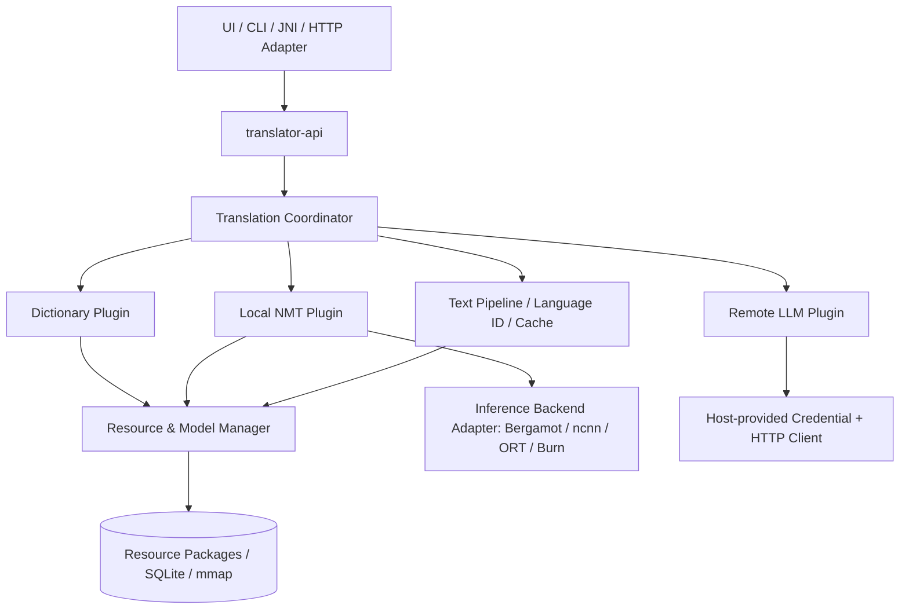

# 轻量跨平台混合翻译 SDK — 完整软件开发设计文档

> 文档版本：v1.11（架构基线；ADR 增补见 §14 与文末修订记录）  
> 编写日期：2026-11-05（v1.11 修订 2026-11-05）  
> 交付形式：Rust Library SDK；**不实现 UI**，但预留桌面、Android、命令行及服务端适配接口  
> 目标平台：Windows x86_64、Ubuntu Linux x86_64/aarch64、macOS aarch64/x86_64、Android arm64-v8a

## 0. 执行摘要

本项目实现一套以**本地优先、低常驻内存、模块可替换**为核心的翻译 SDK。应用层只依赖稳定的 `translator-api`；SDK 内部通过 `Coordinator` 调度三类能力：**Dictionary（词典/短语/轻规则）**、**Local NMT（本地神经机器翻译）**、**Remote LLM（可选远程语言模型）**。`Resource & Model Manager` 是共享资源层而非译文流水线最后一级。用户默认离线，绝不因本地引擎失败而自动上传文本，除非明确配置允许。

**首期推荐的实现路线**：纯 Rust 字典/路由/缓存 + 可插拔的 Bergamot/Marian 本地 NMT 适配器（验证后落地）；并行保留 `ncnn` 适配接口并以 Android 低内存基准决定后续取舍。所有第三方资源必须通过独立的资源包及许可证审核进入发行包。**不能假设 Firefox 任意语言对都有模型，也不能假设这些模型能直接在 ncnn 上推理。**

### 0.1 已确定与待验证

| 项目 | 状态 | 约束 |
|---|---|---|
| Rust 核心与 UI 分离 | 已确定 | SDK 不依赖 Tauri、egui、Android UI |
| 三引擎能力分层 | 已确定 | 词典、本地 NMT、远程 LLM |
| 可替换插件化 | 已确定 | 稳定能力契约、插件发现/注册、版本兼容 |
| 低内存优先 | 已确定 | 冷启动、热模型、推理峰值分别测量 |
| Bergamot + Firefox Marian | **优先验证** | 语言覆盖、原生平台构建、授权、模型注册表 |
| ncnn + Marian/OPUS-MT | **技术备选** | Seq2seq 导出、跨注意力、动态解码及量化均需验证 |
| 词库许可证与再分发 | **必须审核** | 每个词库包单独登记来源、版本、义务 |
| 具体性能指标 | **待实测** | 本文中的数值均为工程目标，不是实测结果 |

## 1. 范围、用户场景与非目标

### 1.1 范围

- 文字翻译：单词、短语、完整句子、较长文本（自动分段）；源语言可指定或自动识别。
- 词典查询：词条、读音、词性、释义、例句和来源信息；与完整句子翻译分开建模。
- 本地 NMT：按语言对加载模型、翻译、并发调度、超时/取消、延迟卸载和内存预算。
- 远程 LLM：统一 Provider 插件，密钥交由宿主注入，显式授权网络调用。
- 资源包：字典、词形分析器、规则、语言识别模型、神经翻译模型的发现、安装、卸载、完整性校验、更新回滚。
- 端口适配：原生 Rust API；之后用 C ABI / JNI / UniFFI / HTTP adapter 暴露相同语义。
- CLI、自动化测试、基准测试、日志和诊断能力。

### 1.2 暂不实现

- 图形界面、划词热键、OCR、语音识别、系统翻译服务接管。
- 自训练大型翻译模型；完整的规则机器翻译语法引擎。
- 默认云端翻译、云端历史同步、上传用户词典。
- 不可信动态库插件直接加载进核心进程（v0.x 阶段优先编译期插件和数据驱动资源插件）。

### 1.3 典型使用

1. 单词查询时：语言检测 → 精确词条查询 → 返回多释义（无模型常驻）。
2. 简短固定短语：规范化 → 安全精确匹配 → 命中可信短语库 → 返回结果。
3. 一般完整句子：本地 NMT；术语/占位符保护由前后处理组件协作。
4. 未安装模型：返回可安装资源建议；只有在明确授权后才能请求远程 LLM。
5. Android 内存紧张：拒绝新的高预算模型加载，完成/取消进行中的请求后释放模型。

## 2. 总体架构与依赖规则



**依赖方向**：`api → core/contracts`；`dictionary`, `nmt`, `llm`, `runtime-*`, `resources` 依赖 `contracts`；由顶层 `composition-root` 装配并注入。`core/contracts` **不得**依赖 ncnn、Bergamot、SQLite、HTTP 实现。资源管理器提供共享服务，可被 Coordinator 或各插件调用，不能反向控制业务调度。

### 2.1 四个“插件”边界

| 插件类别 | 能力标识 | 可替换内容 | 首期形态 |
|---|---|---|---|
| Translation Engine | `translation.dictionary` / `translation.nmt` / `translation.remote` | 请求翻译、引擎选择 | Rust Trait，编译期注册 |
| Dictionary / Linguistic Provider | `dictionary.lookup` / `analysis.tokenize` / `analysis.detect` | 词库、形态分析、语言识别 | Trait + 数据包 |
| Inference Runtime | `runtime.bergamot` / `runtime.ncnn` / `runtime.ort` | 特定模型执行 | 独立 crate + 原生适配 |
| Resource Package & Installer | `package.dictionary` / `package.model` 等 | 文件、版本、索引、元数据 | 声明式 Manifest + installer |

区分 **模型**（Marian、M2M100）与 **推理运行时**（Bergamot、ncnn、ORT）：兼容关系由 `ModelCompatibility` 显式声明，不允许通过字符串名称猜测兼容。

## 3. Cargo Workspace 与模块职责

```text
translator-sdk/
├── Cargo.toml
├── crates/
│   ├── translator-api/           # 唯一受支持的对外入口、Builder、Facade
│   ├── translator-types/         # 请求/结果/错误/语言/能力/版本（无重型依赖）
│   ├── translator-core/          # coordinator、策略、缓存键、路由、取消
│   ├── translator-plugin-api/    # Engine/Provider/Runtime traits、注册表
│   ├── translator-resources/     # 包管理、校验、加载租约、内存预算、生命周期
│   ├── translator-dictionary/    # FST/SQLite、词条规范化及来源
│   ├── translator-analysis/      # language ID、tokenizer、词形/保护规则
│   ├── translator-rules/         # 声明式规则编译、执行及版本化
│   ├── translator-nmt/           # encoder-decoder 模型调用抽象、分句
│   ├── translator-llm/           # provider、prompt、请求安全和限流
│   ├── runtime-bergamot/         # native FFI；feature gated
│   ├── runtime-ncnn/             # native FFI；实验性 feature
│   ├── runtime-ort/              # 备选，feature gated
│   └── translator-storage/       # 查询缓存、历史选装、事务处理
├── bindings/
│   ├── translator-c/            # 版本化 C ABI
│   └── translator-jni/          # Android JNI 封装
├── apps/
│   └── translator-cli/          # 调试 / 基准 / 资源包验证
├── tools/
│   ├── pack-dictionary/         # 离线导入与数据授权追溯
│   ├── pack-rules/
│   └── pack-model/
├── fixtures/                    # 多语言金样本、边界与异常数据
└── docs/                        # ADR、API、性能、许可证
```

统一特性开关例如：`dictionary-sqlite`, `dictionary-fst`, `analysis-lindera`, `lid-fasttext`, `runtime-bergamot`, `runtime-ncnn`, `runtime-ort`, `remote-http`, `c-abi`, `android-jni`。默认构建只启用最少依赖，不能因为一个通用 API 自动引入全部 native runtime。

> 实际落地的 crate 名与上图规划名有出入（P2/P3 顺延，未改名重排）：`translator-resources` → `translator-resource`；`translator-nmt` 由 `translator-runtime`（进程边界与帧协议）+ `translator-nmt-bergamot`（P3.1-E 的真实引擎适配）承担；`runtime-bergamot` 尚未单独成 crate（当前经参考 CLI 调用，见 ADR-030/032）。

## 4. 稳定公共 API（建议 v0.1 契约）

以下是**接口设计示例，不宣称已编译验证**；代码实现应以同一份 `translator-types` 类型定义为准。

```rust
#[derive(Clone, Debug)]
pub struct TranslateRequest {
    pub text: String,
    pub source: Option<LanguageTag>,
    pub target: LanguageTag,
    pub policy: TranslationPolicy,
    pub glossary_id: Option<String>,
    pub timeout_ms: Option<u64>,
}

#[derive(Clone, Debug)]
pub enum TranslationPolicy {
    AutoLocalFirst,
    DictionaryOnly,
    LocalOnly,
    RemoteOnly,
    ExplicitEngine(String),
}

pub struct TranslationResult {
    pub text: String,
    pub source: LanguageTag,
    pub target: LanguageTag,
    pub engine_id: String,
    pub model_id: Option<String>,
    pub elapsed_ms: u64,
    pub warnings: Vec<TranslationWarning>,
}

pub enum TranslationErrorCode {
    InvalidRequest, UnsupportedLanguage, ResourceNotInstalled,
    CapabilityUnavailable, RuntimeInitFailed, OutOfBudget,
    Cancelled, Timeout, BackendFailed, NetworkNotAuthorized,
    ProviderRejected, IntegrityFailure,
}
```

公共 Facade 预留以下稳定方法：

```rust
// 示意：具体签名、取消令牌类型在实现阶段冻结
impl Translator {
    pub async fn translate(&self, req: TranslateRequest) -> Result<TranslationResult, TranslationError>;
    pub async fn lookup(&self, req: LookupRequest) -> Result<Vec<DictionaryEntry>, TranslationError>;
    pub async fn detect_language(&self, text: &str) -> Result<Vec<LanguageGuess>, TranslationError>;
    pub fn capabilities(&self) -> Vec<CapabilityInfo>;
    pub fn resources(&self) -> &ResourceApi;
    pub fn plugins(&self) -> &PluginRegistryApi;
    pub async fn shutdown(&self) -> Result<(), TranslationError>;
}
```

### 4.1 额外预留（v0.1 定义语义、可分期实现）

- `translate_batch()`：批处理，并记录每项独立错误；不得使一个失败请求中断整个批次。
- `translate_stream()`：供远程 LLM 和未来流式 NMT 使用；字典及非流式引擎可一次性输出。
- `explain_route()`：仅返回路由决策信息，不暴露用户文本到日志。
- `cancel(request_id)` / `CancellationToken`：取消等待任务，已经进入 native 同步推理的取消以安全检查点为准。
- `resource_events()`：模型加载/卸载/错误/内存压力事件。
- `health()`、`diagnostics()`：运行时版本、插件版本、内存统计、已安装资源。
- `glossaries()`、`history()`：可选能力，避免主库默认保存用户内容。
- `set_network_consent()`：宿主显式控制联网权限；默认拒绝远程回退。

## 5. 插件契约、注册与替换机制

### 5.1 对象安全 Trait（适合 `Arc<dyn ...>`）

```rust
use std::{future::Future, pin::Pin, sync::Arc};

pub type BoxFuture<'a, T> = Pin<Box<dyn Future<Output = T> + Send + 'a>>;

pub trait TranslationEngine: Send + Sync {
    fn descriptor(&self) -> EngineDescriptor;
    fn supports(&self, source: &LanguageTag, target: &LanguageTag) -> bool;
    fn translate<'a>(&'a self, req: &'a TranslateRequest)
        -> BoxFuture<'a, Result<TranslationResult, TranslationError>>;
}

pub trait DictionaryProvider: Send + Sync {
    fn descriptor(&self) -> ProviderDescriptor;
    fn lookup<'a>(&'a self, req: &'a LookupRequest)
        -> BoxFuture<'a, Result<Vec<DictionaryEntry>, TranslationError>>;
}

pub trait InferenceBackend: Send + Sync {
    fn descriptor(&self) -> BackendDescriptor;
    fn supports_model(&self, model: &ModelManifest) -> CompatibilityReport;
    fn load<'a>(&'a self, model: &'a ModelManifest, limits: &'a ResourceLimits)
        -> BoxFuture<'a, Result<Arc<dyn LoadedModel>, TranslationError>>;
}

pub trait LoadedModel: Send + Sync {
    fn infer<'a>(&'a self, input: &'a NmtInput)
        -> BoxFuture<'a, Result<NmtOutput, TranslationError>>;
    fn estimated_bytes(&self) -> u64;
}
```

**实现提醒**：原生库的模型句柄未必 `Sync`；不能未经验证直接把 C++ 指针包进 `Arc<dyn LoadedModel + Send + Sync>`。对非线程安全 runtime 使用专属 worker/actor，`LoadedModel` 只作为消息代理；或修改契约为串行句柄服务。词典查询与翻译应使用不同的能力接口，不要将多义词硬塞进单个翻译字符串。

### 5.2 插件描述与版本策略

每个插件带 `id`（如 `org.example.runtime.ncnn`）、`plugin_api_major/minor`、`semver`、`capabilities`、`platforms`、`supported_architectures`、`runtime_requirements`、`priority`、`license`；注册时：

1. 校验 API **主版本一致**与最低次版本能力。
2. 检查平台、CPU 指令集、动态库依赖及算子覆盖。
3. 用 `supports_model()` 验证模型格式、架构、tokenizer、precision、解码能力。
4. 不满足条件时返回明确不兼容信息，允许其他插件继续加载。
5. 优先级仅用于**可兼容插件**间排序，不能绕过质量/内存要求。

### 5.3 插件形态与安全阶段

| 阶段 | 类型 | 价值 | 安全约束 |
|---|---|---|---|
| v0.1 | 编译期 Rust Trait 插件 | 可审计、跨平台、不引入复杂 ABI | 固定 binary，按 feature 选装 |
| v0.2 | 数据驱动资源插件 | 词库/规则/模型随时更新 | 签名/哈希校验、schema 白名单、只读加载 |
| v0.3 | C ABI 动态库插件（可选） | 第三方运行时替换 | ABI 版本、线程/释放约定、可信签名与隔离策略 |
| 可选 | 进程外插件 | 隔离不可信/易崩溃代码 | IPC、权限与额外内存开销；移动端谨慎 |

**不建议**直接把 Rust `dyn Trait` 跨动态库 ABI 暴露。若需要外部二进制插件，使用 `repr(C)` 结构体 + 函数指针表 + 明确分配/释放方法，或使用进程外协议。ABI 必须含 `abi_version`、`struct_size`、能力位，并约定 UTF-8/错误码/生命周期。

### 5.4 替换演练

- 用 `FakeNmtEngine` 替换 Bergamot：核心 API 与协调器代码不变。
- 用 ncnn 替换 Bergamot：只替换 `runtime-*` crate 与模型包，旧模型包保持可查询但标记不兼容，不暗中转换。
- 用另一套词典替换 CC-CEDICT：仅替换 `DictionaryProvider`/数据包；UI 获取相同 `DictionaryEntry`，许可证来源仍可溯源。
- 用新 LLM 厂商替换旧厂商：只实现 `RemoteProvider`，密钥、重试、限流由宿主/统一服务管理。

## 6. 翻译路由及处理流水线

```text
Validate request → Normalize → Language ID (optional)
   → Split protected spans (URL / email / code / {placeholder}) → Rules (plain text only)
   → Protect placeholders/code/URLs → Cache lookup
   → Select eligible engines by policy + capabilities + resource budget
   → Dictionary (only safe exact lexeme / fixed-phrase match)
       OR Local NMT (sentence translation)
       OR Remote LLM (explicit consent / explicit selection)
   → Restore placeholders → Terminology validation
   → Result + provenance + warnings → Optional non-sensitive cache
```

**AutoLocalFirst** 的推荐决策：

1. 长度、格式、语言检测不确定时避免直接查词替代整句翻译。
2. 单词请求默认返回词典多释义；短语只有在**高可信精确匹配**时直接返回。
3. 完整句子优先选择已安装且兼容、预算可接受的本地模型。
4. 未安装或加载失败返回 `ResourceNotInstalled` / `OutOfBudget` / `BackendFailed`，可附 `suggested_packages`。
5. 仅当请求策略明确允许且宿主已经授予联网许可时，才可选择远程引擎。
6. 缓存键必须包含规范化文本哈希、源/目标语言、引擎和模型版本、术语表版本、规则版本、解码配置、隐私隔离域。

不得把逐词词典的命中当作整句译文，也不得对代码占位符进行破坏性的自动翻译。未能确保占位符恢复时返回警告或错误；
关键占位符（URL/邮箱/代码/模板变量）在严格模式下必须失败而不是降级（ADR-009）。

规则**只作用于受保护跨度之外的纯文本**（ADR-009）。这条排在 `Protect` 之前不是顺序偏好，而是安全要求：
规则先跑就会把 `https://example.com/LLM` 改坏，而之后再做保护已经晚了一步。

**术语约束（输出侧）** 是流水线的最后一道，P2.4 起实现（ADR-015）：

- 契约是 `TargetTermGuard`，与输入侧 `TextRules` 分开——输入侧改写"送进引擎的文本"，
  输出侧约束"引擎写出来的词"，两者不可互相替代；
- 实现方必须自己重新切分受保护跨度并跳过（还原后的文本仍能被同一套扫描器认出）；
- 策略三档：`off`（不跑）/ `warn`（只报不改，**默认**）/ `enforce`（改写，必须显式开启）。
  默认之所以不是 `enforce`：悄悄改掉用户译文属于"不可见的产品行为变更"，而术语表可能来自
  第三方，误改的代价高于漏改；`warn` 会把违规位置一并交出，由宿主决定是否重译或换策略；
- 术语规则可声明**源文触发条件**（`source_variants`）：只有源文命中才验证/改写译文。
  `computer` 在 "计算器" 的语境里才是误译，在其它语境是正常词——只看译文会误伤；
- 字典 `lookup()` 与词典直出**不参与**强制替换（ADR-020）：查词返回资源原样，最多给警告；
- 受保护跨度、规则命中、术语违规、还原缺失等结构化信息**不进** `TranslationResult`，
  而是走独立入口 `translate_with_diagnostics()`（ADR-008/015）。两条入口共用同一段实现，
  因此不可能给出不同译文。

## 7. 字典、语言检测、规则系统

### 7.1 统一词条数据模型

`DictionaryEntry { headword, normalized, language, readings[], pos[], senses[], examples[], variants[], source_id, source_license, confidence, metadata }`。

- 将来源词条与用户术语表分开保存；每条释义有 `source_id`，避免二次打包无法追溯。
- FST 做精确/前缀索引，SQLite 做释义详情、FTS/历史；内存不足时尽可能 `mmap` 只读数据。
- 动态多语言词典按包安装，不在启动时装载所有词条。
- 针对中英日韩：中英可选 CC-CEDICT；日语可选 JMdict；多语言可选 Kaikki/FreeDict。见第二份《资源备选文档》。

### 7.2 规则引擎范围

只做低成本、可测试的规则：NFC/NFKC 可配置规范化（不能全局无条件 NFKC）、大小写/标点、缩写、词形、分句、术语表替换或约束、URL/邮箱/代码/变量保护、基于语言对的策略。**完整句子仍交给 NMT**。规则格式采用 YAML/JSON 开发，构建时编译为只读二进制，包含 `schema_version`、语言对、优先级、匹配条件和测试样本。可选解析器如 Lindera，但要核实底层词形词典授权和移动端体积。

三条硬约束（ADR-009，P1 已实现）：

1. **规则必须尊重受保护跨度**：URL、邮箱、代码、`{模板变量}` 的内容对规则不可见，字节级不变。
2. **执行语义必须有版本**：规则包声明 `pipeline_version`；当前语义为 2（跳过受保护跨度）。
   声明 1 的旧包**不可执行**（返回 `UnsupportedPipelineVersion`），不自动迁移、不静默降级。
3. **旧包仍可被资源管理器识别、查看元数据与迁移，但不可执行**；迁移工具必须重新跑通金样本才产出新包。

兼容 v1 词典数据格式（ADR-010）与允许执行 `pipeline_version: 1` 的规则包是**两件独立的事**：
前者是数据格式，后者是不安全行为。

### 7.3 安全规则示例

```yaml
schema_version: 1
id: en-zh-protection
source: en
target: zh
normalization: NFC
protect:
  - url
  - email
  - code_span
  - placeholder_brace
exact_phrase_policy:
  require_verified: true
  require_full_match: true
```

规则变更必须通过金样本测试，不允许默认启用会改变语义的任意正则替换。输入属于不可信数据，必须限制规则执行时间/长度与匹配次数。

**关于正则的表述更正（2026-11-05 审查）**：不能把"不做正则"的理由写成"正则可能灾难性回溯"。
Rust `regex` 采用有限自动机，时间线性，不存在 PCRE 式回溯爆炸。暂缓正则 DSL 的真实理由是：
规则语言越通用越难审计语义、规则包不应具备任意匹配能力、以及在没有真实需求前无法量化
输入长度/匹配次数/输出尺寸的上限（ADR-014）。

## 8. NMT 模型、运行时与兼容矩阵

### 8.1 首期模型策略

- **默认评估**：Mozilla/Firefox Translations 的量化 Marian 模型（根据官方**当前**模型注册表确认目标语言对），使用 Bergamot 参考实现验证质量和低内存表现。
- **备选轻量**：Helsinki-NLP OPUS-MT / MarianMT 按语言对模型，先用参考运行时测质量，再决定是否转换为 ncnn。
- **多语言可选包**：M2M100 418M（更大，非轻量默认），远期考察其他架构。
- **禁用未经证明的兼容假设**：Firefox 模型不是 ncnn 原生模型；导出/算子/Tokenizer/动态解码兼容性必须完整通过验证。

### 8.2 模型 Manifest（示例）

```json
{
  "schema_version": 1,
  "id": "model.marian.en-zh.lite.example",
  "version": "0.1.0",
  "kind": "translation-model",
  "source_language": "en",
  "target_languages": ["zh-Hans"],
  "architecture": "marian-encoder-decoder",
  "runtime_compatibility": [
    { "runtime": "bergamot", "minimum_version": "TBD", "validated": false }
  ],
  "tokenizer": { "type": "sentencepiece", "files": ["tokenizer.model"] },
  "weights": [{ "path": "model.bin", "sha256": "FILL_AT_BUILD" }],
  "license": { "spdx": "TBD", "source_url": "TBD", "notice_file": "LICENSE.txt" },
  "estimated_disk_bytes": null,
  "estimated_peak_ram_bytes": null,
  "quality_report": null
}
```

`TBD` 为必填的构建审核占位符，发行包不得带 `TBD`/虚构哈希。部署时需区分文件大小与实测工作集，按设备和最大源文本长度维护基准数据。

### 8.3 生成式 seq2seq 运行注意

Encoder、Decoder、Cross-Attention、特殊语言 token、EOS、Beam Search、KV Cache、Dynamic Shape、序列长度与量化误差均影响正确性。ncnn 转换成功**不代表翻译正确**；必须与原框架逐阶段对比 Encoder/Decoder logits，测试句子质量、内存峰值与长文本表现。GPU 可用不代表一定优于 CPU，尤其移动设备短文本。

## 9. Resource & Model Manager 详细设计

### 9.1 核心组件

- `PackageRegistry`：资源列表、版本、语言、能力、许可、兼容、状态；只读元数据不触发模型加载。
- `PackageInstaller`：下载/导入 → 校验 SHA-256/可选签名 → 解压防路径遍历 → schema/许可检查 → 原子切换 → 回滚。
- `ModelLoader`：单飞加载（single-flight）、按语言对/架构选择、热模型共享、加载失败冷却。
- `MemoryBudgetController`：按 Android/桌面 profile 管理估算与实际峰值；控制并发、beam、batch、模型驻留。
- `ModelLease`：活跃请求持有租约，引用归零后才可卸载。
- `IdleEvictor`：TTL/LRU 卸载；Android 内存压力时优先回收非活跃资源。
- `ResourceMetrics`：分别报告模型磁盘体积、文件映射 RSS、匿名 RSS、峰值 RSS、GPU 内存（可得时）。

### 9.2 生命周期

```text
NotInstalled -> Installed/Unloaded -> Loading -> Ready -> InUse
                       ^               |          |
                       |               v          v
                  Unloaded <- Evicting <- Idle/MemoryPressure
                                        
                       Loading/InUse -> Failed (with backoff)
```

`Unloading` 需等待活跃租约释放；超时取消只是取消 SDK 等待，不能擅自释放 native 侧正在使用的资源。模型下载失败不得破坏已经安装的上一版本。

### 9.3 工程预算（非实测保证）

| 设备/状态 | 初始验收目标 | 备注 |
|---|---:|---|
| 无模型加载的核心 SDK | 额外 RAM 尽量 < 10–20 MB | 单独测纯 core vs 词库映射 |
| 字典查询状态 | 额外 RAM 尽量 < 30–50 MB | 依语言包/索引调整 |
| Android Lite NMT 活跃 | 模型相关峰值尽量 < 200–250 MB | **高挑战目标，达不到需调整模型** |
| 桌面 Lite NMT 活跃 | 模型相关峰值尽量 < 300–400 MB | 并发默认 1 |
| 任意平台热模型空闲 | 空闲 TTL 可配；默认释放 | 空闲数值分开记录 |

这些数字是**目标/停止条件**。不得在 README/市场文案中称为已验证性能。内存限制可先软预算+加载前预测，再通过工作线程/进程隔离和实际峰值统计完善。

P2.3 实现的预算机制（ADR-013）刻意只做"装配期准入"，不做运行时限流，原因是数值来源有限：

| 项 | 来源 | 与真实 RSS 的关系 |
|---|---|---|
| FST 索引 | `index.fst` 文件大小（mmap） | 上界：页可能从未换入 |
| SQLite 页缓存 | `PRAGMA cache_size` 配置值 | 配置意义上的上界（目标值），**不是 RSS**；实际换入页数可能更少，需用 `sqlite3`/`smaps_rollup` 实测核对 |
| 连接/语句/分配器 | 一个**写死的猜测值**（256 KiB） | 无实测依据，已显式标注 |
| 释义库 mmap | 只进"最坏情况"上限，不进记账 | 与实际触达页数相关 |

真实对照（`docs/04` §6.2，本机、CC-CEDICT 121,584 条）：索引 1.7 MB + 释义库 18.2 MB 的包，
查词后进程 RSS **+9.8 MB**，总占用 24.3–24.9 MB——远大于记账用的下界（约 3 MB）。
因此预算判定只能回答"**肯定不够**"，不能回答"够用"。
宿主若需要硬保证，必须自己用系统手段监控 RSS；本 SDK 不提供、也不宣称提供硬上限。

## 10. 跨平台 ABI 与执行模型

| 平台 | SDK 发布物 | CPU/GPU 方案 | 注意 |
|---|---|---|---|
| Windows x64 | Rust staticlib/dylib / rlib | CPU 优先，ncnn Vulkan 可选 | MSVC/MinGW ABI 要固定，DLL 打包 |
| Ubuntu x64/arm64 | `.so` / rlib | CPU、Vulkan 可选 | glibc 兼容与目标发行版 |
| macOS arm64/x64 | `.dylib` / staticlib | CPU 优先；Metal 路线须后端支持 | Universal Binary 与签名 |
| Android arm64 | `.so` + JNI | ARM CPU，Vulkan 可选 | NDK、ABI、生命周期和内存压力 |

**Android 禁止依赖环回 HTTP 服务作为必需路径**。宿主通过 JNI/C ABI 调用 Rust；阻塞型 native 推理必须放到受控工作线程，异步调用层只调度任务。建立 `HostServices` 接口供宿主注入 `AppDataDir`、网络许可、系统内存压力事件、凭据存储、日志回调、可取消任务执行器。

### 10.1 C ABI 预留

建议使用 opaque `TranslatorHandle*`，函数命名 `translator_v1_*`：`create`, `destroy`, `translate_async`, `cancel`, `poll_event`, `list_resources`, `load_resource`, `unload_resource`, `free_buffer`。数据跨边界采用固定尺寸 `repr(C)` 和长度明确的 UTF-8 buffer；不得让宿主直接释放 Rust 分配的内存；panic 不得穿越 FFI 边界。异步回调需定义线程约束和销毁顺序。

## 11. 远程 LLM 插件与隐私

- `RemoteProvider` 能力声明：支持模型列表、上下文/长度限制、流式、费用提示、重试建议。
- `CredentialProvider` 由宿主注入，SDK 不内置明文 API Key，不在日志输出密钥或完整用户文本。
- 远程调用**默认关闭**；只有 `RemoteOnly` 或明确授权的 fallback 才发送原文。
- 网络超时、429、5xx 应可识别；重试必须有指数退避和幂等保护，避免重复计费。
- 请求日志默认仅保留长度、耗时、引擎、匿名错误码；历史记录为用户选装。
- 可选 `SensitiveTextPolicy` 阻断密码、访问令牌、隐私信息进入远程服务；不能承诺自动检测百分之百准确。

## 12. 测试与质量基线

### 12.1 自动化层次

1. **单测**：语言标签、规范化、FST 查询、路由优先级、资源 Manifest 校验、LRU 和租约。
2. **契约测试**：所有 Engine/Runtime 插件共同通过同一组 `supports()/translate()/load()/unload()` 行为测试。
3. **金样本**：中↔英、日↔英、简繁字形、符号、URL、代码、占位符、否定句、歧义句及术语。
4. **参考模型对比**：与官方框架相同 tokenization/decoder 参数，检验输出一致性或可解释差异。
5. **性能**：冷启动/热模型短句/100 字/长文本、p50/p95 延迟、总 RSS、峰值 RSS、GPU 内存、CPU 时间、耗电和热降频。
6. **稳定性**：并发翻译、模型删除中请求、加载失败、断电/磁盘满、安装包哈希不一致、JNI 销毁竞态。
7. **安全**：ZIP Slip、路径穿越、非法 schema、大文件解压炸弹、prompt injection 不得触发网络权限升级。

### 12.2 CI Matrix

| 环境 | 构建 | 单元/契约 | 本地真实设备基准 |
|---|---|---|---|
| Windows x64 | 必须 | 必须 | 必须（CPU） |
| Ubuntu x64 | 必须 | 必须 | 必须（CPU） |
| macOS arm64 | 必须 | 必须 | 必须（CPU） |
| Android arm64 | 必须 | JNI 烟测 | **必须使用物理机** |

验收应输出 JSON 基准报告并标明硬件型号/内存/系统/驱动/模型版本。比较 runtime 时使用同一模型和同一源句，避免以不同模型的结果推断框架性能。

## 13. 实施阶段与交付物

| 阶段 | 工作内容 | 必须交付的可验收成果 |
|---|---|---|
| P0 — 架构骨架 | workspace、types、traits、composition root、Mock plugins | CLI 通过 Mock 翻译、API 无重型依赖 |
| P1 — 字典/规则 | CC-CEDICT/Kaikki 子集打包、FST/SQLite、规则、语言 ID | 可离线查词、替换词库不改 API |
| P2 — 资源管理 | Manifest、导入/校验、版本回滚、租约、预算 | 模型安装卸载与压力测试 |
| P3 — 首个 NMT | 选定单方向轻量 Marian，在参考 runtime 打通 | 输出真实译文、模型可卸载、引用对照 |
| P4 — 插件替换验证 | Bergamot 与 ncnn/ORT 候选对照 | 同一公共 API 下交换后端、报告差异 |
| P5 — Android/跨平台 | ARM64 JNI、物理机基准；桌面构建 | 四平台构建与端到端测试 |
| P6 — Remote LLM | 网络显式授权、Provider 接口、密钥注入 | 默认无网络，用户授权后远程可用 |
| P7 — SDK 发行 | API 文档、示例、包签名、许可证目录 | 可重复构建、版本迁移说明、发布清单 |

**P3 的实际模型语言对必须从当前官方注册表核实后选定**；若 Mozilla 缺少目标方向，优先更换资源/运行时，不改变核心契约。

## 14. 决策记录（ADR）

- ADR-001：API 是 Rust SDK，而非必需 HTTP 服务；理由：减少移动端额外进程和内存。
- ADR-002：插件首先是**能力 Trait + 编译期依赖注入**；不急于动态加载 Rust `.so`。
- ADR-003：字典查询与整句翻译必须拆分；防止词典单义强行覆盖语境。
- ADR-004：本地优先，远程默认关闭；可通过策略显式授权。
- ADR-005：按语言包部署小模型优先于巨型单模型常驻；高级多语言模型选装。
- ADR-006：Resource Manager 按租约与内存预算管理生命周期，不由 UI 控制 raw native handle。
- ADR-007：任何推理后端切换必须通过契约/质量/性能回归测试。
- ADR-008（Accepted）：规则 trace 走独立诊断通道，不扩公开枚举。理由：给 `TranslationWarning` 加变体会破坏宿主穷尽 `match`；诊断需要与具体请求关联的快照（`translate_with_diagnostics`），而不是重演的 `explain_rules()`。
- ADR-009（Accepted，P1 已实现）：规则必须尊重受保护文本跨度。URL/邮箱/代码/模板变量对规则不可见；规则执行语义有版本号，旧语义（`pipeline_version: 1`）不可执行。
- ADR-010（Accepted，P2.1 + P2.5 已实现）：`manifest_schema_version` 与 `payload_schema_version` 分离。资源协议与词典存储 schema 独立演进；v1 包只读兼容（用真实 CC-CEDICT 包验证）；v2 写入路径已由 `pack-dictionary --payload-schema` 提供，`dictionary.sqlite.v2` 见 ADR-016。
- ADR-011（Proposed，仍未落地）：按资源版本构造执行计划与缓存键。缓存键仍用 `id@version` 字符串指纹（现已含规则包与术语表版本），**不是** `ResolvedExecutionPlan` 的哈希；计划形状要等 P3 真实后端接入后才稳定，提前定死会立刻返工。
- ADR-012（Accepted，P2.2 + P2.3 已实现）：资源激活采用版本化目录 + 租约 + 原子切换。已实现版本化目录、原子切换、失败清理、崩溃恢复、激活版本拒删，以及**协作式文件租约**（谁挂载谁登记，删除前检查；见 ADR-018）。
- ADR-013（Accepted，P2.3 已实现）：内存预算以软限制 + 准入控制 + 回收为主。跨平台 native/GPU 分配无法靠用户态计数硬保证，不得宣传为硬上限；实现按此执行——预算在装配期判定（`OutOfBudget`），数值是各组件自报的**下界估计**，不是 RSS（§9.3、`docs/07` §2.3）。
- ADR-014（Accepted）：正则 DSL 暂缓，保留 `PatternMatcher` 扩展点。理由见 §7.3 的更正说明。
- ADR-015（Accepted，P2.4 已实现）：输出侧术语约束是独立契约（`TargetTermGuard`），不塞进输入侧规则；结构化结果走 `translate_with_diagnostics` 而不是新增 `TranslationWarning` 变体（延续 ADR-008）。理由：输入侧改不了"引擎写出来的词"，而给公开枚举加变体会破坏宿主的穷尽匹配。
  增补（P2-S，对应 `docs/08` 审查 ADR-020）：默认策略是 **`Warn`**（只报告不改写），`Enforce` 必须显式开启；术语规则可声明**源文触发条件**（`source_variants`），只有源文命中时才验证译文——避免"译文里出现某个目标语言变体就推定源文该用某术语"的误改（见 ADR-020）。
- ADR-016（Accepted，P2.5 已实现）：`dictionary.sqlite.v2` 把释义内联进 `entries.senses`（U+001F 分隔），以失去"逐条释义行"换取一次 B-tree 查找。真实 CC-CEDICT 实测 p50 17.4 → 9.0 µs（−48%）、库体积 18.2 → 13.6 MB（−25%）。v1 保持可读，读写两侧都校验 `PRAGMA user_version`，格式与清单不符即拒绝打开。
  增补（P2-S，对应 `docs/08` D-03 / 审查 ADR-017）：**新包默认写 v2**（`pack-dictionary` 默认即为 v2），v1 进入**只读兼容窗口**，`--payload-schema dictionary.sqlite.v1` 保留为 legacy 重现用法；v1 读取器的退役版本**尚无日期**，等真实发行与兼容矩阵明确后再定，不在文档里承诺"永久兼容"。
- ADR-017（Accepted，P2.3 已实现）：`state.json` 的跨进程互斥用 `O_CREAT|O_EXCL` 锁文件，不引入 `libc`/`flock`。理由是零依赖、语义明确（创建成功即持锁）、失败可见；代价是崩溃残留锁需人工确认（程序只在"持锁 pid 确定已死"时自动回收）。
  增补（P3.2，`docs/19` §1.2）：`recover()` 的职责从"只清半成品"扩大为"让仓库回到一致状态"——额外删除**孤儿安装目录**（rename 成功、写状态前崩溃）并**丢弃目录已不在的记录**，激活版本丢失时退回 history 里还在的版本；`audit()` 仍然只读。持久化边界：`write_state` 与 `commit_install` 在 rename 之后都 fsync **父目录**（仅 Unix；非 Unix 显式跳过，不宣称跨平台持久化）。
- ADR-018（Accepted，P2.3 已实现）：租约是**协作式**的，不是内核强制锁。每个使用方一个文件（`leases/<id>/<version>/<pid>-<nonce>.json`），检查即列目录。诚实边界：绕过本 SDK 直接 `open()` 资源文件的程序检测不到；无法判定进程存活时按"占用"处理。
- ADR-019（Accepted；v0.x 部分落地）：术语按**请求级解析出的不可变快照**生效。每次翻译只绑定一份有效术语表（`id` + `version`，内容摘要 `content_digest` 随后续执行计划一起进缓存键）；`glossary_id` 只用于**选择**，不承诺多表叠加，不存在表时返回明确错误而不是静默退回默认表。理由：多表叠加需要优先级、同源短语冲突检测与合并哈希，属于独立设计，先不做半成品。现状：`id@version` 指纹已进键（P2.5），`content_digest` 未实现（P3.1 与本条一起收口）。
- ADR-020（Accepted，P2-S 已实现）：字典 `lookup()` 永远返回原始释义，**不受输出侧术语约束改写**；`translate()` 的词典直出也不默认套用强制替换（最多给非破坏性警告）。完整句子的 NMT 译文才进入术语验证。理由：`lookup()` 是"查词"，用户要的是资源真实内容；把词典释义替换成"更喜欢的说法"会让查词结果不可追溯。
- ADR-021（Accepted，P3.3 已实现观测部分）：**预算记账与平台内存观测分离**。`MemoryBudget`（CAS 记账）负责装配期准入与协作式估算，对外一律称 accounted/estimated bytes，不得称 RSS 或硬上限；另设可选 `ProcessMetricsProvider`（Linux `/proc`/`smaps_rollup`、Windows 进程 API、macOS `task_info`、Android 平台回调）负责真实占用观测，测不到时返回 `Unavailable` 而不是 0。两条数值不得互相冒充（`docs/08` D-04）。现状（`docs/20`）：测量侧已落地——`tools/p33-bench` 读 `/proc/<pid>/status`（RSS/VmHWM）与 `/proc/<pid>/smaps_rollup`（PSS），并按 `PPid` 建进程树把 native 一起算进去；`MemoryBudget` 仍是自报下界，**没有**接上 RSS 硬上限。首次 PSS 数据：native RSS 340.80 vs PSS 332.56 MiB（差 2.4%），全树卸载后 PSS 340.30 → 3.07 MiB。库内仍**没有** `ProcessMetricsProvider` trait，观测代码只在测量工具里。
- ADR-022（Accepted，P2-S 已实现）：**租约登记与卸载/清理必须在同一跨进程临界区内完成**「检查安装状态 + 登记/删除」。`acquire_lease` 与 `uninstall`/`cleanup` 共用进程内 `Mutex` + 同一个 `state.lock`，锁内重读状态（锁顺序一致，先 Mutex 后文件锁）。状态锁的陈旧判定用「pid + 进程启动标识」：确定持有者已死才回收，无法判定时按占用处理并报 `LockTimeout`（带锁文件路径与持有者）。
- ADR-023（Accepted，P3.1-D + P3.2 已实现）：真实模型接入时必须同时实现 single-flight 加载、热模型租约与卸载保护、`ResolvedExecutionPlan`（engine / runtime / model revision / tokenizer / 规则与术语指纹 / 解码参数 / 语言方向 / 隐私域）稳定哈希进缓存键，并以 model revision 隔离缓存。在此之前，禁止用真实 NMT + `id@version` 指纹（或 `model_id: None`）上线缓存。
  落地（`docs/18`/`docs/19`）：single-flight（`load_gate`，LC-01）、排队绝对截止时间（LC-04）、在飞请求计数与卸载等待（LC-02）、`ResolvedExecutionPlan`+摘要（ADR-035）、**真实 NMT 的结果缓存以计划摘要为键**（ADR-038，LC-09）。前提条件已满足，故转为 Accepted。
- ADR-024（Accepted，P3.0 已执行）：**Linux 先交付，核心保持平台无关**。P3 的验收范围只有 Ubuntu x86_64 / CPU；Windows、macOS、Android 只保留扩展边界（trait、feature、配置项），**不得**用 Linux 的测试结果对外表述为跨平台通过。理由：跨平台实证需要真机与 CI，没做就说没做（`docs/11` §3.3）。
- ADR-025（Accepted，P3.0 已执行）：**先打通原生参考链路，再写 Rust 适配**。顺序是：锁定模型坐标与校验和 → 原生 CLI 出真实译文并记录基线 → 才允许实现 `runtime-bergamot`。理由：参考链路不通时，Rust 侧的"翻译失败"无法区分是 FFI 写错还是模型/配置不对；本次先证明"模型确实能翻"（en→zh-Hans，23/24 金样本），再谈 adapter（`docs/11`）。
- ADR-026（Proposed，P3.1-B/D 落地）：**模型身份以内容为准，且身份要覆盖整个执行栈**。缓存、实例复用、诊断必须携带一份足以复现译文的摘要集合：**权重内容摘要、Tokenizer/词表摘要、短名单（lexical shortlist）摘要、解码参数（beam、长度惩罚等）、runtime build 标识**；不能只用 `package_id@version`，也不能只摘要权重。同版本不同 hash 视为不同模型。现状（`docs/13` D-02 / `docs/15` D-15 / **`docs/18` §1.2**）：诊断用的 `content_digest = package@version#权重sha256前32位` 仍**只能用于诊断，不得用作缓存键**；P3.1-C/D 新增的 `ResolvedExecutionPlan`（`plan-v1`）已经覆盖本条要求的五项（权重 / tokenizer / 短名单 / 解码参数 / runtime build）与语言方向、保护策略、规则与术语指纹，可算出稳定摘要（ADR-035），P3.2 起真实 NMT **有**缓存了，但键是覆盖五文件的计划摘要而不是 `content_digest`；实测把 `nonbreaking_prefix.en` 改一行，计划摘要从 `dcc88e56…` 变成 `4eba81ed…`，而 `model_id`（`content_digest`）**没有任何变化**（`docs/19` §2.6）——这就是本条结论的直接证据。P2.5 的 `id@version` 指纹缺口仍在（ADR-019/023 已记录）。
- ADR-027（Accepted，P3.1-A 已落地接口；实例独占未做共享验证）：**原生运行时归受控 worker 独占，且隔离边界必须是进程级故障隔离，不是线程**。理由：`panic = "abort"` 让 `catch_unwind` 失效，线程也无法隔离 SIGSEGV/`abort()`；P3.0 实测缺文件时 `abort()`（信号 6）、截断权重 SIGSEGV（信号 11），只有独立地址空间能把宿主保住。实现约束（`docs/13` §1）：单一 worker 进程独占模型实例，对外只暴露 `Send + Sync` 的消息代理与 `RuntimeTransport` trait；IPC 用长度前缀帧（有上限）、强制 `request_id`/`worker epoch`/`model revision` 关联、请求超时与三级终止（shutdown 帧→SIGTERM→SIGKILL）、无僵尸、受控重启用预算且不静默重放；禁止无依据的 `unsafe impl Send/Sync`；不向 `translator-api` 泄漏 C++ 类型/pid/socket；非 Linux 平台明确返回 `CapabilityUnavailable` 而非空实现。
- ADR-028（Accepted，P3.0 事实）：**模型权重不入库、许可未确认前不分发**。权重（约 51 MB）只通过 `models.lock.json` 里的 CDN 坐标 + sha256 复现；Remote Settings 记录里没有 license 字段，`mozilla/translations` 仓库代码是 MPL-2.0，但权重的再分发条款需模型卡/法务确认。在结论确定前，仓库只提交锁定记录、配置模板与构建脚本。**P3.4 已把这条变成机器检查**（ADR-040）：`tools/check-release.py` 的 C1/C3/C4/C6 与 CI 的 `release-redline` job 每次提交都验证「已跟踪文件无权重、打包清单无权重、再分发状态字段未被改成 allowed」。光有人写「我们不分发」是不够的——红线必须能在一次 `git add .` 之后自动抓住。

- ADR-029（Accepted，P3.1-C 已实现）：**占位符与结构化文本的完整性优先于流畅度，且失败必须显式**。`{name}`/`{order_id}` 这类标记、URL/邮箱、反引号代码块在送入真实 NMT 前必须被保护、译后精确还原；数量或身份不一致时返回 `IntegrityFailure`，严格模式下**不得**输出「看起来正常」的译文。理由：P3.0 实测直送真实模型时 `{name}`/`{order_id}` 被吞、反引号被改写（`docs/11` §2.4），说明「模型会照抄标记」的假设不成立，也不能靠无限试探提示词或无条件正则替换来补救。验收：SP-01～12（编号按 `docs/17` §3.2），尤其「标记被删除/复制/篡改 → `IntegrityFailure`」。现状（`docs/18`）：`translator-core::protection` + `translator-nmt-bergamot` 已接到真实 NMT 路径，两层测试覆盖；**默认策略不是标记而是安全分段**（ADR-034），因为实测没有任何一种标记能稳定穿过真实 Marian。

- ADR-030（Accepted，P3.1-B 已实现）：**隔离快照优先于路径二次校验**。模型的身份绑定到 worker 实际可访问的一份**私有、只读、已校验副本**，而不是 Manifest 里的字符串路径。实现（`translator-runtime::snapshot`）：元信息预检查（存在/非符号链接/普通文件/大小）→ 复制与 sha256 **同一次读**（比较的是副本字节）→ 副本目录 0o700、文件 0o400 → worker 在 spawn native **之前**用 `ModelSpec::verify_digests()` 再核一遍 → 快照活到 unload/shutdown/Drop，SIGKILL 残留按目录名里的 pid 清理。诚实边界：文件权限**不是**安全沙箱，同用户恶意进程仍可改写；`openat`/目录 FD/seccomp 未做。实测代价 `model_preparation_ms` = 262 ms / 49.5 MiB（`docs/15` §2.4）。
- ADR-031（Accepted，P3.1-B 已实现）：**真实 Bergamot 默认单 worker、单 in-flight**。默认 1 个 worker 进程、1 个 native 进程、并发 1；任何并发提升必须先给出「内存 + 延迟」证据（P3.0/P3.1-B 实测都是 1 线程：峰值 413.8 MiB、热 p50 13.17 ms）。不要把 `--cpu-threads 1`（native 线程数）与进程数混为一谈。串行锁导致的「排队不受超时约束」是已知限制，队列与绝对 deadline 属于 ADR-023 的范围（P3.1-D）。**P3.3 增补（实测）**：`native --cpu-threads 1` 只约束 Marian 自己的线程池，OpenBLAS/OpenMP 会另外起线程，导致同一进程内并发 10 的吞吐掉到 15.0 rps、p50 139 ms；worker 在 spawn native 时把 `OPENBLAS_NUM_THREADS`/`OMP_NUM_THREADS` 设成 native 线程数（**宿主显式设置则不覆盖**）后，同一负载为 31.0 rps / p50 35 ms，499 字单句 p50 340 → 176 ms。因此：**报单句延迟或并发吞吐必须同时说明 native 侧线程配置**，否则数字不可比。
- ADR-032（Accepted，P3.1-B 已实现）：**IPC 协议版本与原生运行时版本分开管理**。`PROTOCOL_VERSION`（当前 1）只描述父子进程之间的帧/消息形状；原生运行时的身份走 `Payload::Loaded.runtime_build`（Bergamot commit `9271618…`）与 `runtime`（`bergamot-cli`）。改帧形状要升 `PROTOCOL_VERSION`，换 native 构建只改 `runtime_build`，两者不得互相冒充。理由：`docs/14` §3.7 要求 load 回执能核对「到底是哪一版在跑」，而协议兼容性与 native 版本是两件不同的事。
- ADR-033（Accepted，P3.1-B 已实现）：**加载 / 翻译 / 排队截止时间分离**。`Load` 30 s、`Translate` 15 s、`Health`/`Unload`/`Shutdown` 10 s，终止升级仍是 shutdown 帧 500 ms → SIGTERM 500 ms → SIGKILL；任何阶段超时都**废弃持有模型状态的进程**（native 与 worker），不暗中重试。排队截止时间已于 P3.1-D 实现：`guard_until(deadline)` 在状态锁上用 `try_lock` + 1 ms 轮询，到期返回 `Timeout{operation:"queue"}`，不再在 Mutex 上无限等待（`docs/18` §1.3 / LC-04）。并发仍恒为 1、**没有队列结构**，因此没有 FIFO 公平性，也没有"队列长度"指标——这一点不得含糊表述为"已实现排队调度"。

- ADR-034（Accepted，P3.1-C 已实现）：**受保护跨度默认"不进模型"（安全分段），占位符标记降级为可选策略**。理由：真实 Marian 的实验（5 种候选标记 × 7 类句子，`docs/18` §2.6）里没有任何一种标记能稳定保留，最好的 `#Pn#` 也只过 6/7；"唯一无碰撞标记"在该后端上不成立，放宽断言不能把它变成通过。实现（`translator-core::protection`）：`ProtectionPlan` 把受保护跨度摘成 `Piece::Protected(id)`，换行摘成 `Piece::Literal`（worker 会把换行符变成空格），模型只看到纯文本段；还原按 `Piece` 顺序拼回原文并 `verify_structure()` 复核"在、按序、不重复"。`ProtectionMode::Marker` 保留（`#P{n}#` + 严格校验），失败一律 `IntegrityFailure`，并明确**不是**默认安全路径。代价：一句 N 个跨度需要 N+1 次 native 调用、逐段丢失上下文（`docs/18` §2.7），不得宣称"无代价"。
- ADR-035（Accepted，P3.1-D 已实现）：**执行计划摘要就是（未来的）缓存身份，且必须版本化并可锁定**。`ResolvedExecutionPlan`（`PLAN_SCHEMA = plan-v1`）+ `canonical()`（键按字典序、`k=v` 逐行、转义 `\`、`\n`、`\r`、`=`）+ sha256 = `digest`，`short_digest()` 取前 16 位给诊断。字段固定 14 项 + 每个模型文件一行；**新增字段必须同时升 `PLAN_SCHEMA`**。金值（`67d2768e…`）被钉在单元测试里，防止无意改动让所有缓存身份漂移。现状：真实 NMT 仍无缓存消费者，摘要目前只用于诊断与 CLI 展示。
- ADR-036（Accepted，P3.1-E 已实现）：**真实 NMT 以可选 feature 接入公共入口，默认依赖树里不得出现 native/进程代码**。`translator-api` 的 `nmt-bergamot = ["dep:translator-nmt-bergamot"]` 默认关闭，`TranslatorBuilder::nmt_bergamot(config)` 只挂载引擎、构造期只做文件与摘要校验（不 spawn、不加载权重）；`translator-cli` 的 `nmt` feature + `--nmt` 负责端到端。理由：设计要求"默认 `cargo build` 不拉 native C++/权重"，而 CLI 是 workspace 默认成员（`docs/18` §2.8 的 `cargo tree` 证据）。代价：`docs/17` §5 的 CLI 验收命令需要额外两个开关，文档必须写清，不得让人误以为默认二进制能跑真实模型。
- ADR-037（Accepted，P3.1-D 已实现）：**卸载与在飞请求的关系是"等待"，不是"拒绝"或"杀进程"**。`unload()` 取状态锁；正在翻译的请求持锁执行 native 调用，因此卸载会等它结束，卸载成功后 `identity()` 为空、下一次请求自动重载（实测含快照 + native load ≈ 1.13 s）。`active_requests` 计数是租约的可观测部分（LC-02 的证据）。理由：`docs/17` §4.1.3 允许"等待/安全取消/明确错误"三选一，而当前并发恒为 1，把并发复杂度推给宿主不划算。代价：没有"取消进行中请求"的能力，卸载延迟取决于在飞请求耗时。
  增补（P3.2）：计划摘要**跨卸载保留**，因此"卸载后重查同一句"直接命中缓存（实测 0 ms），不会为了一个已有答案重新加载 342 MiB；空闲回收只提供 `evict_if_idle(ttl)` API，**不内置后台线程**——SDK 不该偷偷起线程改宿主的内存占用，宿主（或 CLI 的 `--nmt-idle-ttl`）自己调。

- ADR-038（Accepted，P3.2 已实现）：**真实 NMT 的结果缓存以执行计划摘要为键，并遵守四条纪律**。
  (1) 键 = `plan-v1` 摘要 + 目标语言 + 原文 sha256，键里**不存原文**；
  (2) 只缓存**成功**结果——把失败缓存成成功是最坏的一类 bug；
  (3) 有界 **FIFO**（容量 0 = 关闭），命中不改变淘汰顺序；命中率是观测量，不是优化目标；
  (4) 计划摘要**跨卸载保留**，卸载后重查同一句直接命中（0 ms），不会为了一个已有答案重载 342 MiB。
  实现：`translator-core::plan_cache` + `BergamotNmtEngine` 的翻译前查表。理由：`content_digest` 只覆盖权重
  （实测换 prefix 表时 `model_id` 不变），`id@version` 连权重都不看，两者都不能当缓存键（ADR-026）。
  代价：没有跨引擎共享、没有持久化、没有 LRU（`docs/19` D-32/D-33）；`plan_digest` 在 `load()` 时算一次，
  因此调用方**必须在 load 之后把 config 视为只读**（D-34）。

- ADR-039（Accepted，P3.3 已实现）：**性能数字必须带口径，并落成可 diff 的基线文件**。
  一条延迟数字只有在同时给出"构建（release/debug）、是否含加载、缓存开关、线程/beam、样本数、分位算法、
  机器与负载"时才算证据；本项目的做法是让测量工具把口径写进 JSON 的 `caliber` 字段
  （`fixtures/nmt/baseline-p33-*.json`），无 `caliber` 的延迟数字视为无效。
  分位数用**最近秩法**（不插值），保证人能手工复核。内存一律同时报 RSS 与 PSS，并说明"RSS 相加会重复计共享页"。
  理由：P3 期间出现过三次"数字是对的但结论是错的"——debug 构建的词典查询慢 20×、
  BLAS 线程超订让 499 字慢一倍、以及把 P3.1-B 的 13.17 ms（debug + 完整 worker 往返）与
  P3.3 的 6.78 ms（release + 进程内直调）直接比较。**跨构建、跨机器、跨口径的数字不得并列**，
  只能各自作为自己的基线。

- ADR-040（Accepted，P3.4 已实现）：**权重的「不可分发」必须由机器检查兜住，而不是由文档声明**。
  三条：`licenses/model-assets.json` 里 `license.status = unconfirmed` 且
  `redistribution = prohibited-until-confirmed`（**写死**，改它等于解除红线，必须同时给出法务结论与 `reviewed_by`）；
  `tools/check-release.py` 七项检查（已跟踪文件无权重/大文件、许可清单与依赖树一致、模型坐标三方一致、
  打包清单无权重、`.gitignore` 覆盖、红线文案存在、可选的本机哈希核对）；CI 的 `release-redline` job 每次提交都跑。
  理由：红线最容易被「顺手 `git add .`」和「某次打包把 fixtures 里的权重带上」破坏，而这两件事都不会有人故意做。
  代价：新增模型文件要同时更新 lock、资产清单与基线三处，否则 C3 报错——这是刻意的摩擦。
- ADR-041（Accepted，P3.4 已实现）：**本项目不以 crates.io 为分发单位，所有 crate `publish = false`**。
  内部依赖一律 path-only（`[workspace.dependencies]` 不写版本号，避免版本漂移），代价是 `cargo package`
  只有零依赖的 `translator-types` 与 `translator-resource` 能成功，其余 12 个被 cargo 拒绝
  （`all dependencies must have a version requirement`）。分发形态定为**源码仓库 + `cargo build --release` 产物**。
  理由：现在把版本号补上，等于承诺一套人工维护的版本矩阵，而 P3 阶段没有任何 crates.io 消费者。
  若将来要发布，需要给内部依赖同时写 `version` 并接受该维护成本（`docs/21` D-48）。
- ADR-042（Accepted，P3.4 已实现）：**平台支持是「证据表」，不是「编译开关」，且必须可单测**。
  `translator-runtime::platform` 用 `support_for(os: &str)` 判定，`VERIFIED_PLATFORMS = ["linux"]`；
  非 Linux 返回 `CapabilityUnavailable`，错误信息含平台名与原因。理由：原来写成 `#[cfg]` 两条分支，
  在 Linux 上编译时非 Linux 分支被裁掉，「非 Linux 会明确报错」这句话**没有任何测试能覆盖**——
  无法被测试的承诺等于没有承诺。代价：收紧证据表 = 宣布支持新平台，必须同时给出该平台的真机证据；
  现在 Windows/macOS/Android 只能跑 Mock 与词典路径（P5）。
- ADR-043（Accepted，P3.4 已实现）：**CI 分流为「默认门禁」与「自托管真实模型」，且缺前置必须快速失败**。
  `ci.yml` 的 `default-gate`（fmt / clippy `-D warnings` / 双 feature 测试 / 默认依赖树不得出现
  `translator-runtime` / rustdoc `-D warnings` / 性能冒烟 / 文档编号检查）与 `release-redline`；
  `real-model.yml` 用 `workflow_dispatch` + 自托管 runner，第一步检查 `NMT_BERGAMOT_BIN`/`NMT_MODEL_DIR`，
  缺就 `exit 1`。理由：把需要权重的测试塞进默认门禁有两种坏结局——要么 CI 因为拿不到权重长期红，
  要么有人加 `|| true` 把它变成绿色装饰。而「缺前置就跳过」更坏：它会让「真实模型已验证」变成一句没有证据的话。
  现状：两个 workflow 都**没有在 GitHub 上真跑过**（无远端 runner，`docs/21` D-47），G11 因此判 Conditional。

- ADR-044（Accepted，P4-01 已实现）：**P3 功能基线冻结，未闭合的验收项进独立台账，不再往 P3 加功能**。
  冻结的是**对外语义**（`translate/lookup/detect_language` 与 `TranslationPolicy`、`protect-seg-v1` 的字节级保真、
  `plan-v1` 的编码与摘要、资源 manifest/payload 版本、Linux 单 worker/单 in-flight 的**基线配置**），
  不冻结内部实现与 P4 需要的独立插件 crate。落地：分支 `p3-frozen` + `fixtures/p3-freeze/manifest.json`
  （`tools/freeze-manifest.py --check` 会因 tag 移动、`Cargo.lock`/基线 JSON 改变、台账条目被删而失败）+
  `fixtures/release-blockers.json` + `check-release.py` 的 C8 与 `--release-mode`。
  理由：没有自校验的"冻结"只是一句口号；而把 open 的验收项写进文档表格，下一个人照样会忘。
  代价：任何对基线 JSON 的"小修"都会让冻结校验失败，这是刻意的摩擦。
- ADR-045（Accepted，P4-02 已实现门禁，插件未实现）：**第二后端先过可行性门禁，再写插件；不同模型只能做 B 类比较**。
  门禁四条：能在 Linux CPU 上产出**真实译文**（非 Mock）、许可明确、资产坐标与 sha256 全部锁定、
  解码链路可复现。候选必须显式写明**它和基线是不是同一个模型**：不是同一模型时，
  性能/内存差异**不得**归因于 runtime（`docs/24` §2.4）。已探明并写进锁定文件的三个坑：
  `source.spm` 的 piece id ≠ 模型的 id 空间（模型的 id 来自 `vocab.json` 的 65,001 项联合词表，
  用错不会报错、只会输出通顺但错误的中文）；merged decoder 首步 encoder 侧 K/V 必须给真实 `src_len`；
  带缓存步输出的 `present.encoder.*` 是 0 长度占位，不能回喂。
  理由：`docs/23` §4 明确不允许"转换成功即等价"的假设，而本轮实测正是"能跑、不报错、但全错"的典型；
  代价：门禁阶段用 Python PoC，Rust 插件前不能宣称 P4-G01/G02 通过。

- ADR-046（Accepted，P4-03 已实现）：**第二个本地 NMT 后端以"同一契约、独立 crate、默认不编"的方式接入**。
  `translator-nmt-ort` 只实现 `TranslationEngine` + `TranslationPlugin` 契约；`translator-api` 分两层 feature：
  `nmt-ort`（只编契约，依赖树里没有 `ort`）与 `nmt-ort-runtime`（连 ORT 一起编，静态链接进产物）；
  `translator-nmt-ort` 自己的 `ort-runtime` 决定是否真正链接运行时。默认构建的依赖图与二进制里
  **不得出现任何 ORT 痕迹**（实测：`cargo tree -p translator-api` 19 行 / `ort` 0 次；开 feature 后 165 行；
  默认 CLI `ldd` 无 `libonnxruntime.so`）。路由、`protect-seg-v1`、`plan-v1` 一律不动：
  换后端不允许改变结构保护语义。理由：`docs/23` §4 要求插件替换是"可插拔"而不是"改内核"；
  代价：第二后端的一批能力（Marker 模式、缓存、取消、worker 隔离）暂时缺失，按 P4-G05/G06 记为部分通过。
- ADR-047（Accepted，P4-03 已实现）：**退化抑制是 NMT 后端的职责，且必须可观测、不得静默**。
  纯贪心解码在短片段上会退化成周期性重复（实测 `Hello ` 片段重复 97 次「你好」，同一模型在 Python 参考实现里
  同样如此）；后端必须自己设上界：生成长度 `min(max_new_tokens, src_len*8/5+12)`、无重复 3-gram 抑制、
  连续 3 个相同 token 即停、尾部同周期块 ≥3 次收敛到一轮。三项阈值是**工程选择**，允许误伤有意重复，
  因此必须可观测：触发次数经 `degeneracy_count()` 暴露；**不得**为此给 `TranslationWarning` 加变体
  （会破坏宿主穷尽匹配）。理由：把 97 次重复直接交给宿主，等于把"看起来成功"的垃圾当译文输出；
  代价：抑制会推模型转向次优 token，效果是"有界但可能更怪"，所以在 `docs/25` §2.5 给出实际译文供判断。
- ADR-048（Accepted，P4-03 已实现）：**冻结承诺的对象是 tag 指向的提交，不是 HEAD**。
  `tools/freeze-manifest.py --check` 必须按冻结提交比对 `Cargo.lock` 与基线 JSON；工作区与冻结基线的差异
  以 `DRIFT` 行打印、**不计失败**，除非基线 JSON 本身被就地改写（那是证据被篡改）。
  理由：P4 合法新增 `ort`/`tokenizers` 会让 `Cargo.lock` 变化，按 HEAD 比会在第一次正常前进时误报，
  把"冻结"退化成"禁止前进"；代价：`DRIFT` 行需要人看一眼，后续应升级为需签字的漂移台账（`docs/25` §6）。

- ADR-049（Accepted，P4-05 已实现）：**分词器不允许静默丢弃字符，`unk_id` 必须显式指向 `<unk>`**。
  `tokenizer.json` 的 `model.unk_id = None` 不会报错，它会让词表外字符（emoji、生僻字）被**直接丢掉**：
  轻则"只剩 emoji 的片段"变成空 token 序列、上层报 `InvalidRequest`，重则正常句子悄悄少字符而译文看起来正常。
  落地：`tools/p4/build-tokenizer.py` 固定 `unk_id = 1`，并在产物摘要文件
  （`fixtures/p4/derived-tokenizer.json`）里记录"生成脚本 + 产物"的双份 sha256。
  推论：**词表外字符不保证被译文带出**（本候选实测退化成下划线），要保真只能走标记模式或核心保护策略，
  两者都不属于后端可以自己决定的范围（D-71 已把这条钉成特征化测试）。
- ADR-050（Accepted，P4-07）：**第二后端的验收结论分两件事判，不合并成一个"通过"**。
  "插件替换可行"（能装能卸能翻、结构保真、默认构建零污染）与"能否替换 P3 基线后端"（延迟/内存/质量）
  必须分开给结论：本轮前者 `go`、后者 `no-go`，整体 `conditional-go`，默认状态即回退（两个 feature 默认关闭）。
  理由：把两者合成一个"通过"，下一个接手的人会自然地以为"既然通过了，那就换掉吧"；
  而实测延迟 15.7～26.1×、长句译文不可用，任何合并式结论都会掩盖这一点。代价：结论表要多两行，
  但发行/选型判断有据可依。

- ADR-051（Accepted，`docs/28` 已实现）：**验收口径三分，且必须机器可查**。
  "工作包交付"、"门禁闭合"、"候选可用"是三件事，不得用一个"通过"概括。
  落地：`fixtures/p4/acceptance.json`（`sdk-p4-acceptance/v1`）+ `tools/p4-acceptance.py --check`
  + `check-release.py` 的 **C9**。硬规则：`status=pass` 的门禁不得带未闭合项；`partial` 的每一项必须进
  `carry_over` 且带 `priority/owner/exit_evidence`；引用到的发行阻断项必须与 `release-blockers.json`
  完全一致并保持 `open`。理由：`docs/23` §7.3 要求 G01～08 全通过，而实际 G05/G06 只部分满足——
  只在文字里写"部分满足"，下一个人照样会读成"通过"（`docs/27` R-02/R-06）。
  代价：每轮必须维护一份台账，且"顺手关掉"阻断项会被脚本挡住。
- ADR-052（Accepted，`docs/28` 已实现）：**性能数字必须与 workload 元数据同存，且只有同文本同口径才能相比**。
  每个基线条目至少要能回答：文本摘要、源 token 数、token 上界、分词器摘要、解码策略、benchmark 版本、
  机器与线程数、结果缓存开关、模型与精度。落地：`p4-ort-bench/v2` 的 `workload` 块、
  `bergamot_bench` 的同文本口径、以及"测量工具自身不得污染被测对象"的两处修复（分词器复用、
  进程树内存）。理由：`docs/24` 与 `docs/25` 的 499 字数字（830.75 vs 2652.33 ms）曾被人当性能退化，
  实测差异全部来自 token 预算（40 vs 131 步，同图差 1%）；更早的 A/B 表还把两批不同文本并排算过倍数
  （`docs/27` R-04、`docs/28` D-78）。代价：基线文件变大，且换文本必须换基线而不是就地改数字。
- ADR-053（Accepted）：**发行阻断项的含义只以台账为单一事实来源，报告不得自行改写标题**。
  `fixtures/release-blockers.json` 的 `title` 是唯一权威；报告、验收文件、README 只能引用 id 与状态。
  理由：`docs/25` §5 曾凭记忆把 G06/G08/D-46 写成别的内容（`docs/27` R-01），危害在于
  **让人误以为某项已有人认领**。代价：引用时要回查一次台账，不能凭印象写。
- ADR-054（Accepted，用户 2026-11-06 决策）：**平台验证证据按"实体机 > 模拟器/虚拟机 > CI runner"分层，
  并且只认当前可得的最上一层**。Windows 走**实体机 SSH**（B 路线）；本机 KVM 虚拟机不作为验收证据；
  CI 的 `windows-latest` 若后续启用只算回归护栏、不算证据。理由：P5 要回答的是"在这台机器上能不能用"，
  虚拟机缺驱动/缺 GPU/缺 OEM 差异，正好是跨平台最容易出问题的地方；CI runner 不可控、不留机器指纹。
  代价：验证速度取决于实体机是否在线，且必须先解决可达性（内网/穿透）与提权安装工具链这两件外部事项。
- ADR-055（Accepted，`docs/30` 已实测）：**Android 交付必须分别证明"编得出、装得上、调得通"三段链；
  x86_64 产物不得充当 ARM64 证据**。落地：`docs/30` §2 的正向冒烟（AVD 上 `System.loadLibrary` + JNI 返回值）
  与负对照（同一份源码的 `aarch64` 产物在 x86_64 设备上被 `dlopen` 拒绝：
  `EM_AARCH64 (183) instead of EM_X86_64 (62)`）。理由：只报"交叉编译成功"会把"编译合规"误读成"设备可运行"，
  而这两件事在 P5 里正是验收面与结论面的区别（与 ADR-051 同源）。代价：拿到 ARM64 真机之前，
  Android 结论必须写成"仅编译合规"。
- ADR-056（Accepted，`docs/30` 已实现）：**环境证据只由只读、版本化 schema 的脚本采集，禁止手抄**。
  落点：`tools/p5/windows-recon.ps1`（`dsh-win-recon/v1`，纯 getter，不装不改）+ `windows-recon.sh`
  （远程拉取、标记剥离、`utf-8→cp936→cp1252` 解码兜底、schema 校验）。理由：`docs/29` 的勘察数据是手敲的，
  换台机器就不可复现，且"中文版 Windows 控制台吐 CP936"这类事会让手抄的版本号悄悄变成乱码。
  代价：脚本本身要先写后验（`docs/30` D-89 记了这个欠账），真机执行前只能承诺"语法通过"。
  **追加（`docs/31`）**：采集之外还要**判定**——`tools/p5/windows-preflight.py` 把部署要求编成
  `R1`～`R15` 的 PASS/FAIL（系统版本、架构、CPU/内存/磁盘、rustc host 是否 MSVC、rustfmt/clippy、
  Python ≥3.9、Git、sshd、长路径、MSVC 工具集、工具链对齐），退出码可直接进 CI。
  理由：只"报告"不"判定"，部署是否合格就变成人与人之间的口头确认。
- ADR-057（Accepted，`docs/32` 提出、`docs/33` 已落地）：**唯一可写工作区 + 逐项审批的权限边界**。
  在验证机（Windows 实体机）上，只有 `E:\augenstern\translate` 是默认可写；**工作区外一律只读**，
  任何创建/覆盖/删除——以及 `git config --global|--system`、注册表、PATH、Defender、服务、持久环境变量、
  已有工具的安装位置——都必须先获用户逐项批准，**且与是否需要管理员权限无关**；SSH 会话里带管理员令牌
  不构成任何预授权。Python 固定用 `D:\Anaconda3\python.exe`；Rust 不由本会话安装或切换；代理只允许
  "当前进程/当前命令"临时设置。落地：`tools/p5/windows-env-current.ps1`（`dsh-win-env/v1`，纯 getter）
  与 `windows-env.sh`；`docs/33` 是首个按此边界执行的阶段（唯一写入 = 工作区内 4,210 B 的证据文件）。
  理由：前几轮的设计默认"为了验证可以顺手改环境"（D 盘建目录、全局 git 配置、Defender 排除），
  在别人的生产机上这是越权；而**边界一旦靠人品维持，就等于没有边界**。代价：三件事变慢或变贵——
  `CARGO_HOME` 落工作区导致依赖全量重下、不能用 Defender 排除（构建慢一倍以上）、
  `core.autocrlf` 只能在项目内覆盖且必须逐仓库设置。推论：Windows 侧的耗时数字**不得**与 Linux 并排算倍数
  （ADR-052 的口径纪律再加一条限定词："Defender 未排除"）。

- ADR-058（Accepted，`docs/34` 已落地）：**跨平台验证用 `cfg` gate 表达"该平台不可达"，不用 `ignore` 掩盖；
  两个平台的用例数必须同时给出并解释差值**。落地：`worker_process.rs`/`lifecycle.rs` 整目标
  `#![cfg(target_os = "linux")]`；Bergamot 配置渲染 5 例与 transport 2 例按平台 gate；`lc08` 用
  `cfg_attr(windows, ignore = "<原因>")` 而非静默跳过；`docs/34` §2.1 给出 Linux 372 / Windows 322 与 -50 的逐项来源。
  理由：Windows 上 `/proc/<pid>` 判活恒为 false，会让"进程被杀后宿主仍活着"这类断言**假通过**——比失败更危险；
  而"少了 50 个用例"若不同时解释，下一个人会误判为覆盖率下降。代价：每个平台专属用例都要写一行平台注释，
  且同一功能可能在两个平台各有一套计数口径。

- ADR-059（Accepted，`docs/35` 已实现）：**Windows 的进程存活判定用 `kernel32` 裸 FFI（`OpenProcess` +
  `GetExitCodeProcess` + `GetProcessTimes`），以创建时间作启动标识，且"拿不到答案"仍必须返回 `Unknown`**。
  落地：`translator-resource/src/leases.rs` 的 `win_probe`；错误码 87（`ERROR_INVALID_PARAMETER`）→ `Dead`、
  5（`ERROR_ACCESS_DENIED`）→ `Unknown`、退出码 ≠ `STILL_ACTIVE` → `Dead`、`GetProcessTimes` 失败 → `Alive(None)`。
  理由：`Unknown` 在租约语义里等于"仍被占用"，会让崩溃残留的锁/租约永远挂着（`lc08` 与 `store::recover` 都卡在这里）；
  但把未知当"已死"会删掉正在被用的目录，代价更大，所以只把**确定**的情形升级成 `Dead`。
  不引 `windows-sys`：冻结区文件加依赖边会牵动 `Cargo.lock` 与供应链审计（ADR-028），四个裸声明更好审。
  代价：`STILL_ACTIVE == 259` 与"以 259 退出"无法区分（方向保守）；macOS 仍返回 `Unknown`。

- ADR-060（Accepted，`docs/36` 已落地）：**Android 的验收口径 = 模拟器功能验证 + 交叉编译合规；
  物理设备性能（速度/耗电/温度/峰值内存）单列"未验证"，且 ARM64 运行不可得时不阻塞其余平台**。
  落地：x86_64 AVD 上跑真 `translator-cli`（词典/资源/CLI/识别/翻译全过）；ARM64 只到"ELF64 AArch64 +
  `LOAD` 0x4000 对齐 + 仅 libdl/libm/libc"；ARM64 运行尝试以 `QEMU2 emulator does not support arm64 CPU
  architecture` 证伪（新版模拟器只支持同架构系统镜像）。理由：模拟器能证明**功能兼容**，不能证明**物理性能**；
  把两者混在一个"通过"里，就会有人拿模拟器数字去答移动端能效问题（ADR-052 同源）。
  代价：移动端结论永远带一个"未验证"尾巴，直到有 aarch64 宿主或真机。

- ADR-061（Accepted，`docs/39` 已冻结）：**JNI 契约 v1 = 4 个 native 入口 + 字符串代际句柄 + JSON DTO**。
  入口只有 `nativeProtocolVersion` / `nativeCreate` / `nativeCall(handle, method, payload)` / `nativeClose`；
  方法级能力（`capabilities`/`detect`/`lookup`/`resources`，P6.2 加 `translate`）走 `nativeCall`，**新增能力不改 ABI**。
  句柄是 `"generation:index"` 字符串而非 `jlong`：强制走注册表查表 + 代际校验，过期返回 `AlreadyClosed`，
  不可能把宿主传错的值解引用成段错误。输出用 `NewString(UTF-16)` 而非 `NewStringUTF`（后者期待 Modified UTF-8，
  含 Emoji 时会与 Rust 的标准 UTF-8 冲突）；输入含 `U+0000` 一律 `InvalidRequest`，不静默改写。
  业务失败一律走结构化 JSON（沿用 `TranslationErrorCode` 的 12 个码，不新增），只有契约级错误才抛
  `IllegalArgumentException`；`panic` 在 FFI 边界 `catch_unwind` 后转 `BackendFailed`。
  理由：JNI 是唯一"错误会变成崩溃"的边界，把它收敛成 4 个字符串入口后，**ABI 稳定与错误可诊断**同时成立。
  代价：多一层 JSON 分发与解析（微秒级）；字符串句柄不能当指针用（这正是目的）。

- ADR-062（Accepted，`docs/40`/`docs/41` 已实现）：**JNI 绑定层的关闭语义 = "拒绝新请求 + 在飞请求安全跑完"，
  且绑定层自有的 `AlreadyClosed` 不进 SDK 错误码表**。落地：`bindings/translator-jni` 的注册表把
  `Arc<Translator>` 交给调用路径，`nativeClose` 只置位并移除条目；最后一个 `Arc` 释放才 drop Translator。
  证据：Android 模拟器上并发 400 次 `lookup` + 主线程 60ms 后 `close` → 389 ok / 11 `AlreadyClosed` / 0 崩溃。
  理由：JNI 是唯一"错误会变成崩溃"的边界，close 与 call 交错时若直接 drop 就是 use-after-free；
  而把 `AlreadyClosed` 混进 12 个业务错误码里，会让下游误以为它是可重试的业务失败。
  代价：Kotlin 侧要同时处理 12 个 SDK 码 + 1 个绑定码；契约文档必须写明这一点。

- ADR-063（Accepted，P8 已实现）：**JNI 多实例的有效性由每个 entry 自己承担，而不是由全局 generation 一票否决**。
  现状（P6 冻结）：`Registry.generation` 全局自增，`nativeCall` / `nativeClose` 要求 handle 的 gen 等于当前
  generation；因此 `nativeCreate` B 会让 `nativeCreate` A 的 handle 立即 `AlreadyClosed`（`docs/44` D-156）。
  决定方向：handle 仍为 `"gen:index"`，`index` 单调、永不复用；`Entry` 保存自己的 generation 与 closed；
  `nativeCall` 校验 `entry.generation == handle.gen && !closed`，不再比较全局 generation；`nativeClose`
  只关闭 index 对应的 entry；已关闭/伪造的 handle 仍返回 `AlreadyClosed`。
  向后兼容：四个导出入口、handle 格式、JSON DTO、12 个业务错误码均不变；`capabilities` 增加
  `binding.multi_instance=true` 供宿主探测；`protocol_version` 保持 1（这是放宽而不是收紧）。
  代价：宿主必须负责 `close`，多个实例同时存活会各自占内存/句柄；测试覆盖并发 create/call/close、
  index 不复用、旧 handle 不误伤新实例。**状态 Accepted（P8 已实现）**：`bindings/translator-jni` 已改为
  per-entry generation/closed，`capabilities` 返回 `binding.multi_instance=true`；Rust 单测 M-01/M-03/M-04/M-06
  与 Android Harness M-01～M-06 通过，P6 J-01/J-03/J-06/J-15 无回退（`docs/49`）。

> 状态含义：**Accepted** = 已决定并（如注明）已实现；**Proposed** = 已决定方向但尚未实现，写入 ADR 不等于已验证；
> **Deferred** = 明确延后。上表未标注 Deferred 的项均须在对应阶段交付。

### 14.1 修订记录

| 版本 | 日期 | 变更 |
|---|---|---|
| v1.0 | 2026-11-05 | 架构基线 |
| v1.1 | 2026-11-05 | 新增 ADR-008～014；§6 流水线补「受保护跨度 → 规则（仅纯文本）」；§7.2 增补规则三硬约束与 `pipeline_version`；§7.3 更正正则相关表述 |
| v1.2 | 2026-11-05 | 新增 ADR-015～018（术语约束、`dictionary.sqlite.v2`、跨进程锁、协作式租约）；ADR-010/012/013 从 Proposed 改为 Accepted 并注明实实现范围，ADR-011 明确仍未落地；§6 流水线补「术语约束（输出侧）」；§9.3 补齐预算的数值来源与"下界估计"限定 |
| v1.3 | 2026-11-05 | 并入 `docs/08` 的四个 P3 前决策：新增 ADR-019～023（术语表快照、`lookup()` 不受改写、预算与 RSS 观测分离、租约/卸载跨进程原子性、真实模型的 single-flight 与执行计划）；ADR-015 增补「默认 Warn + 源文触发」、ADR-016 增补「v2 默认写入 / v1 只读窗口」；§9.3 把页缓存一行的"精确"改为"配置上界、需实测"。编号处理：`docs/08` §8 的 ADR-015～021 是**候选编号**，其中 015～018 已被占用，按标题与内容合并进现有 015/016 与新 019～023，未覆盖任何旧 ADR |
| v1.4 | 2026-11-05 | P3.0 落地：新增 ADR-024～028（Linux 优先/参考链路先行/内容即身份/worker 独占/权重不入库）；`docs/10` 的候选 ADR 标题按内容合并进这几条，未覆盖旧编号 |
| v1.5 | 2026-11-05 | P3.1-A 落地（`docs/13`）：ADR-027 从 Proposed 改为 Accepted，并把措辞从「worker 独占」收紧为「**进程级**故障隔离」（明确线程与 `catch_unwind` 不可用、IPC 硬约束、非 Linux 显式不可用）；ADR-026 把模型身份从「权重 + tokenizer 摘要」扩展为**权重 / Tokenizer / 短名单 / 解码参数 / runtime build** 五项，并注明当前 `content_digest` 只能诊断、不得作缓存键；新增 ADR-029（严格占位符完整性，Proposed，P3.1-C）。编号处理：`docs/12` §6 的候选 ADR 建议按内容并入 026/027/029，**未覆盖任何旧编号**；ADR-029 是当前最大号 028 之后的第一个空号 |
| v1.6 | 2026-11-05 | P3.1-B 落地（`docs/15`）：新增 ADR-030～033（隔离快照 / 真实 Bergamot 默认单 worker / IPC 与原生版本分离 / 分阶段截止时间）；ADR-026 的现状一栏改为引用 P3.1-B 实测并再次声明「不得作缓存键」。编号处理：`docs/14` §8 的四条建议按内容顺延为 030～033（029 已被占位），**未覆盖任何旧编号** |
| v1.26 | 2026-11-07 | P8 实现（`docs/49`）：JNI 改为 per-entry generation/closed（ADR-063 Accepted），Android M-01～M-06 + P6 回归 **40 PASS**；Bergamot 引擎/ORT 会话共享池（Weak 引用，相同模型内容/配置复用同一 worker/会话）、`CacheKey` 接入后端 `cache_identity`、词典内容摘要进资源指纹、RemoteOnly/本地缓存域隔离。Linux **401 passed / 0 failed / 60 ignored**（all-features 404 / 65 ignored）；G12/G11 仍 open。 |
| v1.25 | 2026-11-07 | P7.1–P7.5 收口（`docs/44`）与用户验收决策（`docs/46`）：G06 取消合同、G08 外部 SIGKILL 闭合；Android 34 PASS / 1 PENDING；Linux 391 passed；J-14 模拟器基线；**Windows P7.3 复测由 `docs/45` 补记（344 passed / ORT 24 passed）**。新增 **ADR-063（Proposed）**：JNI 多实例改为 per-entry generation/closed，handle 格式与入口不变，`capabilities` 增 `binding.multi_instance=true`。G12/G11 仍 open，P7 裁定 **Conditional / Internal Preview**。编号处理：ADR 按最大号 062 之后顺延 063，**未覆盖任何旧编号** |
| v1.24 | 2026-11-07 | P6.1–P6.5（`docs/40`/`docs/41`，**P6 收口**）：新增 `bindings/translator-jni`（cdylib，4 个导出符号）与 `tests/android-harness`；Android x86_64 模拟器上**完整 SDK 经 JNI 23/23 断言 PASS**（真词典/识别/翻译路由/资源/编码/并发关闭/错误映射）；J-11 `cargo tree` 命中 0、J-13 ARM64 cdylib 合规、J-12 Windows 337 passed；Linux 379 passed。新增 **ADR-062**（关闭语义 + `AlreadyClosed` 属绑定层码）。P6 裁定 **Conditional**：J-07/J-14/J-15、APK 载体、真实 Android NMT、ARM64 运行仍 pending；5 条发行阻断项**仍 open**，`--release-mode` 继续 FAIL。偏差 D-136～D-143。编号处理：ADR 按最大号 061 之后顺延 062，**未覆盖任何旧编号** |
| v1.23 | 2026-11-07 | P6.0（`docs/39`，计划稿归档 `docs/38`）：冻结 **JNI 契约 v1**（4 个 native 入口 / 字符串代际句柄 / JSON `protocol_version=1` / UTF-16 输出 / NUL 拒绝 / 12 个错误码透传），新增 **ADR-061**。只读预检确认：Rust 1.99.1、NDK r30、两个 Android target 就位；`translator-api` 默认 feature 下不依赖 HTTP/Tauri（P6.0 门禁 PASS）；仓库无任何 JNI crate（P6.1 需新建 `bindings/translator-jni`）。记录 6 条决策偏差 D-130～D-135（句柄形态、入口收敛、UTF-16、NUL、验证载体选 `d8+app_process` 而非 Gradle、JNI 开发在 Linux 侧）。本阶段未建 crate、未跑 Android 构建、未动台账。编号处理：ADR 按最大号 060 之后顺延 061，**未覆盖任何旧编号** |
| v1.22 | 2026-11-07 | P5.5 + P5.6（`docs/36`/`docs/37`，**P5 收口**）：Android 改为模拟器验证——x86_64 AVD 上跑**真 SDK**（`translator-cli` 交叉编译含 bundled SQLite，能力表/识别/翻译/词典 lookup/资源 install·list·inspect·audit·拒绝卸载激活版本 全过）；ARM64 只到**编译合规**（ELF64 AArch64 / `LOAD 0x4000` / 仅 libdl·libm·libc），**运行验证被证伪**（`QEMU2 emulator does not support arm64 CPU architecture`）；移动端物理性能单列"未验证"。新增 **ADR-060**。P5 裁定 **Conditional**：工作包交付完成，5 条发行阻断项仍 open，`--release-mode` 必须继续 FAIL；平台证据表（Linux/Windows/Android x86_64/Android ARM64 × 九项能力）见 `docs/37` §2。编号处理：ADR 按最大号 059 之后顺延 060，**未覆盖任何旧编号** |
| v1.21 | 2026-11-06 | P5.4（`docs/35`）：实现 Windows 进程存活探测（`OpenProcess`/`GetExitCodeProcess`/`GetProcessTimes`，**不引新依赖**），新增 **ADR-059**；解 gate `lc08` 与 `cross_process.rs`，`store` 的租约回收断言跟上新语义，新增 3 条探测用例。Windows `cargo test --workspace` **333 passed / 0 failed / 60 ignored**（`translator-resource` 80 passed，含 6 条跨进程不变量与 5 个崩溃注入点）；Linux **375 / 0 / 60** 无回退。删掉一条自己写的错误断言（父子 start_id 必不同——Linux jiffies 10ms 会撞，D-118）。**D-115 结案**：`ort-sys` 的 `cache_dir()` 优先读 `ORT_CACHE_DIR`，后续构建用进程级环境变量即可把缓存落到 `.build\ort-cache`，旧 360.9 MB 保留待决（D-121）。计数口径更新为 375 vs 333（差 42，D-122）。编号处理：ADR 按最大号 058 之后顺延 059，**未覆盖任何旧编号** |
| v1.20 | 2026-11-06 | P5.2–P5.3（`docs/34`）：在工作区 `E:\augenstern\translate` 内完成 Windows 构建回归与 ORT 实跑——W1–W10 全绿（`cargo test --workspace` **322 passed / 0 failed / 56 ignored**；ORT 真实模型 **24 passed**；W10 在含空格+中文的路径下构建通过）。新增 **ADR-058**（跨平台验证用 `cfg` gate 表达不可达、两平台用例数必须同时给出并解释差值）。为了让 Windows 通过而修的 7 个提交：fmt(D-108)、3 处仅 Windows 的 clippy(D-109)、Bergamot 配置夹具(D-110)、transport(D-111)、worker/lifecycle 整目标 gate(D-112)、lc08 ignore(D-113)、工具脚本两处编码(D-114)。**D-92 实测确认**：默认特征链接的是 `directml` **静态**包（`onnxruntime.lib` 343 MB + `DirectML.dll`），产物**没有** `onnxruntime.dll`，且与 Linux 的 `none` 变体不可并排比性能（D-116）。**D-115 待处置**：`ort-sys` 把 360.9 MB 缓存写到工作区外 `%LOCALAPPDATA%\ort.pyke.io`（工具默认行为，违反 ADR-057，未擅自删除）。编号处理：ADR 按最大号 057 之后顺延 058，**未覆盖任何旧编号** |
| v1.8 | 2026-11-05 | P3.2 落地（`docs/19`）：新增 ADR-038（计划摘要作缓存键 + 四条纪律）；ADR-023 从 Proposed 改为 Accepted（真实 NMT 的缓存键已换成计划摘要）；ADR-026 增补"换 prefix 表时 `content_digest` 不变"的实测；ADR-017 增补 `recover()` 语义扩大与目录 fsync（仅 Unix）；ADR-037 增补"摘要跨卸载保留 + 空闲回收不内置线程"。编号处理：`docs/17` 未给候选编号，按当前最大号 037 之后顺延 038，**未覆盖任何旧编号** |
| v1.11 | 2026-11-05 | P4-01/P4-02 落地（`docs/24`）：新增 ADR-044（P3 功能冻结 + 自校验冻结清单 + release-blockers 台账 + `check-release.py --release-mode`）与 ADR-045（第二后端先可行性门禁、不同模型只能 B 类比较、三个 ONNX 陷阱）；ADR-028/040 的许可状态改为显式状态机 `pending → reviewed_allowed/reviewed_denied`（解除禁发必须填审核人/时间/范围/证据）。编号处理：`docs/23` 未给候选编号，按当前最大号 043 之后顺延 044～045，**未覆盖任何旧编号** |
| v1.10 | 2026-11-05 | P3.4 落地（`docs/21`）：新增 ADR-040～043（红线机器化 / 不以 crates.io 分发 / 平台支持是证据表且可单测 / CI 分流与快速失败）；ADR-028 增补「已由 check-release 与 CI 机器验证」；§14 记录 P3 最终裁定为 Conditional（G12 权重许可阻断，G06/G08/G11 为条件项）。编号处理：`docs/17` 未给候选编号，按当前最大号 039 之后顺延 040～043，**未覆盖任何旧编号** |
| v1.9 | 2026-11-05 | P3.3 落地（`docs/20`）：新增 ADR-039（性能数字的口径纪律与基线文件）；ADR-021 从「未实现」改为「已实现观测部分」（`p33-bench` 读 RSS/VmHWM/PSS 并按进程树汇总，库里仍无 `ProcessMetricsProvider`）；ADR-031 增补 BLAS/OpenMP 线程必须与 native 线程数对齐的实测依据。编号处理：`docs/17` 未给候选编号，按当前最大号 038 之后顺延 039，**未覆盖任何旧编号** |
| v1.7 | 2026-11-05 | P3.1-C/D/E 合并批次落地（`docs/18`）：新增 ADR-034～037（默认安全分段 / 执行计划摘要即未来缓存身份 / 真实 NMT 以可选 feature 接入 / 卸载等待在飞请求）；ADR-029 从 Proposed 改为 Accepted 并改为引用 SP-01～12 与分段默认策略；ADR-023/026/033 的现状一栏补齐 P3.1-D 已实现与仍未实现的分界（缓存仍未上线、并发仍为 1）。编号处理：`docs/17` 未给候选编号，按当前最大号 033 之后顺延 034～037，**未覆盖任何旧编号**；`docs/17` §12 引用的 `docs/16` 从未到达本仓库，SP 编号沿用 `docs/17` §3.2 |
| v1.12 | 2026-11-05 | P4-03/P4-04 落地（`docs/25`）：新增 ADR-046（第二个 NMT 后端以独立 crate + 两层 feature 接入，默认构建零 ORT 痕迹）、ADR-047（退化抑制属后端职责、必须可观测、不得加公开警告变体）、ADR-048（冻结校验按冻结提交比，HEAD 漂移只报 `DRIFT`）；`ORT_STEADY_BYTES` 由 420 MiB 上调为 600 MiB（Rust 进程内实测 PSS 574.8 MiB）；许可证白名单新增 `CDLA-Permissive-2.0`（build-only 的根证书数据）。编号处理：`docs/24` 未给候选编号，按当前最大号 045 之后顺延 046～048，**未覆盖任何旧编号** |
| v1.13 | 2026-11-06 | P4-05～P4-07 落地（`docs/26`）：新增 ADR-049（分词器 `unk_id` 必须显式，禁止静默丢字符）与 ADR-050（插件替换可行性与“能否替换基线后端”分开判定）；补记 P4-05 的 SP/LC 适用性表、P4-06 的长稳与 A/B 分类、P4-07 的 `conditional-go` 裁定与回退方式。编号处理：按当前最大号 048 之后顺延 049～050，**未覆盖任何旧编号** |
| v1.14 | 2026-11-06 | P4 审查响应（`docs/28`，审查原文 `docs/27`）：新增 ADR-051（验收口径三分 + 台账 C9 机器校验）、ADR-052（性能数字必须带 workload 元数据，且只有同文本同口径可比）、ADR-053（阻断项含义以台账为单一事实来源）；更正 `docs/25` §5 的 G06/G08/D-46 含义（D-77）、A/B 比较改用同文本重测（10.9～15.0× / 1.63×，D-78）、`13/13 PASS` 拆为 PASS/EXPECTED_UNSUPPORTED/OPEN（D-80）。编号处理：按当前最大号 050 之后顺延 051～053，**未覆盖任何旧编号** |
| v1.15 | 2026-11-06 | P5 前置环境勘察（`docs/29`，无代码变更）：记录本机硬件/虚拟化工具链实测、Android 环境现状（仅 x86_64 镜像，P5 的 ARM64 需求缺口 D-83）、Windows 三种验证路线对比，并记下 **D-84：平台门禁只认 linux，Windows 上 Bergamot worker 必然不可用**（ORT 后端无平台判断）。P5 的平台验证策略 ADR 待路线选定后再落，本轮不预写 |
| v1.16 | 2026-11-06 | P5-01（`docs/30`）：路线落定——Windows 只走实体机 SSH（用户决策），Android 装 NDK r30 并在 x86_64 AVD 上打通 JNI。新增 ADR-054（平台证据按实体机 > 模拟器 > CI 分层，只认最高可得一层）、ADR-055（Android 三段链分别证明；x86_64 产物不得充当 ARM64 证据，附 `EM_AARCH64` 实测负对照）、ADR-056（环境证据由只读版本化脚本采集，禁止手抄）。新增 `tools/p5/windows-recon.{ps1,sh}` 与 W1～W10 验证矩阵（均未在 Windows 真机上执行，D-89）。编号处理：按当前最大号 053 之后顺延 054～056，**未覆盖任何旧编号** |
| v1.17 | 2026-11-06 | P5-02（`docs/31`）：交付 Windows 验证机部署清单（必装 6 件 / 明确不要装 7 类 / 目录与 CRLF 纪律）与判定工具 `tools/p5/windows-preflight.py`（`R1`～`R15`，退出码可进 CI），ADR-056 追加"采集之外还要判定"。同时记下 **D-92：`ort` 的 Windows 预编译包没有纯 CPU 行，默认解析到 DirectML 变体**（读 `ort-sys` 的 `dist.tsv` + `resolve.rs` 得出，未实测）——这直接影响 Windows ORT 数字能否与 Linux 并排比较（ADR-052 口径）。`docs/31` 原预留为并排对比报告，现改为部署清单、对比报告顺延 `docs/32`（D-94，编号为空位，非覆盖） |
| v1.18 | 2026-11-06 | P5-03（`docs/31` v2）：**实体机实测**（`ssh home` = NAN-WINDOWS，Win11 25H2 build 26200）后重写部署清单——8 项必装里 6 项已就绪，判定 `R1`～`R15` = PASS 12 / FAIL 0 / WARN 1（rustc 1.97.0 ≠ 1.99.1）/ INFO 2；`cargo build` hello-world 实测 40.1 s 通过，W1 闭合。真正待办收窄为 4 条写文件级动作（关 CRLF、仓库落 `D:\dev`、指定 Python 解释器、ORT 下载走代理）。勘察脚本在真机上修掉两处缺陷（`curl` 取到 PS 别名、`rustup show active-toolchain` 不存在）并增采 `env`/`python_path`/`python_launcher`（D-96）。清单口径由"钉 1.99.1"改为"优先沿用已装版本"（D-97），位置假设由 `C:\dev` 改为 `D:\dev`（D-98）。**未新增 ADR**（无新决策，仅事实与台账修订） |
| v1.19 | 2026-11-06 | P5.1（`docs/33`，审查稿归档 `docs/32`）：采纳"唯一可写工作区 `E:\augenstern\translate` + 逐项审批"，新增 **ADR-057**；由此作废旧建议（`D:\dev`/`C:\dev`、全局 `core.autocrlf`、Defender 排除、`D:\python` 作默认解释器）。只读预检实测：Rust 已升到 **1.99.1**（与 Linux 同版，`docs/33` D-102 使 `cargo fmt` 比对口径收紧）、Anaconda Python 3.13.5、VC 17.14 + SDK 26100、工作区空且 E: 剩 133.7 GiB；**更正** `docs/31` 的 `cdn.pyke.io` 结论（直连非"不通"而是极慢/不稳：HEAD 12 s 超时、采样 ≈224 B/s；代理 200），并把 ORT 包体积更正为 **32.4 MB**（D-103）。新增 `tools/p5/windows-env-current.ps1` + `windows-env.sh`（`dsh-win-env/v1`），修掉三处真机才暴露的工具缺陷（`$args` 自动变量、`$py`/`$PY` 大小写冲突、脚本非 ASCII 经 stdin 被代码页破坏，D-107）。编号处理：ADR 按最大号 056 之后顺延 057；`docs/32` 被审查稿占用，并排对比报告顺延 `docs/34`（D-106），**未覆盖任何旧编号** |

## 15. 主要风险与应对

| 风险 | 影响 | 缓解 |
|---|---|---|
| Mozilla 模型语言覆盖与仓库迁移 | 部分方向无法安装 | 查当前官方 registry，提供 OPUS-MT 替代 |
| Bergamot Android 编译/部署差异 | 移动端受阻 | 早期 ARM64 PoC；保留 ncnn/ORT 插件 |
| ncnn 缺少 seq2seq 算子/动态解码支持 | 研发周期失控 | 先单语对 PoC；失败不阻塞 SDK |
| 字典/语料 ShareAlike 或 GPL 约束 | 商业分发风险 | 包级 SPDX、法务审核、独立来源记录 |
| Android 内存/热降频 | 使用体验差 | 轻量模型+并发1+CPU优先+动态卸载 |
| ABI 与线程生命周期问题 | 崩溃/泄漏 | opaque handles、worker actor、sanitizer、JNI 冒烟测试 |
| 语言检测误判、短语歧义 | 译文错误 | 允许显式语言；低置信度走 NMT |

## 16. 参考资料（核对日期 2026-11-05）

- Bergamot Translator：https://github.com/browsermt/bergamot-translator
- Firefox/Bergamot 技术说明：https://firefox-source-docs.mozilla.org/toolkit/components/translations/resources/03_bergamot.html
- Mozilla Translations（当前模型与流程）：https://github.com/mozilla/translations
- Firefox 模型注册表：https://mozilla.github.io/translations/firefox-models/
- ncnn（BSD-3-Clause；CPU/Vulkan/allocator/pnnx）：https://github.com/Tencent/ncnn
- Argos Translate 模型包/语言中转：https://argos-translate.readthedocs.io/en/latest/
- Lindera 文档：https://lindera.github.io/lindera/
- fastText 语言识别：https://fasttext.cc/docs/en/language-identification.html
- 对应词库和替代模型详见 `02_翻译资源候选与备选清单.md`。

---

**交付判据**：即使移除 Bergamot、ncnn、Mozilla 模型以及全部第三方词库，`translator-api` 仍应能以 Mock/空资源模式编译运行，并通过插件兼容性与路由测试。这是本项目“方便替换”的核心验收标准。
