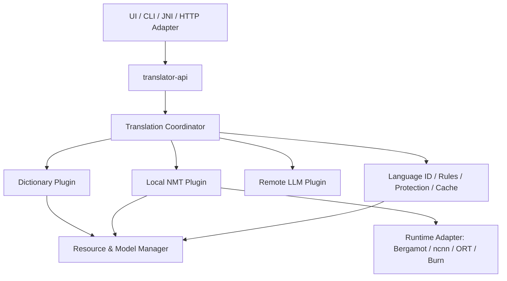

> **归档说明**：本文是外部输入文档的原样归档（2026-11-05 收到），标题沿用其自身的 `17 —` 编号。
> 归档只做排版（统一标题层级、去掉对话系统的包裹符号），**不改动任何判定、编号与验收标准**。
> 阅读约定：
> - 本文的裁定是**审查方意见**：接受 P3.0/P3.1-A/P3.1-B，**不接受 P3 完成**，批准继续 P3.1-C/D/E；
> - 本文引用的 `16_P3.1-B技术审查与P3.1-C实施建议.md` 在本仓库中**不存在**（未收到该文件），
>   因此本仓库无法引用其 SP-01～12 细则；`docs/18` 的 SP 编号按本文 §3.2 的表格执行；
> - 文中"pending"状态以本仓库实际提交为准，`docs/18` 只更新有证据的条目。

# 17 — P3 完整实施与验收总报告（滚动验收版）

> 项目：轻量跨平台混合翻译 SDK  
> 基线：`01_翻译SDK完整开发设计` v1.6，§13 原始 P3 定义；`10_P3_Linux本地NMT开发建议与验收计划`  
> 报告日期：2026-11-05  
> 当前证据截止：`2f8c4c1` / tag `p3.1b`（以所提供的 `15_P3.1-B报告` 为准）  
> 适用验收环境：**Ubuntu 24.04 x86_64 / CPU**；非 Linux 平台不在本轮验收范围  
> **当前总状态：P3 正在实施，尚未达到正式完成/发行验收。** P3.0、P3.1-A、P3.1-B 已有报告证明；P3.1-C/D/E、P3.2、P3.3、P3.4 均未收到实施证据，不能写为已通过。  
> 证据性质：**基于用户提交的设计与阶段实施报告进行归档和验收映射，不是独立源码审计或在本环境重新运行 Rust 测试。**

---

## 0. 执行摘要与正式裁定

### 0.1 保持不变的项目架构



- P3 仅承担**首个可用的本地 NMT 引擎及 Linux 验收**；不改写 P0～P7 原始里程碑。
- P4 仍是 **Bergamot 与 ncnn/ORT 等后端的插件替换验证**；P5 是跨平台扩展；P6 是 Remote LLM；P7 是 SDK 发行。
- 用户决定 Linux 优先：P3 验收只要求 Ubuntu x86_64 CPU，Windows/macOS/Android 仅保留平台无关接口，不宣称构建或性能通过。
- 字典、规则、NMT、LLM 都通过稳定契约接入，具体 Bergamot/进程协议不得泄露到 `translator-api`。

### 0.2 本轮判定

| 范围 | 当前状态 | 说明 |
|---|---|---|
| P3.0 原生模型与基线 | **报告通过** | 官方权重 + Bergamot CLI 产出真实译文，含模型锁文件与基准 |
| P3.1-A Worker 隔离 / IPC | **报告通过** | Mock 真崩溃/超时/坏帧路径已验证 |
| P3.1-B 真实 Bergamot Worker | **有条件通过** | 三层进程链路与真实模型测试完成；结构化文本仍不安全 |
| P3.1-C 文本结构保护 | **待实施 / 待提交证据** | `{name}` 被吞、代码标点被改；目前不能通过 |
| P3.1-D 执行计划 / 租约 / 并发 | **待实施 / 待提交证据** | 缓存身份、队列 deadline、single-flight 等未实现 |
| P3.1-E 公共 API / CLI / CI | **待实施 / 待提交证据** | 真实模型尚未进入 `Translator::translate()` |
| P3.2 资源生命周期与一致性 | **待验收** | `10` 的正式规划；可与 P3.1-D 共享代码，但须独立核验 |
| P3.3 Linux 性能、质量与低内存 | **只有初始基线** | 缺长时间趋势、PSS、质量评价、完整恢复后测试 |
| P3.4 Linux SDK 发布候选 | **未达到准入** | 权重再分发许可尚未确认，发行文档/CI 未完成 |

**阶段裁定：允许继续开发 P3.1-C/D/E，禁止将 P3 整体标记为 Done。**

## 1. 原始范围与交付边界

原始 `01` §13 的 P3：“**首个 NMT：选定单方向轻量 Marian，在参考 runtime 打通；输出真实译文、模型可卸载、引用对照**”。`10` 将其工程化拆成 P3.0～P3.4，但这些是 P3 内部工作包，不替代 P4～P7。

### 1.1 P3 必须交付

1. Ubuntu 上至少一个语言方向的可追溯量化 Marian 模型，模型资源和参考运行时固定到 revision、校验和、构建信息。
2. `Translator::translate()` 和 CLI 通过 **Local NMT 插件**返回真实译文，默认离线、不会擅自发送远程请求。
3. URL/邮箱/模板变量/代码片段结构保护，不能无声丢失、复制或改写关键片段。
4. 模型的安装/校验/加载/推理/卸载/错误恢复和运行中资源保护，并与 P2 Resource Manager 协作。
5. 可替换的 `TranslationEngine`/`InferenceBackend` 或等价适配，核心不依赖具体 Bergamot 私有数据类型。
6. Linux CPU 的性能、内存、质量、故障、并发基准和可重现验收记录。
7. 保持空资源/Mock 构建和 P0～P2-S 回归通过；权重许可证未清楚前不分发权重。

### 1.2 本阶段不做

- UI、划词热键、OCR 或语音功能；
- Windows/macOS/Android 构建与真机测量；
- ncnn/ORT 与 Bergamot 的正式替换性能对照（归 P4）；
- Remote LLM 的完整 Provider 功能（归 P6）；
- 多语言全覆盖或模型训练。

## 2. 已有工程证据与交付记录

### 2.1 P3.0 — 原生参考链路（`docs/11`，tag `p3.0`）

- 模型：Mozilla Firefox Translations `en → zh-Hans` v3.0 `base-memory`，模型文件、词表、短名单经 SHA-256 比对；`models.lock.json` 锁定来源；模型权重未入仓库。
- Bergamot：`browsermt/bergamot-translator` commit `9271618ebbdc5d21ac4dc4df9e72beb7ce644774`；参考 CLI 加按行基准补丁，翻译链本身未改。
- 功能：`Hello world!` → `你好,世界!`；24 条原始金样本报告为 23 条符合其当时约束。**不可把此数字与 P3.1-B 的 21/24 作直接同比**。
- P3.0 发现：`{name}`/`{order_id}` 可能被吞；反引号可能变成中文引号；缺文件可 `abort()`，截断权重可 SIGSEGV。
- 本机性能（单线程）：热 p50 **13.08 ms**，native 峰值 RSS **413.8 MiB**，稳态 **341.5 MiB**；双线程峰值 **678.5 MiB**，热 p50 **12.82 ms**。P3.0 “冷到首行” **605.9 ms** 为热页缓存下的 CLI 路径，非真正冷盘保证。

### 2.2 P3.1-A — RuntimeTransport / 独立 Worker（`docs/13`，tag `p3.1a`）

- 新增 `translator-runtime`；`ProcessTransport` + `RuntimeTransport` Trait；独立进程隔离 `abort`/SIGSEGV 风险。
- 外部 IPC：4 字节大端长度 + JSON，8 MiB 单帧上限，协议版本、request id、epoch、revision 关联；stderr 限长诊断环形缓冲。
- Mock worker 覆盖真实 `abort()`、坏帧、超时、重启预算与收尸。模型四文件存在性/大小/哈希预检查已实现，但 A 阶段仍有校验到 native 打开的 TOCTOU。
- 报告测试：**281 passed / 0 failed / 9 ignored**（比 P2-S 的 244 新增 37）；Mock IPC p50 **0.016 ms**，**不代表真实翻译延迟**。
- 本阶段**没有** Rust API 的真实模型接线。

### 2.3 P3.1-B — 真实 Bergamot Worker（`docs/15`，commit `2f8c4c1`，tag `p3.1b`）

```text
Rust host
  └─ nmt-worker（Rust Supervisor：外部 IPC、超时、进程监督）
       └─ bergamot CLI（native：私有行协议，模型推理）
```

- `snapshot.rs`：源文件元信息预检查 → 复制副本时同步计算 SHA-256 → 私有目录/只读文件 → worker 在启动 native 前再核对；快照随 unload/Drop 释放。0o400/0o700 不是同用户恶意进程隔离。
- `config.rs`：五项白名单配置、范围检查、绝对路径与转义，避免任意 YAML/CLI 注入。
- Load/Translate/其他操作超时分别为 **30 s / 15 s / 10 s**；**排队等待尚无截止时间**。
- 原生进程崩溃映射回 Rust 错误；默认 1 worker、1 native、1 in-flight；Unload 通过结束 native 进程实现。
- Mock/单测常规报告：**293 passed / 0 failed / 21 ignored**；真实模型专项 **12/12 passed**（须显式 `--ignored --test-threads=1` 执行）。常规 21 ignored 包含这些真实模型测试，不可把它们称为常规门禁已执行。
- 真实模型金样本：**21 通过、1 失败、2 仅记录**；`code-01` 反引号丢失可能在 `must_contain` 宽松断言下误判通过。该金样本分数**不等同于翻译质量评价**。

#### P3.1-B 可引用的性能基线

| 指标 | 测值 | 口径 |
|---|---:|---|
| 模型文件集合 | 49.5 MiB | 含模型、词表、lex、prefix |
| 快照准备 | 262 ms | 复制 + 单次读哈希 |
| 加载总墙钟 | 718.9 ms | Rust host 路径，含快照 |
| 首句翻译 | 416.7 ms | 独立请求，不是“加载 + 首句”的合计 |
| 热翻译 p50 / p95 / p99 | 13.17 / 14.09 / 14.40 ms | 同一 worker、100 次、beam=1 |
| host / supervisor RSS | 3.0 / 2.7 MiB | 非模型常驻主体 |
| native 稳态 RSS / VmHWM | 341.9 / 413.8 MiB | 不等于整个应用独占物理内存 |
| Unload / 重载 | 42.8 / 725.1 ms | Unload = native 退出 |

**性能解释**：不能直接用 P3.0 的冷启动 605.9 ms 对比 P3.1-B 的 `load_wall_ms`，因为快照和 IPC 范围不同；host、worker、native 的 RSS 不能简单相加称作独占物理内存。尽管模型主文件很小，工作区仍会使峰值达到约 414 MiB，低内存目标**未充分达标**。

## 3. P3.1-C：严格文本结构保护（待验收工作包）

目标：真实 Marian 翻译时，结构化片段**完整恢复或显式失败**；不得静默破坏后返回“成功译文”。

### 3.1 必需设计

- 沿用 P2 `ProtectedSpan` 扫描器，并在通用文本处理层产生 `ProtectionPlan`（受保护片段 ID、种类、字节范围、原文、策略版本），不绑定 Bergamot。
- 采用唯一、无碰撞的模型输入标记；测试标记在 Marian 中是否会删除、复制或改变形态。不可假定某一种 marker 一定稳定。
- 恢复时验证每个 ID 的出现次数与身份；允许自然语序重排，不允许标记丢失、多出、串换或未知标记。
- **URL、email、代码、模板变量字节级恢复**，包括反引号本身；失败返回 `IntegrityFailure`，不缓存、不自动远程回退。
- 对必要的文本采用安全分段或其他替代策略，若真实模型无法稳定保留 marker，不得通过“放宽断言”宣布成功。
- 诊断只返回保护类别、位置、错误类别，不在集中式日志写入受保护的原文内容。

### 3.2 验收矩阵（承接 `docs/16`）

| ID | 必须覆盖 |
|---|---|
| SP-01～03 | 单个、多种、重复 `{name}`/`{order_id}` 标记各自完整、计数正确 |
| SP-04～05 | URL、带查询参数的 URL、email、模板混合精确保留 |
| SP-06～07 | 反引号代码整体保留；代码内嵌 URL/变量不重复标记 |
| SP-08～09 | 冲突/伪造标记、丢失/复制/篡改，必须返回 `IntegrityFailure` |
| SP-10～12 | UTF-8/emoji、多行长文本、空白/全保护输入不崩溃、不串帧 |

**退出条件**：Mock 故障注入 + 真实 Bergamot 两层测试通过，严格模式成为真实 NMT 的默认安全路径；保留 293 项基线及真实模型 12 条回归。尚未收到这些实现或实测，状态必须是 `pending`。

## 4. P3.1-D 与 P3.2：生命周期、一致性与资源安全（待验收）

`docs/10` 的 **P3.2** 是正式规划中的“真实模型生命周期”工作包；P3.1-D 可以承载部分实现，**不能因完成 D 的代码就省略 P3.2 的独立验收**。

### 4.1 必须实施

1. **ResolvedExecutionPlan**：在缓存前确定 engine、runtime build、模型五文件摘要、tokenizer/shortlist、解码参数、语言方向、规则/术语、保护策略、隐私域；用稳定编码得到 plan digest。`package@version#部分权重 sha256` 目前仅用于诊断，**不能作真实 NMT 缓存键**。
2. **Single-flight**：同 `revision + runtime + device + precision` 并发加载只启动一次；失败可传播并按策略冷却，禁止持全局大锁执行昂贵加载。
3. **模型内存租约**：区分文件资源租约与活跃模型实例租约；有请求时不可卸载，卸载时等待/安全取消或返回明确错误。
4. **Queue deadline**：排队等待、模型加载、翻译执行分别计时；不能在 Mutex 上无限等待，且超时语义不应仅靠杀进程解决。
5. **资源反向依赖**：被其他已安装包依赖的 tokenizer/模型/规则版本不能被 `cleanup` 静默删除。
6. **快照清理**：崩溃/kill 后清理快照和 worker 配置目录；清理前核实进程身份，避免 PID 复用误删。
7. **安装故障注入**：在复制、rename、state 写入前后强杀进程；测试 `audit/recover`，明确文件/父目录 fsync 的 Linux 持久化保证。
8. **内存准入与回收**：使用实际 NMT 测量值调整软预算，明确不是硬 RSS 上限；支持空闲 TTL 与显式卸载，拒绝误杀在用进程。
9. **加载前验证策略**：快照 + 内容摘要 + 租约维持同一 revision；明确同用户恶意进程模型不属于当前保证范围。

### 4.2 建议不变量/验收测试

| 测试编号 | 不变量 |
|---|---|
| LC-01 | 并发 10 次加载同模型 → 只有一次真实模型 load |
| LC-02 | 活跃翻译请求中 unload/cleanup → 不删除、不断指针、不死锁 |
| LC-03 | 模型相同 id/version 但文件 digest 不同 → 不复用实例、不命中旧缓存 |
| LC-04 | 排队 2 个请求，第二个 deadline 到期 → 在 native 调用前返回 Timeout |
| LC-05 | 翻译中 native 死亡 → 原请求失败，下一请求不暗中重放旧文本 |
| LC-06 | 卸载并重载 10 次 → 快照/worker 配置不无限堆积，无残留进程 |
| LC-07 | 依赖 A 引用 B → B 卸载被拒，引用解除后允许回收 |
| LC-08 | 在提交安装关键点 kill -9 → `recover()`/`audit()` 保持仓库可修复 |
| LC-09 | 内容指纹变化后译文与诊断不会使用旧模型缓存 |
| LC-10 | 不配置真实后端时 `translator-api` 空资源/Mock 编译测试通过 |

## 5. P3.1-E：统一 API / CLI 集成与 Linux CI（待验收）

**P3 最重要的对外完成条件不是 worker 能翻译，而是 SDK 公共入口能翻译。**

目标路径：

```text
Translator::translate(request)
  → Coordinator / rules / language pair / local-first route
  → LocalNmtEngine: TranslationEngine
  → ResolvedExecutionPlan + ModelLease
  → ProcessTransport (Rust supervisor)
  → Bergamot native
  → strict Restore + TargetTermGuard
  → TranslationResult / TranslationDiagnostics
```

须证明：

- `LocalOnly`、`AutoLocalFirst` 正确选择真实本地 NMT；词典单词查询仍按 P1/P2 行为，不误用 NMT；
- `translate()` 与 `translate_with_diagnostics()` 共用执行路径，输出译文一致；
- 不授权时任何本地失败都不得自动调用 Remote LLM；
- 真实模型加载、卸载和错误可经 SDK Resource API 观测；
- `Translator::translate()` 和 `translator-cli` 输出真实 `en → zh-Hans` 结果，带准确 engine/model/runtime 身份；
- 默认 `cargo build` 不拉取 native C++/模型权重；Linux 真实模型测试通过可选 feature 与明确的环境变量执行；
- Linux CI 区分无模型默认门禁与可授权下载模型的集成任务；公开分发不得绕过权重许可证审核。

**建议最终 CLI 证据**（命令仅示意，当前尚无证据证明已实现）：

```bash
translator-cli --store <RESOURCE_STORE> translate 'Hello world!' \
  --from en --to zh-Hans --policy local --diagnose
# 期望：真实中文译文、非 mock、runtime/model revision、无网络请求
```

## 6. P3.3：Linux 性能与翻译质量最终验收（待验收）

### 6.1 必测状态

| 场景 | 必须报告 |
|---|---|
| 空 SDK / 空资源 | 进程 RSS、初始化、默认依赖树 |
| 字典 Ready | RSS、查询 p50/p95，确保 P2 无回归 |
| Worker 无模型 | host/supervisor 内存、IPC p50/p95 |
| 模型冷加载 | 真冷盘与热页缓存分开，快照、校验、native load、首句分阶段 |
| 热模型翻译 | 20/100/500 字，p50/p95/p99，线程数、beam size |
| 长时间稳定性 | 100/1000 次 + 10 分钟负载下 RSS 趋势和错误率 |
| 并发 | 1/2/10 请求，整体吞吐、排队延迟、超时数、内存峰值 |
| 卸载/回收 | Unload 前后 host/worker/native RSS、PSS（可测时）、VmHWM、进程/目录残留 |

### 6.2 评价口径

- 金样本应将**结构精确保留**与**语言翻译质量**分开评分：字节级保护、数字/否定/单位等事实保留、人工可读性；不要用 `must_contain` 判断代码围栏或反引号正确。
- P3.0 的 23/24 与 P3.1-B 的 21/24 因判定口径不同不直接比较。先统一评分器，再对同一组固定输入重测。
- 默认单 native worker/单 in-flight 是已验证配置基线；如启用更多线程/worker，必须有明确内存和延迟收益证据。
- 当前单线程 native 峰值 **413.8 MiB**，已高于原设计桌面 Lite 300–400 MB 目标的上沿附近；须如实记录“目标尚未稳定达成”，不能只展示 49.5 MiB 模型文件大小。
- 使用 `/proc`、`smaps_rollup` 等观测应放在 Linux metrics adapter，不把系统 API 加进 `translator-core`。
- 如果内存目标不达标，可以提出更小模型、限制 batch/线程、替代 runtime 等下一步；**具体 ncnn/ORT 替换验证属于 P4**。

## 7. P3.4：Linux SDK 发布候选与正式 P3 验收（待验收）

### 7.1 交付物

1. 可重复构建的 Linux x86_64 Rust SDK、CLI、native worker 产物及必要 runtime 依赖（注明 glibc/BLAS/rpath）。
2. API 文档、资源包 Manifest / 已验证模型坐标、启动/卸载/诊断/网络权限示例。
3. 无权重发行模式及模型安装说明；**权重许可证确认前不得包含权重分发**。
4. 默认构建、真实模型可选集成测试和 Linux CI 结果；完整故障注入、性能及质量基线 JSON。
5. 许可/来源/Hash/构建版本清单，安全限制与已知问题。
6. P3 验收报告更新为 `Passed`、`Conditional` 或 `Blocked`，保留原始审计证据和仍未完成事项。

### 7.2 最终验收总表

| 验收编号 | 判据 | 当前状态 |
|---|---|---|
| P3-G01 | 真实 Marian/Bergamot 离线输出译文 | **通过（报告）** |
| P3-G02 | 模型/运行时 revision、文件摘要可追溯 | **通过技术验证**；许可证未确认 |
| P3-G03 | 真实 native abort/SIGKILL 被 worker 隔离，宿主存活 | **通过（报告）** |
| P3-G04 | 严格占位符/代码/URL/邮箱可恢复或显式失败 | **未通过整体验收**；真实模型尚有已知破坏 |
| P3-G05 | 真实 NMT 经公开 `Translator::translate()` 和 CLI 可用 | **未实现/无证据** |
| P3-G06 | single-flight、租约、超时与取消、无资源竞态 | **未完成/无证据** |
| P3-G07 | 完整执行计划及缓存身份隔离 | **未完成/无证据** |
| P3-G08 | 仓库反向依赖与真实 kill -9 恢复测试 | **未完成/无证据** |
| P3-G09 | Linux 长时间稳定性、PSS/RSS、卸载趋势、质量结果 | **初始基线存在，完整验收 pending** |
| P3-G10 | 默认 Mock/空资源构建和全部旧测试无回归 | **报告通过至 P3.1-B** |
| P3-G11 | Linux CI 与安装/运行/构建文档 | **pending** |
| P3-G12 | 权重与运行时许可证满足目标分发要求 | **pending，发布阻断** |

**必须满足 G04～G11 的 Linux 功能门槛，才能宣布 P3 功能完成；G12 未通过前不能宣布含该模型权重的发布包可分发。** 如果仅提供不含权重的开发者 SDK，应显式限制模型获取与权利责任，不将其表述为完整可分发的离线模型包。

## 8. 已知问题、严重度与行动所有权

| ID | 严重度 | 当前风险 | 下一执行位置 |
|---|---|---|---|
| R-01 | P0 | `{name}`/`{order_id}` 丢失；代码反引号改写 | P3.1-C |
| R-02 | P0 | 真实引擎未接到公开 SDK API | P3.1-E |
| R-03 | P0 | `content_digest` 缺完整执行栈信息；真实 NMT 禁止上缓存 | P3.1-D/P3.2 |
| R-04 | P1 | Mutex 排队无绝对 deadline | P3.1-D/P3.2 |
| R-05 | P1 | single-flight/模型实例租约未落地 | P3.1-D/P3.2 |
| R-06 | P1 | 权重许可证仍待确认 | P3.4 发布前 |
| R-07 | P1 | 资源依赖反向引用/kill -9 安装恢复尚缺 | P3.2 |
| R-08 | P1 | 三层进程和工作区总内存较高（native 峰值 413.8 MiB） | P3.3，P4 再做后端对照 |
| R-09 | P2 | SIGKILL 后 `/tmp/nmt-worker-*` 可能残留配置目录 | P3.1-D/P3.2 |
| R-10 | P2 | 同用户恶意篡改隔离快照并非当前安全保证 | 发行前安全模型评估 |
| R-11 | P2 | 真实模型已锁定一个方向，其他方向未验 | P3.3 或后续资源扩展 |
| R-12 | P2 | Linux 之外未验证 | P5（Linux 之后） |

## 9. 执行顺序与项目编号纪律

为了减少评审循环，剩余任务建议一次集成、集中验收，而不再把每个小步骤单独包装成新里程碑：

1. **完成 P3.1-C/D/E（一个实施批次）**：结构保护、执行计划与安全加载、真实 `translator-api`/CLI 接线；内部任务仍可独立 commit，结束时只出一份 P3.1 集成验收结果。
2. **执行 P3.2 生命周期一致性验收**：集中补齐资源竞态/依赖/故障注入，不再创建 P3.1-F/G 等编号。
3. **执行 P3.3 Linux 测试**：性能、质量、长时间趋势，给出与预算不符时的决定。
4. **执行 P3.4 Linux SDK 发行候选检查**：文档、CI、许可证、交付打包；形成 P3 最终版本报告。
5. **P3 通过后进入原定 P4**：优先评估 ncnn/ORT 插件替换；后续 P5 跨平台、P6 Remote LLM、P7 全面发行仍按 `01` 原始里程碑及 Linux-first 的执行顺序协调。

**编号说明**：`P3.2/P3.3/P3.4` 不是新的 P4/P5/P6；它们来自 `docs/10` 的 P3 内部工作包。`P3.1-C/D/E` 也不是“补丁包”，只是同一功能的实施任务。任何后续变更不得覆盖 `docs/01` §13 的 P0～P7 正式定义。

## 10. 可复现命令与证据收集

以下命令是已有报告中的复现方式；**本次编写文档没有执行这些命令**。

```bash
cd translator-sdk
. /opt/rust/env.sh

# 默认无模型路径（报告 P3.1-B：293 passed / 0 failed / 21 ignored）
cargo test --workspace
cargo clippy --workspace --all-targets -- -D warnings
cargo fmt --all --check

# 真实模型路径（需预先准备本地 Bergamot 和模型）
export NMT_BERGAMOT_BIN=/tmp/p3/bergamot-translator/build/app/bergamot
export NMT_MODEL_DIR=/tmp/p3/models
export LD_LIBRARY_PATH=/tmp/p3/sysroot/usr/lib/x86_64-linux-gnu:/tmp/p3/sysroot/usr/lib/x86_64-linux-gnu/openblas-pthread
cargo test -p translator-runtime --test real_bergamot -- --ignored --test-threads=1

# P3.1-B 基线产物
NMT_BASELINE_OUT=fixtures/nmt/baseline-p3.1b-linux-x86_64-1thread.json \
  cargo run -p translator-runtime --release --example p3_1b_evidence
```

下一次 P3 更新应保存：Git commit/tag、平台/硬件/编译配置、固定资源摘要、默认测试与真实专项测试原始输出、性能 JSON、崩溃注入结果、资源审计结果、许可证审核决定；禁止只写口头“全部完成”。

## 11. 正式决议与待更新状态

**2026-11-05 P3 中期决议**：

- **接受 P3.0 / P3.1-A / P3.1-B 的阶段性成果（以已提交报告为证据）。**
- **不接受 P3 全部完成的结论。** P3.1-C/D/E 和 P3.2～P3.4 尚缺实施与验收证据。
- **保留三层进程设计**作为当前 Ubuntu 实现，不因为多一层进程立刻返工成 C ABI；有条件替换时必须通过同一 SDK 契约。
- **默认单 worker、单 in-flight、严格结构保护、远程默认禁止、失败不静默重试/缓存。**
- **下一交付目标**：一次完成 P3.1 剩余 C/D/E，之后按 `docs/10` 继续 P3.2～P3.4 的 Linux 验收。
- **发布红线**：Mozilla 模型权重再分发许可未确认，不打包权重，不宣称可发布含权重的模型包。

## 12. 来源与追溯

本文事实来自以下用户提供的文件，性能与测试值均沿用其报告口径：

- `01_翻译SDK完整开发设计(2).md`（v1.6）：§0、§2、§5、§9、§13、ADR-023～033。
- `10_P3_Linux本地NMT开发建议与验收计划.md`：P3.0～P3.4 的阶段结构与准入门槛。
- `11_P3.0_原生模型验证报告.md`：Bergamot 参考链路、模型版本、golden 和原生基线。
- `12_P3.0技术审查与P3.1准入决策.md`：进程隔离、模型完整性和真实验收约束。
- `13_P3.1-A报告.md`：`translator-runtime` Mock worker、IPC、超时/崩溃隔离和测试。
- `14_P3.1-A技术审查与P3.1-B实施建议.md`：隔离快照与真实模型接入任务。
- `15_P3.1-B报告.md`：真实三层进程路径、性能、故障、局限、测试证据。
- `16_P3.1-B技术审查与P3.1-C实施建议.md`：SP-01～12、严格保护及后续 D/E 交接。
- `09_P2-S稳定化报告.md`：P3 必须承接的资源与缓存安全遗留项。

> **文档使用说明**：此文件是“完整的 P3 实施与验收**总报告框架 + 已有阶段验收快照**”，不是“P3 已实施完毕的最终通过证明”。P3.1-C/D/E 和 P3.2～P3.4 提交实施记录后，应在原文件中逐条更新 `pending`，保留旧基线，不以计划代替执行结果。
