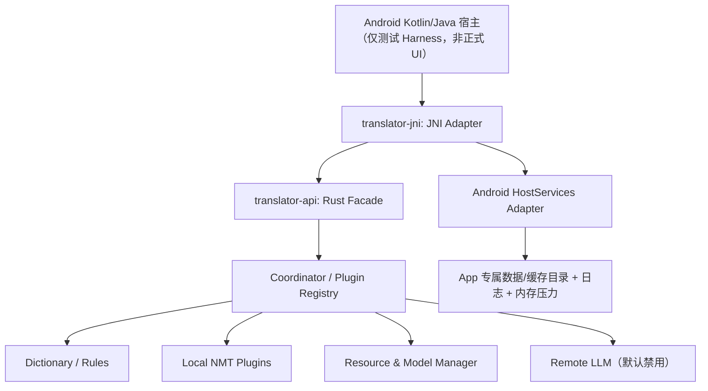

# P6 — 跨平台 SDK 绑定与 Android JNI 开发建议及验收计划

> 文档性质：**开发建议 / 待执行**，不是实施报告。  
> 编写日期：2026-11-07  
> 上游依据：`01_翻译SDK完整开发设计`、`32_P5_Windows优先开发建议与权限边界`、`34_P5.2-P5.3_Windows构建回归与ORT实跑报告`、`35_P5.4_Windows进程存活探测与跨进程资源验证报告`、`36_P5.5_Android模拟器验证报告`、`37_P5阶段总结与验收报告`。  
> 基线：P5 **Conditional（条件性通过）**；P6 不得擅自关闭 P5 遗留的发行阻断项。  
> 当前工作区：**`E:\augenstern\translate`**；Python 固定为 **`D:\Anaconda3\python.exe`**。  
> 平台策略：Linux/Windows 已有 SDK 能力保持；**Android 只用模拟器/虚拟机测试，禁止要求物理设备**；macOS 只预留接口，不承诺验收。

---

## 0. 执行摘要与拍板建议

**P6 的核心目标是把 P5 在 Android 模拟器上已能运行的 Rust SDK 核心，真正封装为 Java/Kotlin 可以调用的 `translator-jni` 库，验证调用、资源生命周期、异常与编码边界，同时确保现有 Rust Library API 不被 JNI、UI 或某一推理后端绑死。**

P5 已经证明：

- Windows x64：核心、词典、规则、资源管理及 **ORT 真实模型翻译**可用；Bergamot 的隔离 worker 仍有明确平台门禁。
- Android x86_64 AVD：真实 `translator-cli` 可运行，FST/SQLite 词库、资源仓库、Mock 路由可用；此前 JNI 冒烟只验证小型独立 `cdylib`，**没有验证完整 SDK 通过 JNI 调用**。
- Android arm64：编译与 ELF/16 KiB 对齐检查通过，**运行未验证**；现有主机的 Android Emulator 不能运行 arm64 镜像。
- 发行门禁 **G12/G11/G06/G08/D-46 仍 open**；报告未提供所有门禁的具体关闭条件，不能自行宣布其已解决。

**推荐实施顺序：P6.0 冻结契约 → P6.1 JNI 最小链路 → P6.2 资源/异步/异常 → P6.3 模拟器端到端 → P6.4 兼容回归与安全 → P6.5 验收与交付。**

### 0.1 什么不属于 P6

不开发 UI、不增加 OCR/语音/划词，不强制将 Bergamot 移植到 Android，不直接以 Android 模拟器结果宣称真机性能，不以 ARM64 模拟器无法运行作为 SDK API 失败，不要求实现全平台同一 NMT 后端，也不预设云端 LLM 自动回退。

## 1. P6 验收范围与证据分级

| 平台/能力 | P5 证据 | P6 目标 | 不得声称 |
|---|---|---|---|
| Linux x86_64 | 已有 Rust SDK 与本地 NMT 证据 | 保持 API、回归测试、行为一致 | P6 已重新测得所有性能（除非实测） |
| Windows x86_64 | W1–W10 PASS、ORT 24 个真实模型用例、资源进程语义 | 防回归，验证绑定层不污染核心 | Bergamot worker 在 Windows 可用 |
| Android x86_64 AVD | 真 SDK CLI 能查词/管理资源；独立 JNI 冒烟成功 | **完整 SDK 的 JNI 端到端** | JNI 冒烟等于 SDK JNI 完成 |
| Android arm64 | 交叉编译/ELF 合规 | 维持构建门禁和 ABI 导出检查 | ARM64 运行、速度、电量和峰值 RSS 已测 |
| macOS | 未纳入 P5 证据 | 保留 HostServices、C ABI/FFI 分层 | 已构建或已验证 |

验收按三级报告：**构建通过**、**在模拟器中加载/调用通过**、**真实 NMT 运行通过**。每个能力逐项标注，不允许用一项证明替代其他项。

## 2. 架构边界与新增模块



**依赖约束**：`translator-jni → translator-api`，绝不反向。`translator-types` / `translator-core` / `translator-plugin-api` 不得出现 `JNIEnv`、`jobject`、`Android Context` 等类型。JNI 只是一个可移除的边界 crate；移除后 Rust API、CLI 和其他平台仍然能够编译运行。

建议新增（实际工程目录以仓库现有组织为准）：

```text
translator-sdk/
  bindings/
    translator-jni/            # Rust cdylib：JNI 导出、错误转换、句柄注册
  tests/
    android-harness/           # 极简 Java/Kotlin 调用方（非生产 UI）
  fixtures/p6/                # 输入/输出金样本、ABI、错误码、日志
  tools/p6/                   # 构建、部署、ADB 验证和结果汇总脚本
```

如果当前 `bindings/` 已有规范，优先遵循既有布局，不为了目录美观进行大规模搬迁。C ABI/UniFFI 可作为后续可选适配，不强制 P6 同时实现三套绑定。

## 3. 对外 JNI 契约（先冻结语义，再选实现细节）

### 3.1 设计原则

1. Java/Kotlin 不接触原生 Rust 指针，不直接持有 FST/SQLite/模型 C++ 句柄；使用 `long handle` 仅作为**不透明、带代际校验的句柄 ID**。
2. 统一约定语言标签、错误码、资源 ID、超时与联网许可的语义，和 `translator-api` 一致。
3. **不要**把 Rust `TranslationEngine` trait / future / panic 穿过 JNI 边界；所有 native 入口必须将错误映射为可读、稳定的返回值或受控异常。
4. Java/Kotlin 线程不能直接阻塞 UI 主线程；阻塞操作由调用者使用 Executor/Coroutine，或由适配层提供后台异步接口。
5. JNI 接口只传文本、配置、结果和能力描述，不暴露具体运行时内部布局。

### 3.2 建议的最小 Kotlin/Java 语义

```kotlin
interface TranslatorClient : AutoCloseable {
    fun capabilities(): List<Capability>
    fun detectLanguage(text: String): List<LanguageGuess>
    fun lookup(text: String, source: String, target: String): List<DictionaryEntry>
    suspend fun translate(request: TranslateRequest): TranslateResult
    fun listResources(): List<ResourceInfo>
    override fun close()
}
```

> 以上为**建议接口，不是已实现代码**。第一版可先同步 JNI + Kotlin 层调度线程，之后再提供原生异步/取消能力。若产品要求取消长时间 NMT 推理，必须明确“取消等待”和“停止已进入 native 的计算”并非一回事。

### 3.3 Rust JNI 入口候选

| 操作 | JNI 责任 | 宿主可见行为 |
|---|---|---|
| `nativeCreate(config)` | 校验配置/数据目录，注册 Translator 句柄 | 成功返回 handle，失败有错误码 |
| `nativeCapabilities(handle)` | 读取当前能力表 | 返回已验证能力；不得谎报未启用的 NMT |
| `nativeLookup(handle, request)` | 转 UTF-8、调用词典 | 多释义及出处不丢失 |
| `nativeTranslate(handle, request)` | 路由并调用 SDK | 返回引擎 ID、模型/资源信息、译文、警告 |
| `nativeDetect(handle, text)` | LanguageIdentifier 调用 | 可返回多个候选及置信度 |
| `nativeListResources(handle)` | 资源清单查询 | 只读，版本与许可可追踪 |
| `nativeClose(handle)` | 幂等关闭，等待/取消在途任务 | 不泄漏、不重复释放 |

**格式策略**：优先定义统一 DTO，并采用稳定、版本化的序列化格式（例如 JSON）作为早期 JNI 交换协议；待基准证明序列化成为瓶颈后再引入大量 Java DTO/字段级 JNI 封送。若使用 JSON，显式设 `protocol_version`，未知 major 拒绝，不静默猜测。

## 4. 句柄、生命周期与并发安全（P0）

- 由 JNI 层管理 `HandleRegistry`，保存 `Arc<Translator>`（或与现有 `Translator` 类型兼容的受控实例）；外部 `jlong` 只是索引和 generation，不允许直接转换为裸指针再 `Box::from_raw` 多次释放。
- `close()` 必须支持重复调用和线程竞争：第一次触发关闭，后续调用得到 `AlreadyClosed` / 幂等成功；无 use-after-free。
- native 同步调用时取得请求租约；关闭中拒绝新请求，活跃请求安全结束或到安全检查点后取消。
- 不在持有 `HandleRegistry` 全局锁时执行 SQLite 查询、磁盘 I/O、网络请求或 NMT 推理，避免长时间阻塞其他调用。
- 线程安全声明必须有证据：`JNIEnv` 仅在当前线程有效；跨线程调用需要正确附加到 JVM；不得跨线程缓存局部引用。
- 资源包在宿主应用专属目录管理；允许宿主提供 `data_dir/cache_dir`，不得由 Rust 写死 `/data/local/tmp` 作为生产路径。

### 4.1 JNI 错误映射

沿用 `TranslationErrorCode`（例如 `InvalidRequest`、`ResourceNotInstalled`、`OutOfBudget`、`Cancelled`、`Timeout`、`BackendFailed`、`NetworkNotAuthorized`、`IntegrityFailure`）；异常仅限 JNI 契约错误，业务失败优先结构化结果。捕获 Rust panic 只能拦截可展开的 Rust panic，**不能**捕获 C++ `abort()`/SIGSEGV；对于不可信原生推理运行时，继续服从现有 Linux worker 隔离和平台 capability gate，切勿在 Android 上绕过门禁强接 Bergamot。

## 5. Android 构建与测试策略（仅模拟器）

### 5.1 目标 ABI

- `x86_64-linux-android`：**主要运行验收 ABI**，使用现有 Android 34 x86_64 AVD。
- `aarch64-linux-android`：**编译与产物审查 ABI**，检查 ELF 机器类型、导出符号、依赖库、16 KiB 页对齐；现有主机上不宣称运行通过。
- 不因不能启动 arm64 AVD 而要求物理 Android 设备；未来若有 ARM64 主机/虚拟环境，可以补功能测试，但不是 P6 阻断项。

### 5.2 测试载体

优先用 Android 原生小型测试 APK/Instrumentation Harness 调用真实 JNI `cdylib`，而不是仅靠 `app_process` 或 C CLI。APK 由 CI/构建脚本生成，但所需 Android SDK/Gradle 插件及版本要先核对，不擅自安装系统组件。测试文件和缓存应全部放入获准工作区或模拟器的应用沙箱；若构建工具会向工作区外写入（例如 Gradle 用户缓存、AVD 系统镜像等），先申请审批或显式重定向并验证。

### 5.3 有限且可验证的 Android P6 能力

- **必测**：JNI 创建/销毁、能力表、Unicode 文本往返、语言检测、多释义字典、规则、资源版本和错误映射。
- **可选**：若已验证的 Android NMT 后端存在并取得合规模型，可加真实翻译；否则明确报告 `CapabilityUnavailable`，不可用 Mock 回显冒充 NMT 实测。
- **不作为必测**：Android 实体机温度、耗电、物理设备 RSS、ARM64 Android 实际运行。

## 6. SDK 资源与插件能力声明

必须沿用现有 `ResourceStore`、清单双版本和插件 registry，不在 JNI 层重新实现一套安装/卸载逻辑。能力表示例：

```json
{
  "protocol_version": 1,
  "platform": "android-x86_64",
  "capabilities": ["dictionary.lookup", "analysis.detect", "resource.list", "translation.mock"],
  "runtime_status": [
    {"id": "runtime.bergamot", "available": false, "reason": "platform_not_validated"}
  ]
}
```

> 这仅为能力表达示例，不是现有返回数据。`translation.mock` 需要明确标注测试能力，不能在用户界面展示为真实离线翻译。

资源安装、激活、回滚、租约语义由 core 统一实现。JNI 插件不得降低 P5 Windows/Linux 已验证的仓库锁安全策略。资源解包、校验、路径遍历与版本错误继续使用现有结构化错误模型。

## 7. 网络、隐私与低内存约束

- **Remote LLM 默认禁用**；JNI 层不得因本地模型不可用自动上传用户文本。是否联网由宿主明确配置，敏感密钥不得进入日志。
- 使用 `String`/`ByteArray` 转换时避免不必要的多次拷贝；大文本请求必须限长或分段，不在主线程执行。
- Android 默认模型实例与推理并发上限不应在 JNI 层私自增大；内存准入由 core/Resource Manager 控制。
- 测试至少记录本机 AVD 的进程 RSS/峰值、首次调用与热调用耗时，**全部标为模拟器数据**，不外推真实设备。
- 由于 P5 并未完成 Android 真实 NMT 模型运行，P6 首先关注 JNI 绑定引入的额外开销，而非声称端侧翻译已达到低内存目标。

## 8. 实施分解、交付物和门禁

### P6.0 — 契约冻结与环境只读预检

**任务**：核对当前 `translator-api`/types 错误码、资源接口、已开启 feature，确定 JNI DTO 协议、配置字段、句柄方案、Android API 级别、Rust target/NDK/测试 Harness 版本。建立变更影响清单。

**交付**：`docs/P6-api-contract.md`、协议样例和失败错误码映射、编译开关矩阵。  
**门禁**：移除 `translator-jni` 不影响 Linux/Windows Rust SDK；不存在新增强制 HTTP/Tauri 依赖。

### P6.1 — 真实 SDK JNI 最小闭环

**任务**：创建 `translator-jni` cdylib；建立/销毁真正的 `Translator` 实例；通过 Java/Kotlin 调用 `capabilities`、`detect_language`、`lookup`。首次仅开放同步入口，由宿主线程池调度。

**交付**：JNI 库、Android Harness、三种调用的实测日志、x86_64 AVD 截获的运行证据。  
**门禁**：不能只复用 P5 的 `HelloJNI` 冒烟而宣称完成；不得通过 Mock 结果伪装真实查词。

### P6.2 — 翻译、资源、错误与取消契约

**任务**：接 `translate`（存在已验证的插件时才给真实 NMT）、结构化错误、资源查询；加入重复关闭/同时翻译与关闭、超时、JNI 异常清理；按既有 API 能力决定取消是否实现，未实现时返回明确错误，不制造空承诺。

**交付**：生命周期与错误注入测试、Java/Kotlin 的线程模型示例、资源清单与版本查询样例。

**门禁**：native panic 不跨 JNI 边界、资源不可在使用中删除、关闭后调用不会 use-after-free。

### P6.3 — Android 模拟器端到端

**任务**：在 Android 34 x86_64 AVD 上跑完整 SDK JNI，而非只验证可加载；打包小型实际词典包、规则夹具、错误夹具；测试中文/日文/Emoji/空串/长串/嵌入 `\0` 的处理（明确接受或拒绝）。

**交付**：ADB/Instrumentation 原始日志、通过/失败/跳过列表、模拟器环境指纹。

**门禁**：路径、编码与多义词出处不丢失；模拟器上无未处理 native 崩溃。

### P6.4 — 保持跨平台可移植性与 Linux/Windows 回归

**任务**：`cargo fmt/clippy/test` 默认+all-features；Windows 用 MSVC 现有环境、Linux 用现有基线，分别记录测试计数与 cfg 例外，不删测试或把失败静默变成 ignored。核对发布依赖和许可证；检查 `translator-jni` 未进入非 Android 默认构建依赖。

**交付**：双平台回归日志、`cargo tree`/feature 对比、插件替换测试结果。

**门禁**：Linux/Windows 已验证功能不倒退；不出现无授权工作区外写入。

### P6.5 — 交付、版本记录和发行门禁更新

**任务**：整理 ABI/Protocol 版本、JNI 使用示例、模型/词库许可、内存/延迟报告、P6 评审报告，更新 ADR（以当前实际最后编号为准，不猜编号）。

**交付**：P6 实施报告、复现脚本、完整 Pending/Blocked 清单和变更记录。

**门禁**：P6 功能验收不能自动关闭 `G12/G11/G06/G08/D-46`；正式发行必须另过 release-mode 审计。

## 9. 必须新增的测试矩阵

| 编号 | 测试 | 必须结果 | 平台 |
|---|---|---|---|
| J-01 | `create → capabilities → close` | 成功、无泄漏 | x86_64 AVD |
| J-02 | 中文、日文、Emoji、组合字符、非 BMP 往返 | Unicode 内容与长度保持一致 | x86_64 AVD |
| J-03 | 真词典多义与来源 | 释义数量/许可/源 ID 与 Rust 侧一致 | x86_64 AVD |
| J-04 | 资源列表/激活/错误 | 不越过资源租约和仓库门禁 | x86_64 AVD |
| J-05 | 双重 `close` / close 后调用 | 无 use-after-free，明确错误 | x86_64 AVD |
| J-06 | 并发 lookup 与 close | 无死锁/悬挂/释放竞态 | x86_64 AVD |
| J-07 | 损坏资源/未知 schema/非法路径 | 对应稳定错误码，不崩溃 | x86_64 AVD |
| J-08 | Remote LLM 未授权 | `NetworkNotAuthorized`，无网络请求 | x86_64 AVD |
| J-09 | NMT 平台门禁 | 不支持的后端明确 `CapabilityUnavailable` | x86_64 AVD |
| J-10 | JNI 异常/空值/超限输入 | 不跨边界 panic，受控返回 | x86_64 AVD |
| J-11 | Rust 核心不依赖 JNI crate | 关闭 feature 后编译、测试通过 | Linux/Windows |
| J-12 | Windows ORT/词库/资源无回归 | 原 W 矩阵保持可复现 | Windows |
| J-13 | ARM64 `cdylib` 交叉编译及 ELF | `AArch64`、16 KiB 对齐、符号/NEEDED 合规 | 构建机 |
| J-14 | 模拟器 RSS/调用时延 | 有原始数据且标明“模拟器口径” | x86_64 AVD |
| J-15 | 卸载/重装 JNI 库或应用生命周期 | 句柄清理、重建无残留 | x86_64 AVD |

若某测试因 SDK 当前并未实现某能力而无法执行，必须明确 `blocked/pending`，不得写为 PASS。`ignored` 与条件编译跳过需说明数量、原因及对应平台。

## 10. 开发环境、权限边界与缓存隔离（强制）

### 10.1 用户授权边界

| 事项 | 准则 |
|---|---|
| `E:\augenstern\translate` 内项目修改与生成物 | 可以按已批准的项目开发流程进行 |
| 该目录**以外**的任意写入、删除、移动、安装、修改配置 | **事先逐项请用户批准**，即使不需要管理员权限 |
| 读取该目录外工具链/现有资源 | 允许只读 |
| 所有管理员权限操作 | **必须提前批准**，不能因 SSH 会话有管理员令牌视为授权 |
| Python | 固定调用 `D:\Anaconda3\python.exe`；不得隐式使用 MSYS2/py launcher 的其他 Python |
| Rust | 使用已有更新版本，执行前只读检查 `rustc -V`，不擅自升级 |
| 代理 | 仅允许当前进程临时设置；不得改系统/用户级持久配置 |
| Android 测试 | **只能使用模拟器/虚拟机，禁止真机** |

### 10.2 需要特别警惕的隐式写入

- Cargo 默认 registry、git fetch 缓存、rustup home、Gradle 用户目录、Android AVD、ADB 状态、Java 临时目录、ONNX Runtime 下载缓存、Python `__pycache__`、操作系统日志等，都可能写到工作区外。
- 在 Windows 运行前，显式设置 `CARGO_HOME`、`CARGO_TARGET_DIR`、`TEMP/TMP/TMPDIR`、`PIP_CACHE_DIR`、`PYTHONPYCACHEPREFIX`、`ORT_CACHE_DIR` 到 `E:\augenstern\translate\.build` 或工作区内受控目录；项目内已有 `.cargo` 可继续使用。
- **工作区外的既有 ORT 360.9 MB 缓存**按当前决定保留，不删除；P5 总结报告称重定向已验证，但 P6 仍应在构建脚本中强制设置 `ORT_CACHE_DIR`，不依赖操作者记忆。
- 当前 Linux 侧 AVD/SDK 原有目录位于用户主目录以外（相对于 Windows 工作区），P5 已使用过；**P6 新增安装、AVD 创建/删除、系统镜像操作或任何目录写入必须先审批**。可只读勘察现有模拟器，不能把“模拟器是项目测试所需”当作对外写入授权。
- 若 Android Emulator 必需在工作区外写运行状态，应先识别具体路径并申请明确批准，或在可行时通过环境变量将 AVD/缓存映射到工作区；无法保证时暂停测试并报告阻断。

### 10.3 受控 Windows 命令范例

```powershell
$W = 'E:\augenstern\translate'
$env:CARGO_HOME       = "$W\.cargo"
$env:CARGO_TARGET_DIR = "$W\.build\target"
$env:TEMP             = "$W\.build\temp"
$env:TMP              = $env:TEMP
$env:TMPDIR           = $env:TEMP
$env:PIP_CACHE_DIR    = "$W\.build\python-cache"
$env:PYTHONPYCACHEPREFIX = "$W\.build\python-cache\pycache"
$env:ORT_CACHE_DIR    = "$W\.build\ort-cache"
# 使用现有 Rust，不安装新版本；模型下载等仅在获准工作区内
& 'D:\Anaconda3\python.exe' tools\p6\check-env.py
```

上面的脚本路径为**建议名称**，不是已存在文件。脚本需先开发并审计其副作用；不要直接按示例假定它已经可运行。

## 11. 关键工程风险和应对

| 风险 | 严重性 | 防护 / 阻断条件 |
|---|---|---|
| JNI double free/use-after-free | P0 | 不透明代际句柄 + close 幂等 + 并发测试 |
| `JNIEnv` 跨线程使用 / 引用泄漏 | P0 | 每线程独立 JNIEnv，局部/全局引用按规则管理，压力测试 |
| Android JNI 仅 Mock、无真实 NMT | P0（证据） | 分清“JNI 功能验收”和“真实 NMT 验收”，能力表如实报告 |
| C++ 运行时 abort / SIGSEGV | P0 | 不绕过当前 worker 平台门禁；未来需隔离模型进程/风险评审 |
| JVM Modified UTF-8 与 Rust UTF-8 差异 | P1 | 明确转换方案，测试 NUL/Emoji/代理项，不直接假设字节兼容 |
| APK/Gradle/AVD 缓存写工作区外 | P0（权限） | 环境预检 + 可控重定向或先申请批准 |
| x86_64 模拟器数据外推 ARM64/物理端 | P0（证据） | ARM64 仅标编译，性能只标 AVD |
| JNI feature 使非 Android 默认构建变重 | P1 | `cfg(target_os="android")`/可选特性，Cargo tree 复核 |
| 新依赖许可证/第三方词典再分发 | P1 | 增补 `licenses/` 和 provenance，审计通过前不发布 |
| 公共 API 在绑定层被平台化 | P0 | 编译期依赖图检查，禁止 `translator-api → translator-jni` |

## 12. 阶段准入、验收与停止条件

**P6 开工准入**：确认 `translator-api` 的现有接口和数据结构；确认 Android AVD/构建工具可在权限边界内运行；确认开发仓库基线和 `Cargo.lock`，记录当前发行阻断项。未核对前不安装新工具或修改全局设置。

**P6 完成的最低验收**：

1. Android x86_64 模拟器上的**完整 Rust SDK 经 JNI**完成实际词典查词、语言识别、资源读取与翻译策略调用，不再只是两条独立证据。
2. JNI 句柄反复创建/销毁、并发、异常、非法输入测试通过；无未处理进程级崩溃。
3. `translator-api` 等核心 crate 维持 UI/平台无关，Linux/Windows 已验证路径不回退。
4. ARM64 编译与 ELF 检查通过，运行仍可标 `pending`；不要求 Android 真机或物理性能结果。
5. 原始日志、环境指纹、构建选项、feature 矩阵、源码修订与报告完整可复现。
6. 任何工作区外写入和管理员操作均有事前审批记录；未经批准的写入不能以“工具默认行为”视为可接受。

**停止条件**：发现 JNI double-free/崩溃、未授权网络调用、写出工作区、真实数据损坏、既有平台重大回归时，停止相关阶段并先修复。若仅 Android ARM64 模拟器不能运行，而 x86_64 模拟器和 ARM64 构建门禁均通过，则记录为平台限制，不阻断 P6 JNI 功能验收。

## 13. 发行门禁与后续路线

P5 总结报告列出 **G12、G11、G06、G08、D-46** 五条仍未关闭的发行阻断项，其中 **G12 权重许可证**、**G11 CI 实际 runner 验证**在报告中有明确说明；其余三条必须回到原有台账查完整定义，不自行推断。P6 功能通过 ≠ 正式发行通过。`check-release.py --release-mode` 在门禁未闭合时仍应 FAIL。

P6 结束后再讨论：Android 上是否接入真实可用的轻量 NMT、是否补充 `C ABI/UniFFI`、Windows Bergamot worker 是否移植、macOS 的构建/功能验证。所有新增工作都应通过插件能力矩阵独立准入，不得倒逼修改既有 UI 无关公共 API。

## 14. 建议报告模板

```text
P6 阶段：P6.x
代码修订：<commit/tag>
平台/ABI/模拟器：<指纹>
1. 实际实现内容：<crate、接口、资源、行为>
2. 可复现的测试结果：<命令、通过/失败/忽略、原始日志路径>
3. 与原设计的偏差及原因：<编号、影响、修复/保留依据>
4. 权限写入审计：<工作区内写入；工作区外只读；逐项审批记录>
5. 未完成：<pending/blocked、证据缺口、后续阶段>
6. 发行门禁：<G12/G11/G06/G08/D-46 原状态，不得自动关闭>
```

---

## 15. 资料依据与说明

- `36_P5.5_Android模拟器验证报告.md`：x86_64 AVD 真 SDK CLI、Android arm64 编译/ELF、JNI 仍 pending、ARM64 模拟器运行失败、物理性能未测。
- `37_P5阶段总结与验收报告.md`：P5 Conditional、Windows ORT 真翻译、worker 门禁、五项发行 blocker、Android 能力证据矩阵。
- `34_P5.2-P5.3_Windows构建回归与ORT实跑报告.md`：Windows W1–W10、ORT 24 项用例、Python 与缓存隔离要求。
- `35_P5.4_Windows进程存活探测与跨进程资源验证报告.md`：Windows `kernel32` 生存判定、资源锁/租约与跨进程验证。
- `01_翻译SDK完整开发设计.md`：UI 无关 Rust API、插件系统、Resource & Model Manager、远程默认禁用的初始架构原则。

> 本文没有直接审计当前完整 `translator-sdk` 源码，也没有执行 P6 构建/测试；所有“建议新增”接口及阶段均属于**建议方案**，实际实施必须以仓库现有代码与经过验证的权限条件为准。
